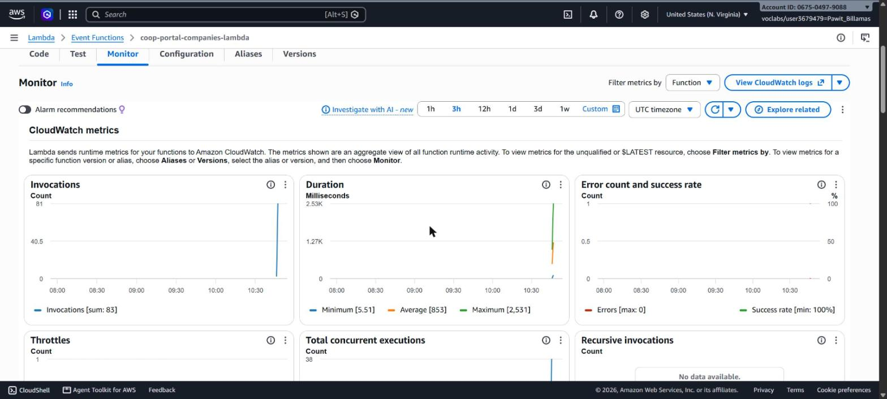
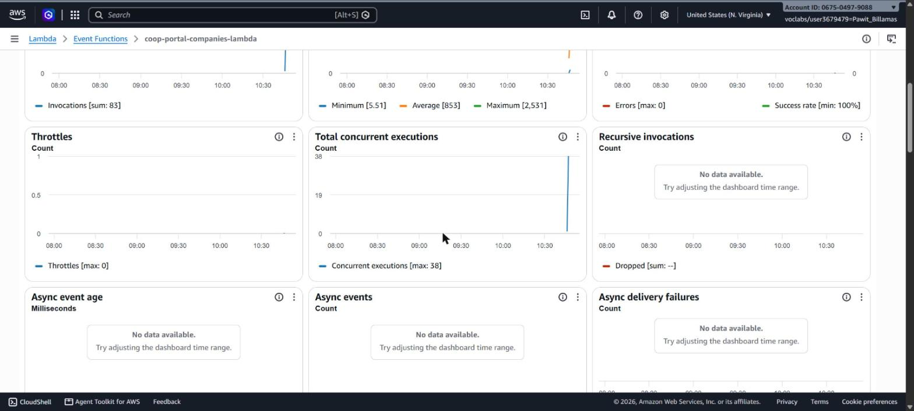
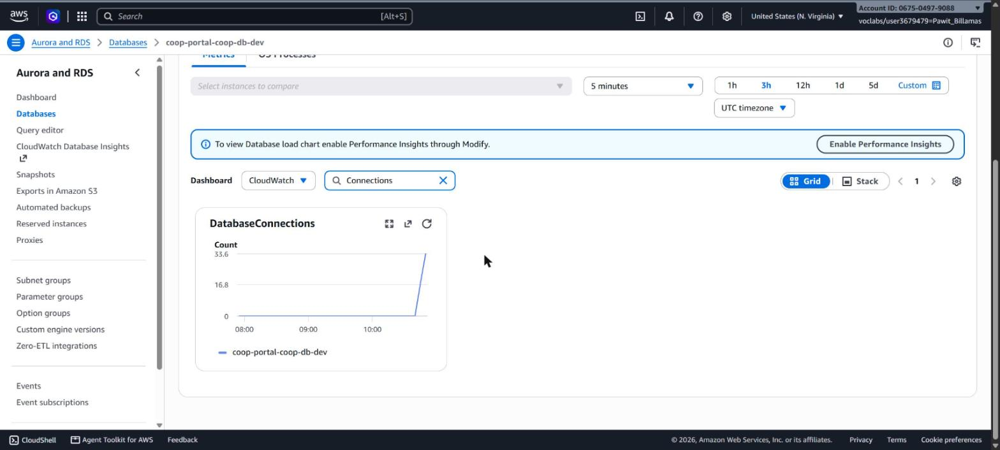

# Direct RDS connection — load assessment (V3-06.2, #105)

**Date:** 2026-10-20
**Scope:** confirm the direct Lambda → RDS PostgreSQL connection (no RDS Proxy)
supports the expected prototype load before hand-off. The Direct-Connection vs
RDS-Proxy decision itself is already settled — the team removed the proxy
(`docs/working-agreement.md`, `proxy.tf` deleted in `feat/97-v3-02-auth`), so
there is no proxy left to benchmark against. This document answers only the
remaining question: *does the direct connection hold under the load we expect?*

## System under test

- `GET /companies` on `coop-portal-companies-api`
  (`https://z9ly6malij.execute-api.us-east-1.amazonaws.com`)
  → `coop-portal-companies-lambda` → RDS `coop-portal-coop-db-dev`.
- RDS: PostgreSQL 16, `db.t3.micro`, `default.postgres16`.
- Public, read-only route — no token, no writes, no schema change.
- Lambda connects to RDS directly; each container holds a `pg` pool (`max = 5`).

## Method

Concurrent `GET` waves of 1, 10, 20, 50 requests against the deployed API,
measuring TCP+TLS connect time, full response time, and error rate per wave.
CloudWatch read back over the same minute for the server side. Raw numbers:
[`evidence/105-01-direct-rds-loadtest.txt`](evidence/105-01-direct-rds-loadtest.txt).

## Results

| Concurrency | Error rate | Connect (ms) | Response avg (ms) | p95 (ms) |
|---|---|---|---|---|
| 1 (cold) | 0% | 603 | 2396 | 2396 |
| 10 | 0% | 610 | 3017 | 4300 |
| 20 | 0% | 576 | 2327 | 3929 |
| 50 | 0% | 592 | 3469 | 5051 |

CloudWatch, same window:

| Metric | Value |
|---|---|
| RDS `DatabaseConnections` peak | **38** (ceiling ~112 for the class → ~34%) |
| Lambda `ConcurrentExecutions` peak | 38 |
| Lambda `Throttles` | 0 |
| Lambda `Errors` | 0 |
| Lambda `Duration` | 1189 ms avg / 2531 ms max (compute only) |

CloudWatch console (captured from the AWS console, not API-rendered):

## Conclusion

- The direct connection absorbed **50 concurrent reads with a 0% error rate**
  and used only **~34% of the RDS connection ceiling** (peak 38 of ~112). No
  throttling, no 5xx, no timeouts.
- Peak 38 concurrent Lambdas held 38 DB connections (one per container for the
  single query), then released them a few minutes after the burst as idle
  containers were reaped. Connection count stayed well below the ~112 ceiling,
  so **connection exhaustion was not observed** at this load. (No claim is made
  that it ever occurred in production — there is no such measurement; #88 is
  closed on the same basis.)
- End-to-end latency (2–5 s) is driven by Lambda cold-start init and the first
  per-container RDS connect, not by database contention: server-side `Duration`
  stays ≤ 2.5 s and DB connections never queued.

**Verdict:** for the prototype's expected load (≤ 50 concurrent reads), the direct
Lambda → RDS connection is sufficient with large headroom. No RDS Proxy is needed
at this scale. If latency becomes a concern, it points at cold starts
(provisioned concurrency / smaller bundle), not at the database tier.

## Limits of this test (AWS Academy Learner Lab)

- Measured against the shared lab account; absolute latency includes lab network
  conditions and is not a production SLA.
- Read path only (`GET /companies`). Write/transaction load (plan submit/review)
  is exercised functionally in #104/#115, not load-tested here.
- `max_connections` is the class default (not raised); the ~112 figure is the
  documented default formula for the instance class, not a value read from a
  `SHOW max_connections` on the box.
