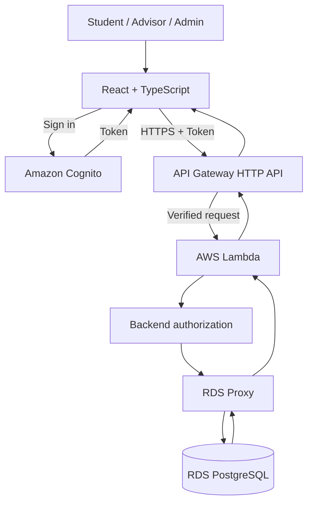

# V3 Architecture and Data Flow

## 1. Proposed Architecture

V3 is designed to reuse the main V2 components and add authentication and authorization for plan management.

Cognito integration and the required API authorization settings are proposed and must be verified before implementation.

## 2. Component Responsibilities

- Frontend: display plans and send API requests.
- Cognito: authenticate users and issue tokens, if selected.
- API Gateway: receive API requests and validate tokens through the configured authorization mechanism.
- Lambda: validate input, apply business rules, and access the database.
- Backend authorization: check roles, plan ownership, and advisor assignments.
- RDS Proxy and PostgreSQL: manage database connections and store application data.

## 3. Main Data Flows

### Sign in

1. The user signs in through the selected authentication service.
2. The frontend receives a token.
3. The frontend sends the token with protected API requests.
4. The API authorization layer validates the token before forwarding the request.

### Submit a plan

1. The Student sends a submission request.
2. The backend identifies the user and checks ownership.
3. The backend validates the plan and current status.
4. The database stores the changes.
5. The API returns the result to the frontend.

### Review a plan

1. The Advisor sends a review request.
2. The backend checks the Advisor's role and assignment.
3. The backend checks the current status.
4. The decision and status change are saved together.
5. The API returns the result to the frontend.

## 4. Security and Future Integration

- Use HTTPS and validate authentication tokens.
- Enforce authorization in the backend.
- Validate input and use parameterized SQL.
- Use database transactions to protect status changes.
- University SSO may be considered in the future, depending on the university's identity provider and integration requirements.

## 5. Items to Confirm

- Authentication method and account linking.
- API Gateway authorization configuration.
- Advisor assignment rules.
- Network and database security settings.
- Whether University SSO is in scope for a later version.

This diagram describes a proposed V3 design, not a verified deployed architecture.
