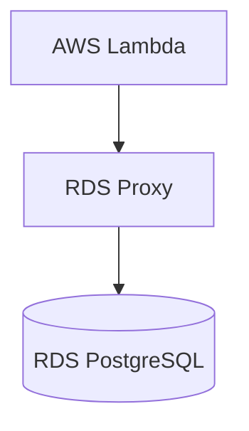
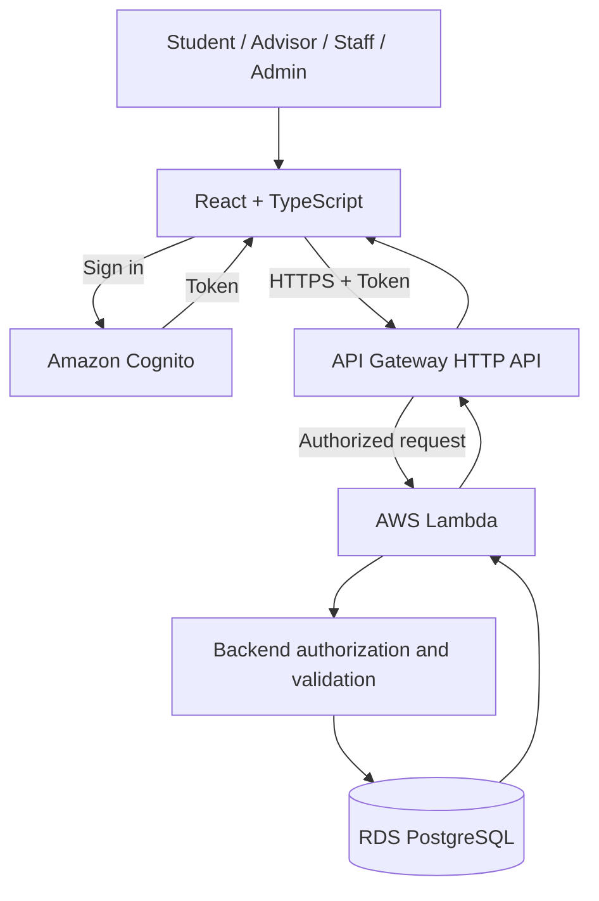

# V3 Architecture and Data Flow

## 1. สถาปัตยกรรมที่ออกแบบสำหรับ V3

V3 นำองค์ประกอบหลักจาก V2 มาใช้ต่อ และเพิ่มการยืนยันตัวตน การตรวจสอบสิทธิ์ และ API สำหรับจัดการแผนสหกิจ โดย V3 จะใช้ AWS Lambda เชื่อมต่อกับ RDS PostgreSQL โดยตรง และตัด RDS Proxy ออกจากสถาปัตยกรรมตามข้อตกลงของทีม

### สถาปัตยกรรมปัจจุบันของ V2

V2 ใช้ AWS Lambda เชื่อมต่อกับ RDS PostgreSQL ผ่าน RDS Proxy

### สถาปัตยกรรมสำหรับ V3

V3 ใช้ Amazon Cognito สำหรับการยืนยันตัวตน และใช้ API Gateway กับ AWS Lambda สำหรับรับคำขอ ตรวจสอบสิทธิ์ และจัดการข้อมูล โดย Lambda เชื่อมต่อกับ RDS PostgreSQL โดยตรง ไม่ผ่าน RDS Proxy

การเชื่อมต่อ Cognito และการตั้งค่า Authorization เป็นส่วนที่ต้องพัฒนาและตรวจสอบก่อนใช้งานจริง แผนภาพ V3 แสดงสถาปัตยกรรมที่ออกแบบไว้ ไม่ใช่การยืนยันว่า AWS ที่ใช้งานอยู่ได้ตั้งค่าครบถ้วนแล้ว

เนื่องจาก V3 เชื่อมต่อฐานข้อมูลโดยตรง จึงต้องคำนึงถึงจำนวนการเชื่อมต่อเมื่อ Lambda ทำงานพร้อมกัน รวมถึงข้อจำกัดของฐานข้อมูล การจัดการ Connection Pool และเวลาในการตอบสนอง เพื่อไม่ให้จำนวนการเชื่อมต่อเกินความสามารถที่ฐานข้อมูลรองรับ

## 2. หน้าที่ของแต่ละองค์ประกอบ

- **Frontend:** พัฒนาด้วย React และ TypeScript สำหรับแสดงข้อมูล สร้างและแก้ไขแผน ส่งแผน และแสดงผลการพิจารณา
- **Amazon Cognito:** ยืนยันตัวตนและออก Token ให้ผู้ใช้ที่เข้าสู่ระบบ
- **API Gateway HTTP API:** รับ API Request ผ่าน HTTPS และตรวจสอบ Token ผ่าน Authorization Mechanism ที่กำหนด
- **AWS Lambda:** ตรวจสอบข้อมูลคำขอ ใช้กฎทางธุรกิจ ตรวจสอบสิทธิ์ และเรียกใช้ฐานข้อมูล
- **Backend Authorization:** ใช้ข้อมูลผู้ใช้จาก Token ที่ผ่านการตรวจสอบแล้ว โดยใช้ `sub` ระบุบัญชี และตรวจสอบ Role เจ้าของแผน และความสัมพันธ์ Advisor กับนักศึกษา
- **RDS PostgreSQL:** จัดเก็บข้อมูลนักศึกษา แผนสหกิจ บัญชีผู้ใช้ การมอบหมาย Advisor และประวัติการพิจารณา
- **Terraform:** ใช้จัดการ Infrastructure ตามการตั้งค่าที่กำหนดใน Repository

RDS Proxy เป็นองค์ประกอบที่ใช้ใน V2 แต่ไม่อยู่ในเส้นทางการเชื่อมต่อฐานข้อมูลของ V3 ตามสถาปัตยกรรมที่ทีมตกลงกัน

## 3. การเข้าสู่ระบบและตรวจสอบสิทธิ์

1. ผู้ใช้เข้าสู่ระบบผ่าน Amazon Cognito
2. Frontend รับ Token และส่งไปกับคำขอที่ต้องเข้าสู่ระบบ
3. API Gateway ตรวจสอบ Token ตามการตั้งค่า Authorization
4. Lambda ใช้ข้อมูลตัวตนที่ผ่านการตรวจสอบแล้วเพื่อระบุผู้ใช้
5. Backend ตรวจสอบ Role และสิทธิ์ในการทำงานกับข้อมูลก่อนเรียกฐานข้อมูล

ห้ามใช้ `student_id`, `reviewer_name` หรือข้อมูลผู้ใช้ที่ส่งมาจาก Frontend เพียงอย่างเดียวเป็นหลักฐานยืนยันตัวตนหรือสิทธิ์

## 4. Data Flow สำหรับการจัดการแผน

### สร้างหรือแก้ไขแผน

1. Student ส่งคำขอสร้างหรือแก้ไขแผนผ่าน API
2. Backend ตรวจสอบ Token และยืนยันว่า Student มีสิทธิ์สร้างแผนหรือเป็นเจ้าของแผนที่ต้องการแก้ไข
3. Backend ตรวจสอบข้อมูลที่จำเป็นและสถานะปัจจุบัน
4. Lambda บันทึกข้อมูลลง PostgreSQL โดยเชื่อมต่อกับฐานข้อมูลโดยตรง
5. API ส่งผลลัพธ์กลับไปยัง Frontend

การแก้ไขแผนอนุญาตเฉพาะสถานะ `PREPARING` และ `RETURNED`

### ยื่นแผนหรือยื่นใหม่

1. Student ส่งคำขอ Submit
2. Backend ตรวจสอบเจ้าของแผน ความครบถ้วนของข้อมูล คุณสมบัตินักศึกษา และช่วงเวลายื่นแผน
3. Backend ตรวจสอบข้อกำหนดจำนวนแผนที่ยังดำเนินการอยู่ต่อรอบ
4. ฐานข้อมูลเปลี่ยนสถานะจาก `PREPARING` หรือ `RETURNED` เป็น `SUBMITTED`
5. API ส่งสถานะผลลัพธ์กลับไปยัง Frontend

### พิจารณาแผน

1. Advisor หรือ Staff ส่งคำขอพิจารณาแผนผ่าน API
2. Backend ตรวจสอบบัญชีและสิทธิ์ผู้พิจารณา
3. Advisor พิจารณาได้เฉพาะนักศึกษาที่ได้รับมอบหมาย ส่วน Staff พิจารณาแผนของนักศึกษาทุกคนได้
4. Backend ตรวจสอบว่าแผนอยู่ในสถานะ `SUBMITTED`
5. ภายใน Transaction เดียวกัน ฐานข้อมูลบันทึกผลใน `plan_reviews` และเปลี่ยนสถานะเป็น `APPROVED`, `REJECTED` หรือ `RETURNED`
6. การเปลี่ยนสถานะต้องสำเร็จเฉพาะเมื่อสถานะยังเป็น `SUBMITTED` หากมีผู้พิจารณาคนอื่นบันทึกผลไปก่อน ให้ยกเลิก Transaction และส่ง `409 Conflict`
7. API ส่งผลการพิจารณากลับไปยัง Frontend

Workflow ใหม่ไม่ใช้ขั้นตอน `start-review` และไม่ใช้สถานะ `UNDER_REVIEW` การพิจารณาเริ่มจากแผนที่มีสถานะ `SUBMITTED` โดยตรง

## 5. ความปลอดภัยและการจัดการข้อมูล

- ใช้ HTTPS สำหรับการสื่อสารผ่าน API
- ตรวจสอบ Token และสิทธิ์ใน Backend ทุกครั้งที่เรียก API ที่มีการป้องกัน
- ใช้ Parameterized SQL เพื่อลดความเสี่ยงจาก SQL Injection
- จำกัดการเข้าถึงข้อมูลตาม Role เจ้าของแผน และการมอบหมาย Advisor
- ใช้ Database Transaction เพื่อป้องกันข้อมูลสถานะและประวัติการพิจารณาไม่ตรงกัน
- จัดการข้อมูลลับและสิทธิ์เชื่อมต่อฐานข้อมูลผ่านการตั้งค่าที่เหมาะสม ไม่ฝังข้อมูลลับไว้ใน Source Code
- กำหนดค่า Connection Pool และตรวจสอบจำนวนการเชื่อมต่อให้เหมาะสมกับข้อจำกัดของ RDS PostgreSQL และการทำงานพร้อมกันของ Lambda
- University SSO อาจเชื่อมต่อผ่าน Cognito Federation ในอนาคต หากมี Identity Provider และข้อกำหนดการเชื่อมต่อที่รองรับ

## 6. ขอบเขตของการออกแบบ

เอกสารนี้กำหนดสถาปัตยกรรมและ Data Flow ที่ V3 ต้องการ โดยแยกสถาปัตยกรรมเดิมของ V2 ซึ่งใช้ RDS Proxy ออกจากสถาปัตยกรรมของ V3 ซึ่งให้ Lambda เชื่อมต่อกับ RDS PostgreSQL โดยตรง

การเชื่อมต่อ Cognito, API Authorization, ตารางใหม่ และการตั้งค่า Infrastructure ยังต้องพัฒนาและตรวจสอบก่อนใช้งานจริง รายละเอียดการพัฒนาต้องเป็นไปตามข้อกำหนดในเอกสาร Workflow, Data Model และ API Specification ของ V3