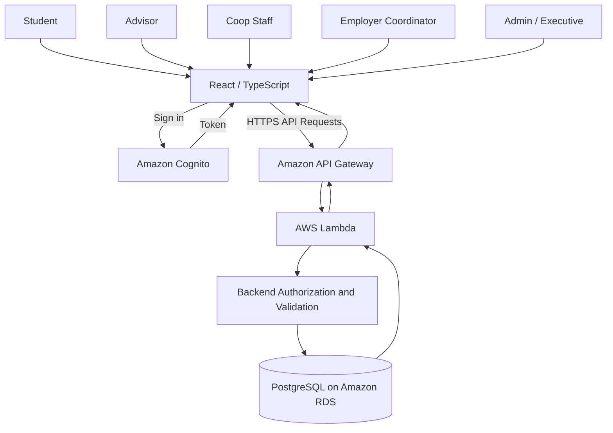

# V4 Architecture and Data Flow

## 1. สถาปัตยกรรมของ V4

V4: Planning, Tracking & Reliability ต่อยอดจากสถาปัตยกรรมและ Workflow ของ V3 เพื่อสนับสนุนการจัดทำแผนสหกิจศึกษา การพิจารณาและส่งแผนกลับเพื่อแก้ไข การติดตามสถานะ กำหนดเวลา การค้นหาและกรองข้อมูล ตลอดจนการตรวจสอบความน่าเชื่อถือของระบบ

สถาปัตยกรรมหลักประกอบด้วย React และ TypeScript สำหรับ Frontend, Amazon Cognito สำหรับการยืนยันตัวตน, Amazon API Gateway สำหรับรับคำขอ API, AWS Lambda สำหรับประมวลผลคำขอและตรวจสอบสิทธิ์ และ PostgreSQL บน Amazon RDS สำหรับจัดเก็บข้อมูล

V4 มุ่งปรับปรุงความสามารถของระบบเดิมโดยไม่เปลี่ยน Workflow หรือเพิ่มบริการ Cloud โดยไม่มีเหตุผลและหลักฐานรองรับ

### 1.1 Logical Architecture

แผนภาพนี้แสดงองค์ประกอบเชิงตรรกะและเส้นทางการสื่อสารหลัก ไม่ได้ยืนยันรายละเอียดการติดตั้ง AWS เช่น VPC, Subnets, Route Tables หรือ Security Groups

### 1.2 ความต่อเนื่องจาก V3

V4 ใช้แนวทางการยืนยันตัวตนและการตรวจสอบสิทธิ์จาก V3 โดยให้ Backend เป็นผู้ตรวจสอบสิทธิ์ก่อนเข้าถึงข้อมูล และใช้ PostgreSQL เป็นแหล่งข้อมูลหลัก

V4 เพิ่มหรือเน้นการทำงานดังต่อไปนี้

- การสร้าง แก้ไข และส่งแผนสหกิจศึกษา
- การพิจารณาแผนโดยผู้มีสิทธิ์ รวมถึงการส่งกลับเพื่อแก้ไขและยื่นใหม่
- การติดตามสถานะของแผนและกำหนดเวลา
- การค้นหาและกรองแผนตามข้อมูลที่เกี่ยวข้อง
- การตรวจสอบข้อผิดพลาด การเปลี่ยนสถานะที่ไม่ถูกต้อง และการทำงานพร้อมกัน
- การตรวจสอบสถาปัตยกรรมเครือข่ายและการเชื่อมต่อฐานข้อมูลตาม Infrastructure ที่ใช้งานจริง

## 2. หน้าที่ของแต่ละองค์ประกอบ

- **Frontend:** React และ TypeScript สำหรับแสดงข้อมูล จัดทำแผน ส่งแผน ติดตามสถานะ และแสดงผลการพิจารณา
- **Amazon Cognito:** ยืนยันตัวตนและออก Token สำหรับผู้ใช้ที่เข้าสู่ระบบ
- **Amazon API Gateway:** รับคำขอ API ผ่าน HTTPS และใช้กลไก Authorization ตามการตั้งค่าของระบบ
- **AWS Lambda:** ประมวลผลคำขอ ตรวจสอบข้อมูลและกฎทางธุรกิจ และเรียกใช้ฐานข้อมูล
- **Backend Authorization:** ตรวจสอบตัวตน Role เจ้าของแผน และความสัมพันธ์ของ Advisor กับนักศึกษาตามกฎที่กำหนด
- **PostgreSQL / Amazon RDS:** จัดเก็บข้อมูลผู้ใช้ แผนสหกิจ สถานประกอบการ รอบเวลา และข้อมูลประกอบ Workflow ตาม Data Model ของระบบ
- **Terraform:** จัดการ Infrastructure ที่กำหนดไว้ใน Repository
- **Activity History:** บันทึกประวัติการเปลี่ยนแปลงหรือการพิจารณาในส่วนที่ระบบรองรับ โดยต้องสอดคล้องกับข้อมูลและสิทธิ์การเข้าถึงที่กำหนด

รายละเอียดขององค์ประกอบและความสามารถที่ deploy แล้วต้องตรวจสอบกับ Source Code, Terraform และ AWS Configuration จริงก่อนใช้เป็นหลักฐาน

## 3. Authentication และ Authorization

1. ผู้ใช้เข้าสู่ระบบผ่าน Amazon Cognito
2. Frontend รับ Token และส่ง Token ไปกับคำขอ API ที่ต้องยืนยันตัวตน
3. API Gateway ตรวจสอบ Token ตาม Authorization Configuration
4. Lambda ใช้ข้อมูลตัวตนที่ผ่านการตรวจสอบเพื่อระบุผู้ใช้
5. Backend ตรวจสอบ Role และสิทธิ์ของผู้ใช้ก่อนดำเนินการกับข้อมูล
6. ระบบปฏิเสธคำขอที่ไม่มีสิทธิ์ตามกฎของ API

การตรวจสอบสิทธิ์ต้องอาศัยข้อมูลที่เชื่อถือได้จากการยืนยันตัวตนและ Backend ไม่ใช้ข้อมูล Role, Student ID หรือชื่อผู้พิจารณาที่ส่งจาก Frontend เพียงอย่างเดียวเป็นหลักฐานอนุญาตให้ดำเนินการ

การเข้าถึงข้อมูลต้องเป็นไปตาม Role และขอบเขตข้อมูลของผู้ใช้ เช่น การตรวจสอบความสัมพันธ์ระหว่าง Advisor กับนักศึกษาที่ได้รับมอบหมาย

## 4. V4 Data Flow

### 4.1 การสร้างและแก้ไขแผน

1. Student เลือกข้อมูลสถานประกอบการและรอบเวลาที่เกี่ยวข้อง
2. Frontend ส่งคำขอสร้างหรือแก้ไขแผนผ่าน API
3. Backend ตรวจสอบตัวตน เจ้าของแผน ข้อมูลที่จำเป็น และสถานะปัจจุบัน
4. Backend ตรวจสอบกฎที่เกี่ยวข้อง เช่น จำนวนแผนที่ยังดำเนินการอยู่ในรอบเดียวกัน
5. ระบบบันทึกข้อมูลลงฐานข้อมูลและส่งผลลัพธ์กลับไปยัง Frontend

การแก้ไขและส่งแผนต้องเป็นไปตามสถานะและเงื่อนไขที่กำหนดใน Workflow ของระบบ

### 4.2 การส่งแผนและพิจารณา

1. Student ส่งแผนผ่าน API
2. Backend ตรวจสอบสิทธิ์ ความครบถ้วนของข้อมูล และเงื่อนไขที่เกี่ยวข้อง
3. ผู้พิจารณาที่มีสิทธิ์เปิดดูแผนและดำเนินการตาม Workflow
4. หากส่งกลับหรือปฏิเสธ ระบบต้องตรวจสอบว่ามีความคิดเห็นตามข้อกำหนด
5. ระบบบันทึกผลการพิจารณาและการเปลี่ยนสถานะให้สอดคล้องกัน
6. Frontend แสดงผลการพิจารณาให้ผู้ใช้ที่เกี่ยวข้องทราบ

ชื่อสถานะและเงื่อนไขการเปลี่ยนสถานะต้องอ้างอิง Implementation และเอกสาร Workflow ที่เป็นปัจจุบัน ไม่สร้างชื่อสถานะใหม่หรือเปลี่ยนชื่อสถานะเดิมในเอกสารนี้

### 4.3 การติดตามสถานะและกำหนดเวลา

1. ผู้ใช้เรียกดูแผนที่ตนเองมีสิทธิ์เข้าถึง
2. Backend ตรวจสอบสิทธิ์ก่อนส่งข้อมูลกลับ
3. Frontend แสดงสถานะและกำหนดเวลาจากข้อมูลที่ระบบจัดเก็บ
4. ระบบสามารถจัดกลุ่มหรือแสดงรายการใกล้ครบกำหนดและเกินกำหนดตามกฎที่ทีมยืนยัน

การแสดงสถานะและกำหนดเวลาเป็นการแสดงผลจากข้อมูลและกฎที่ตรวจสอบได้ ไม่ควรแสดงผลที่ทำให้เข้าใจว่าระบบดำเนินการอนุมัติหรือเปลี่ยนสถานะโดยอัตโนมัติ หากไม่มี Implementation รองรับ

### 4.4 การค้นหาและกรองข้อมูล

ระบบรองรับการค้นหาหรือกรองข้อมูลตามเกณฑ์ที่กำหนดใน V4 เช่น Student, Employer, Period และ Status

Backend ต้องตรวจสอบสิทธิ์ก่อนส่งคืนผลลัพธ์ และต้องไม่เปิดเผยข้อมูลที่ผู้ใช้ไม่มีสิทธิ์เข้าถึง

## 5. Reliability และ Data Consistency

V4 ให้ความสำคัญกับความถูกต้องของข้อมูลและการจัดการข้อผิดพลาดใน Workflow

- **Input Validation:** ปฏิเสธข้อมูลที่ไม่ครบถ้วนหรือไม่ถูกต้องตามข้อกำหนด
- **Workflow Validation:** ปฏิเสธการเปลี่ยนสถานะที่ไม่เป็นไปตามกฎ
- **Duplicate Protection:** ตรวจสอบข้อกำหนดจำนวนแผนที่ยังดำเนินการอยู่ต่อ Student และ Period ตามกฎที่ระบบใช้จริง
- **Concurrent Updates:** ตรวจสอบสถานะปัจจุบันก่อนบันทึกผล เพื่อป้องกันการพิจารณาทับซ้อน
- **Conflict Handling:** ส่ง `409 Conflict` เมื่อคำขอขัดแย้งกับสถานะปัจจุบันตามเงื่อนไขที่ API กำหนด
- **Database Consistency:** ใช้ Transaction เมื่อจำเป็นเพื่อให้ข้อมูลแผนและประวัติการพิจารณาสอดคล้องกัน
- **Error Handling:** จัดการข้อผิดพลาดจาก API และฐานข้อมูลโดยไม่เปิดเผยข้อมูลลับหรือรายละเอียดภายในที่ไม่ควรเปิดเผย
- **Connection Management:** กำหนดและตรวจสอบการใช้ Database Connection ให้เหมาะสมกับข้อจำกัดของ Lambda และ RDS PostgreSQL

การทำงานเหล่านี้ต้องตรวจสอบกับ Implementation และผลทดสอบจริงก่อนระบุว่าเป็นความสามารถที่ผ่านการยืนยันแล้ว

## 6. AWS Network Architecture

Network Architecture ต้องแสดงการเชื่อมต่อระหว่างบริการ AWS ตาม Infrastructure ที่ใช้งานจริง โดยควรตรวจสอบองค์ประกอบต่อไปนี้จาก Terraform และ AWS Configuration

- VPC และ CIDR ที่เกี่ยวข้อง
- Subnets ที่ใช้กับ Lambda และ RDS
- Route Tables และเส้นทางการเชื่อมต่อที่เกี่ยวข้อง
- Security Groups และกฎการอนุญาต Traffic
- การเชื่อมต่อจาก API Gateway ไปยัง Lambda
- การเชื่อมต่อจาก Lambda ไปยัง RDS PostgreSQL
- การเปิดเผยบริการต่อ Internet และขอบเขตของ Private Network
- การพึ่งพาบริการภายนอกที่จำเป็นต่อการทำงาน

แผนภาพ Network Architecture ฉบับสมบูรณ์ต้องจัดทำจาก Configuration ที่ตรวจสอบแล้ว ไม่ควรสมมติว่ามี NAT Gateway, Internet Gateway, Public Subnet, Private Subnet หรือบริการอื่น หากยังไม่มีหลักฐานยืนยัน

## 7. Security และ Privacy

- ใช้ HTTPS สำหรับการสื่อสารผ่าน API
- ตรวจสอบ Token และสิทธิ์สำหรับคำขอที่มีการป้องกัน
- ใช้ Parameterized SQL สำหรับการเข้าถึงฐานข้อมูล
- จำกัดการเข้าถึงข้อมูลตาม Role และขอบเขตที่ได้รับอนุญาต
- ไม่เชื่อถือข้อมูลสิทธิ์ที่ส่งจาก Frontend เพียงอย่างเดียว
- จัดการข้อมูลลับผ่านการตั้งค่าที่เหมาะสม ไม่ฝังรหัสผ่านหรือ Credentials ไว้ใน Source Code
- บันทึกประวัติการเปลี่ยนแปลงที่จำเป็นโดยคำนึงถึงสิทธิ์และความเป็นส่วนตัว
- ตรวจสอบ Network Rules และ Database Access ตาม Configuration จริง

## 8. ขอบเขตและหลักฐานการตรวจสอบ

เอกสารนี้อธิบาย Logical Architecture, Data Flow และข้อกำหนดด้าน Reliability ที่เกี่ยวข้องกับ V4 โดยต่อยอดจากสถาปัตยกรรมของ V3

แผนภาพ Logical Architecture ใช้อธิบายองค์ประกอบและความสัมพันธ์เชิงตรรกะ ส่วน Network Architecture ต้องอ้างอิง Infrastructure ที่ติดตั้งจริง

หลักฐานสำหรับการตรวจสอบควรประกอบด้วย Source Code, Terraform Configuration, API และ Workflow Specification ตลอดจนผลการทดสอบที่เกี่ยวข้อง

เอกสารนี้ไม่ถือเป็นหลักฐานยืนยันว่าทุกองค์ประกอบถูก Deploy หรือผ่านการทดสอบแล้ว ต้องตรวจสอบผลจริงก่อนส่งงาน

## 9. References

- `docs/overview/V3-01-architecture.md`
- `docs/overview/V4-overview.md`
- V3 Workflow, Data Model และ API Specification
- Terraform Configuration ภายใต้ `infra/terraform`
- Implementation และผลทดสอบที่เกี่ยวข้องกับ V4
