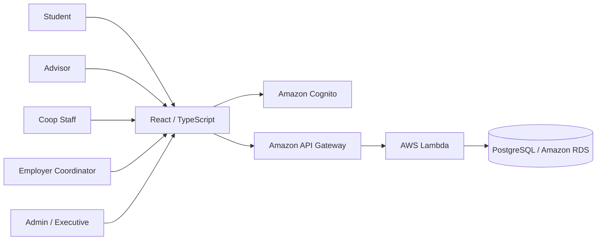

# V4: Planning, Tracking & Reliability — Overview

> เอกสารภาพรวมขอบเขต V4 ใช้เป็นจุดอ้างอิงร่วมของทีมสำหรับ Requirements, User Stories, Acceptance Tests, Architecture, Issues และหลักฐาน
> กำหนดส่ง: **2 พฤศจิกายน 2569 (2/11)**
> สถานะเอกสาร: **ฉบับปรับตาม Reviewer feedback — รอตรวจสอบ Implementation, หลักฐาน และการยืนยันจากทีม**

## 1. Overview

V4 ต่อยอดระบบ Cooperative Education Planning & Management System จาก V3 เพื่อให้การวางแผนและติดตามนักศึกษาและแผนสหกิจศึกษามีความชัดเจน ตรวจสอบได้ และลดความเสี่ยงจากข้อมูลตกหล่นหรือสถานะไม่สอดคล้องกัน

V4 ครอบคลุมข้อมูลและข้อกำหนดสหกิจศึกษา ข้อมูลนักศึกษาและสถานประกอบการ การสร้างและส่งแผน การตรวจสอบและอนุมัติ การติดตามสถานะและ Deadline ตลอดจนการค้นหาและกรองข้อมูลตามสิทธิ์ โดยเน้น 2 สถานการณ์หลัก:

- **TC1 — Advisor Review & Resubmission:** Advisor ที่ได้รับมอบหมายค้นหาและตรวจสอบแผน ให้ความคิดเห็นและส่งกลับให้นักศึกษาแก้ไข จากนั้นนักศึกษาปรับปรุงและส่งแผนเดิมกลับเข้ากระบวนการ แล้ว Advisor ตรวจสอบการส่งใหม่
- **TC2 — Student Plan Creation & Tracking:** Student ค้นหาข้อมูลสถานประกอบการและ Period ที่เกี่ยวข้อง สร้างแผนของตนเอง เลือกหรือเสนอแหล่งฝึกตามขอบเขตที่ตกลง ส่งแผนให้อาจารย์พิจารณา และติดตามสถานะ

V4 ใช้ Login, Role, Assignment, Workflow, API, Database และ Infrastructure ของ V3 เป็นฐาน ไม่สร้างระบบพื้นฐานเดิมขึ้นใหม่ และต้องไม่ทำให้กติกาหรือ Workflow เดิมของ V3 เสียหาย

ขอบเขตที่ทีมใช้วางแผนสำหรับรอบนี้:

- หนึ่งสถานประกอบการต่อหนึ่งแผน (One Employer per Plan)
- ใช้ Period ที่ V3 มีอยู่แล้ว ไม่สร้างระบบ Period ใหม่
- Deadline เป็นการแสดงข้อมูลที่มีอยู่ ไม่สร้างระบบจัดการ Deadline ใหม่
- ใช้ Status Model หลักตาม V3 ส่วนสถานะหลังอนุมัติเป็นประเด็นที่ต้องยืนยันแยกต่างหากตาม FR5
- ใช้ข้อมูลและโครงสร้างเดิมก่อน การเพิ่ม Schema หรือเปลี่ยน Infrastructure ต้องตรวจสอบผลกระทบก่อนดำเนินการ

เอกสารนี้แยก **สิ่งที่ยืนยันแล้ว**, **สิ่งที่เสนอ**, **สิ่งที่ยังต้องตัดสินใจ** และ **สิ่งที่ยังไม่ได้ทดสอบ** ออกจากกันอย่างชัดเจน การระบุไว้ในเอกสารไม่ถือเป็นหลักฐานว่า Implementation เสร็จหรือผ่านการทดสอบแล้ว

## 2. Problem / Goal

### 2.1 Problem

การดำเนินงานสหกิจศึกษาเกี่ยวข้องกับนักศึกษา แผนสหกิจศึกษา รอบเวลา สถานประกอบการ ตำแหน่งงาน กำหนดเวลา และการพิจารณาของอาจารย์ หากข้อมูลและขั้นตอนติดตามไม่ชัดเจนอาจเกิดปัญหา เช่น

- ผู้ใช้เข้าถึงข้อมูลและข้อกำหนดสหกิจศึกษาจากหลายแหล่ง ทำให้ข้อมูลไม่สอดคล้องกัน
- ข้อมูลนักศึกษา แผน สถานประกอบการ ตำแหน่ง และ Period อาจกระจายอยู่หลายส่วน
- Student และ Advisor ไม่เห็นสถานะปัจจุบันหรือขั้นตอนถัดไปอย่างชัดเจน
- การส่งแผนกลับเพื่อแก้ไขและส่งใหม่ติดตามต่อได้ยาก
- ผู้ใช้ไม่ทราบว่ารายการใกล้ครบกำหนดหรือเกินกำหนดแล้ว
- การค้นหาและกรองรายการตามนักศึกษา สถานประกอบการ รอบเวลา หรือสถานะทำได้ไม่สะดวก
- ตรวจสอบย้อนหลังได้ยากว่าแผนเปลี่ยนสถานะหรือถูกดำเนินการเมื่อใด
- การเข้าถึงข้อมูลที่ไม่ตรงกับสิทธิ์ของผู้ใช้อาจทำให้เกิดความเสี่ยงด้านข้อมูลส่วนบุคคล
- การดำเนินการซ้ำหรือคำขอที่ขัดแย้งกันอาจทำให้ข้อมูลไม่สอดคล้องกัน
- ระบบอาจเกิดข้อผิดพลาดหรือไม่พร้อมใช้งานระหว่างดำเนินงาน

### 2.2 Goals

1. รองรับข้อมูลและข้อกำหนดสหกิจศึกษาที่ระบบมีอยู่ตาม FR1
2. ใช้ข้อมูลนักศึกษา แผน สถานประกอบการ ตำแหน่ง และ Period อย่างเป็นระบบตาม FR2
3. รองรับการสร้าง แก้ไข และส่งแผนตาม FR3
4. รองรับการตรวจสอบ อนุมัติ และส่งกลับแก้ไขตาม FR4
5. แสดงและติดตามสถานะสำคัญของนักศึกษาและแผนตาม FR5 โดยรักษา Workflow V3
6. แสดง Deadline พร้อมจำแนกรายการใกล้ครบกำหนดและเกินกำหนดตาม FR6 เมื่อมีข้อมูลวันที่ที่เชื่อถือได้
7. ควบคุมสิทธิ์และตรวจสอบประวัติการเปลี่ยนแปลงที่สำคัญตาม FR7
8. รองรับการค้นหาและกรองข้อมูลตาม Student, Employer, Period และ Status ตาม FR8
9. ทดสอบความถูกต้อง การจัดการข้อผิดพลาด และ Regression ของ V3
10. ตรวจสอบ Network Architecture และการเชื่อมต่อ RDS โดยอ้างอิง Terraform/AWS จริง ไม่กล่าวอ้างเกินหลักฐาน

## 3. Scope

### 3.1 Information & Cooperative Education Data — FR1 / FR2

**FR1 — Information**

- แสดงข้อมูลและข้อกำหนดเกี่ยวกับสหกิจศึกษาที่ระบบมีอยู่ เช่น ขั้นตอน คุณสมบัติ รอบเวลา กำหนดการ และแนวทางการเตรียมตัว
- แสดงข้อมูลพื้นฐานของสถานประกอบการที่เปิดเผยได้
- ข้อมูลที่แสดงต้องมาจากแหล่งข้อมูลที่ตรวจสอบได้และตรงกับข้อมูลในระบบ
- การเข้าถึงข้อมูลที่จำกัดสิทธิ์ต้องเป็นไปตาม Role และ Authorization ของ V3

**FR2 — Data Management**

- ใช้ข้อมูลนักศึกษา แผนสหกิจศึกษา สถานประกอบการ ตำแหน่งหรือโครงการ และ Period จากระบบ V3
- จัดเก็บและเรียกใช้ข้อมูลผ่าน Backend/API และ Database ตามโครงสร้างที่ระบบรองรับ
- ตรวจสอบความสัมพันธ์ระหว่าง Student, Plan, Employer/Position และ Period ให้ถูกต้อง
- รองรับการค้นหาและเรียกดูข้อมูลตามเงื่อนไขที่ระบบกำหนด
- ใช้ Schema เดิมก่อน หากต้องเพิ่มหรือแก้ไข Schema ต้องตรวจสอบผลกระทบและได้รับข้อสรุปจากทีมก่อน

**ขอบเขต:** V4 ต่อยอดข้อมูลและความสามารถที่มีอยู่ ไม่สร้างระบบข้อมูลพื้นฐานของ V1/V2/V3 ขึ้นใหม่ทั้งหมด

### 3.2 Student & Plan Status Tracking — FR5

- แสดงสถานะปัจจุบันของ Student/Coop Plan ตามข้อมูลที่ระบบมีและ Requirement กำหนด
- รองรับการติดตามการส่งแผน การตรวจสอบ การส่งกลับแก้ไข และการส่งใหม่ตาม Workflow V3
- แสดงสถานะที่ตรงกับข้อมูลจาก Backend ไม่ใช้สถานะที่คำนวณหรือกำหนดขึ้นเองใน Frontend
- ไม่เพิ่มหรือเปลี่ยน State Model ของ V3 โดยไม่มีข้อสรุปจากทีม
- สถานะหลังอนุมัติที่โจทย์ยกตัวอย่าง เช่น `Applied`, `Accepted`, `In Progress`, `Completed` จะเป็น Open Decision แยกจาก Workflow หลักของ V3 (ดู §8)

**หมายเหตุเรื่อง Under Review:** ในโจทย์ใช้คำว่า `Under Review` เพื่อสื่อว่าแผนอยู่ระหว่างการพิจารณา ส่วน V3 ใช้ `SUBMITTED` สำหรับแผนที่นักศึกษายื่นและรอผู้มีสิทธิ์พิจารณา จึงใช้เป็นคำอธิบายเชิงกระบวนการได้โดยไม่จำเป็นต้องสร้างสถานะ DB ใหม่

### 3.3 Student Plan Flow — FR3 / FR4

- Student ค้นหา Employer/Position ที่ระบบรองรับ และเลือก Period ที่มีอยู่ใน V3
- Student สามารถสร้างและแก้ไขแผนของตนเองตามสิทธิ์และสถานะที่อนุญาต
- Student สามารถเลือกหรือเสนอ Employer/Position ตามขอบเขตที่ระบบรองรับ
- สร้างแผนโดยเชื่อมโยง Student, Employer/Position และ Period ให้ถูกต้อง
- ขอบเขต V4 ใช้ **หนึ่ง Employer ต่อหนึ่ง Plan**
- รองรับการส่งแผนให้ผู้มีสิทธิ์ตรวจสอบ
- Advisor/ผู้ตรวจสอบสามารถตรวจสอบ อนุมัติ หรือส่งกลับแก้ไขตามสิทธิ์และ Workflow V3
- ใช้ Period และข้อจำกัดการมีแผนที่ยังดำเนินการอยู่ตามกติกา V3
- ไม่สร้างระบบสมัครหลายบริษัท จัดอันดับตัวเลือก หรือระบบ Period ใหม่ในรอบนี้

### 3.4 Deadline Display — FR6

- แสดง Deadline ที่มีอยู่แล้วและเกี่ยวข้องกับ Period/ขั้นตอน โดยใช้แหล่งข้อมูลที่ตรวจสอบได้
- จำแนกรายการตามกำหนดเวลาอย่างน้อยดังนี้:
  - **Upcoming:** มี Deadline ในอนาคตและยังไม่อยู่ในช่วง Near Deadline
  - **Near Deadline:** มี Deadline ในอนาคตและอยู่ภายในช่วงเตือนที่ทีมกำหนด
  - **Overdue:** Deadline ผ่านไปแล้วและรายการยังไม่เสร็จสิ้น
  - **No Deadline / Unknown:** ไม่มี Deadline หรือไม่สามารถยืนยันวันที่ได้
- เกณฑ์จำนวนวันที่ใช้จัดกลุ่ม `Near Deadline` ต้องอ้างอิงโจทย์หรือมติทีม ห้ามกำหนดตัวเลขขึ้นเอง
- การพิจารณาว่ารายการเสร็จสิ้นแล้วหรือไม่ ต้องอ้างอิงสถานะที่ระบบมีจริงและได้รับการยืนยัน
- หากไม่มี Deadline หรือไม่สามารถยืนยันวันที่ได้ ให้แสดง `ไม่ระบุ` หรือ `ยังยืนยันไม่ได้` ไม่สร้างวันที่สมมติ
- ขอบเขต V4 เป็นการแสดงผลเท่านั้น ไม่สร้างระบบกำหนดหรือแก้ไข Deadline ใหม่
- ไม่เพิ่มการแจ้งเตือนอัตโนมัติผ่าน Email, SMS หรือบริการภายนอก

### 3.5 Access Control & Activity History — FR7

**Access Control**

- ผู้ใช้แต่ละบทบาทสามารถเข้าถึง ดู หรือแก้ไขเฉพาะข้อมูลและฟังก์ชันที่ได้รับสิทธิ์
- Backend ต้องตรวจสอบ Role, ownership และ assignment ก่อนเข้าถึงหรือดำเนินการกับข้อมูล
- Advisor เห็นและดำเนินการได้เฉพาะแผนของนักศึกษาที่ได้รับมอบหมายตามกติกา V3
- Student เข้าถึงและจัดการแผนของตนเองตามสิทธิ์และสถานะที่อนุญาต
- Coop Staff ใช้ขอบเขตสิทธิ์เดิมของ V3
- บทบาท Employer Coordinator และ Admin/Executive ที่ระบุในโจทย์ ต้องตรวจสอบการจับคู่กับ Role/Permission ที่มีจริงใน V3 ก่อนกำหนดขอบเขตการใช้งาน หากไม่มี Role ที่ตรงกัน ให้บันทึกเป็น Gap/ประเด็นที่ต้องตัดสินใจ ไม่สร้างสิทธิ์ใหม่ขึ้นเอง
- ห้ามพึ่งพาการซ่อนปุ่มหรือรายการใน Frontend เพียงอย่างเดียวเพื่อควบคุมสิทธิ์

**Activity History**

- ตรวจสอบว่าระบบมีข้อมูลประวัติหรือ timestamp ที่จำเป็นอยู่แล้วหรือไม่
- หากข้อมูลรองรับและทำได้ภายในเวลา ให้แสดงเหตุการณ์สำคัญ เช่น submit, return และ resubmit
- แสดงผู้ดำเนินการและเวลาเฉพาะเมื่อมีข้อมูลยืนยัน
- ไม่เรียกความสามารถนี้ว่า Full Audit Log หากไม่ได้เก็บทุก field และทุกกิจกรรม
- หากต้องเพิ่ม Schema/ตาราง ต้องระบุเหตุผล ประเมินผลกระทบ และได้รับข้อสรุปจากทีมก่อน
- หากข้อมูลเดิมไม่เพียงพอ ให้บันทึกข้อจำกัดและผลกระทบต่อ FR7 อย่างตรงไปตรงมา ไม่ระบุว่า FR7 ผ่านครบถ้วนเพียงเพราะ Access Control ทำงานได้

### 3.6 Plan Search & Filtering — FR8

รองรับการค้นหาและกรองรายการตามเงื่อนไขต่อไปนี้:

- **Student:** นักศึกษาหรือรหัสนักศึกษาที่เกี่ยวข้อง
- **Employer:** สถานประกอบการที่เชื่อมกับแผน
- **Period:** รอบเวลาสหกิจศึกษาที่แผนสังกัด
- **Status:** สถานะปัจจุบันของแผน

ข้อกำหนดการทำงาน:

- ใช้ข้อมูลจาก Backend/API เป็นแหล่งข้อมูลหลัก ไม่กรองเฉพาะข้อมูลที่โหลดมาโดยไม่คำนึงถึงขอบเขตข้อมูล
- ใช้เงื่อนไขหลายตัวร่วมกันได้ตามที่ API รองรับ
- ผลลัพธ์ต้องตรงกับเงื่อนไขค้นหาและข้อมูลจริง
- ต้องบังคับใช้ Authorization/assignment ที่ Backend ด้วย ไม่พึ่งการซ่อนรายการใน Frontend
- Advisor เห็นและดำเนินการได้เฉพาะแผนของนักศึกษาที่ได้รับมอบหมาย ส่วน Coop Staff ใช้ขอบเขตสิทธิ์เดิมของ V3
- การกรองต้องไม่เปิดเผยข้อมูลของนักศึกษาหรือแผนที่ผู้ใช้ไม่มีสิทธิ์เข้าถึง

### 3.7 Reliability & Regression

- ตรวจสอบ invalid transition, duplicate action และ concurrent request
- API/Backend error ต้องไม่ทำให้ข้อมูลเปลี่ยนแปลงผิดพลาดหรือแสดงผลว่าสำเร็จทั้งที่บันทึกไม่สำเร็จ
- ตรวจสอบความถูกต้องของข้อมูลและความสัมพันธ์ระหว่างข้อมูลที่เกี่ยวข้อง
- ทดสอบ TC1, TC2, RT1–RT5 และ REL1–REL6 ตามสภาพแวดล้อมที่ได้รับอนุญาต
- บันทึกผล Pass/Fail/Not Run พร้อมหลักฐานและเหตุผล
- รักษาความสามารถและกติกา V3 ที่เกี่ยวข้อง

### 3.8 AWS Networking & RDS Review

- ตรวจสอบ VPC, Subnets, Route Tables, Security Groups, Lambda VPC Configuration, RDS Subnet Group และ `Publicly Accessible` จาก Terraform/AWS เท่าที่มีสิทธิ์เข้าถึง
- จัดทำ System/Network Diagram ที่ตรงกับสภาพแวดล้อมจริง
- แยก Current State ออกจาก Recommended Target State
- ประเมินแนวทาง RDS แบบ Private และ Network Controls ตามคำแนะนำอาจารย์
- การเปลี่ยน RDS เป็น Private หรือแก้ Network จริงต้องประเมินผลกระทบต่อ Lambda, DB connectivity, AWS Academy permission และแผน deploy ก่อน
- ห้ามเปลี่ยนค่าจริงโดยไม่ทดสอบ Lambda-to-RDS และการ deploy หลังเปลี่ยน

### 3.9 Out of Scope / Next Version

- หลายสถานประกอบการภายในแผนเดียว หรือระบบสมัครหลายแห่ง/จัดอันดับตัวเลือก
- การสร้างหรือจัดการ Period ใหม่ นอกเหนือจาก Period ที่ V3 รองรับ
- การเพิ่ม Status Model หรือ Workflow หลังอนุมัติ ก่อนทีมยืนยัน Requirement และ Mapping
- ระบบสร้าง/แก้ไข/มอบหมาย Deadline แบบเต็มรูปแบบ
- Email/SMS/บริการภายนอกสำหรับแจ้งเตือนอัตโนมัติ
- Full Audit Log ที่ครอบคลุมทุก field และทุกกิจกรรม
- Dashboard/Analytics ขั้นสูงตาม FR9
- การแลกเปลี่ยนข้อมูลกับระบบภายนอกและการนำเข้าหรือส่งออกรายงานตาม FR10
- SLA/uptime guarantee, load test ขนาดใหญ่ หรือ Disaster Recovery เต็มรูปแบบ
- การสร้าง Login, Authentication, RBAC หรือ Workflow หลักของ V3 ใหม่ทั้งหมด
- **Real User Validation:** ทดสอบกับผู้ใช้จริงอย่างน้อย 3 บทบาท (Student, Advisor, Coop Staff) หากเวลา V4 ไม่เพียงพอให้บันทึกข้อจำกัดและเลื่อนไป Next Version โดยไม่กล่าวอ้างว่าได้ทดสอบแล้ว

## 4. Existing System & Architecture

### 4.1 Existing V3 Architecture — Current State (Logical)

องค์ประกอบหลักของ V3 ตามโครงสร้างโครงการ:

- **Frontend:** React และ TypeScript
- **Authentication:** Amazon Cognito
- **API:** Amazon API Gateway
- **Backend:** AWS Lambda
- **Database:** PostgreSQL บน Amazon RDS
- **Authorization:** ตรวจสอบ Role, ownership และ assignment ใน Backend

รายการนี้เป็นภาพรวม Logical Architecture ไม่ใช่การยืนยันว่า AWS resource ทุกตัวมีค่าตามเป้าหมายด้านความปลอดภัย ต้องตรวจสอบ Terraform และ AWS configuration ก่อนสรุปสถานะจริง

### 4.2 V4 Integration Approach

- **Information & Data:** ใช้ข้อมูลและแหล่งข้อมูลที่ระบบ V3 มีอยู่ก่อน
- **Frontend:** เพิ่มหรือปรับหน้าข้อมูล ข้อกำหนด รายการแผน รายละเอียด สถานะ Deadline และ History
- **API/Backend:** ใช้ API เดิมก่อน เพิ่มหรือปรับ endpoint เฉพาะที่จำเป็น พร้อมตรวจสิทธิ์และเงื่อนไขสถานะฝั่ง Backend
- **Database:** ใช้ Schema เดิมก่อน เพิ่ม field/table เท่าที่จำเป็นและผ่านการตรวจผลกระทบ
- **Authorization:** ใช้ Cognito และ Role/assignment rules ของ V3 ไม่สร้าง RBAC ใหม่
- **Reliability:** ตรวจ validation, duplicate actions, concurrency, transaction และ error handling

### 4.3 System Diagram Deliverable

ต้องมี System Diagram อย่างน้อยหนึ่งหน้า โดยแยก **Logical Application Flow** และ **Verified Network Layout** ไม่วาดรายละเอียด Network ที่ยังไม่มีหลักฐาน

**Logical Application Flow**

หมายเหตุ: การแสดงบทบาทใน Logical Diagram ไม่ได้ยืนยันว่าทุกบทบาทมี Permission หรือหน้าจอรองรับใน Implementation แล้ว ต้องตรวจ Role Mapping ก่อน

Network Diagram ฉบับตรวจสอบจริงต้องเพิ่มข้อมูลต่อไปนี้เมื่อยืนยันได้:

- VPC ID/CIDR และ Availability Zones ที่ใช้
- Subnet IDs และชนิด Public/Private ตาม Route Table จริง
- Route Tables, Internet Gateway และ NAT Gateway (ถ้ามี)
- Security Groups พร้อม Inbound/Outbound ที่เกี่ยวข้อง
- Lambda VPC setting, Subnets และ Security Group
- RDS Subnet Group, `Publicly Accessible` และ Security Group
- เส้นทาง Frontend → API Gateway → Lambda → RDS และเส้นทางบริหารจัดการที่จำเป็น

ในเอกสารหลักฐานให้แยก:

1. **Current State:** ค่าที่ตรวจสอบได้จาก Terraform/AWS พร้อมวันที่ตรวจและแหล่งที่มา
2. **Recommended Target State:** ข้อเสนอ เช่น RDS อยู่ Private Subnets และรับการเชื่อมต่อจาก Lambda Security Group เท่าที่จำเป็น
3. **Gap / Constraint:** สิ่งที่ตรวจไม่ได้หรือ AWS Academy ไม่อนุญาต พร้อม error/หลักฐาน

หากตรวจสอบ AWS ไม่ได้ ห้ามสรุปว่า RDS เป็น Private หรือ Network ปลอดภัยแล้ว

## 5. Shared Reference & Terminology

### 5.1 Terminology Mapping

ใช้ตารางนี้เป็นจุดอ้างอิงกลางสำหรับเอกสาร TC1, TC2, RT1–RT5 และการสื่อสารในทีม โดยเทียบคำในโจทย์กับชื่อสถานะของระบบ V3 ไม่อ้างถึงเอกสาร Self-test แยกต่างหาก

| คำในโจทย์ V4 | ชื่อที่ใช้ในระบบ V3 | แนวทางใช้/สถานะการยืนยัน |
|---|---|---|
| Preparing | `PREPARING` | ใช้ `PREPARING` เมื่อกล่าวถึงสถานะในระบบ V3 |
| Submitted | `SUBMITTED` | แผนที่นักศึกษายื่นเพื่อรอการพิจารณา |
| Under Review | `SUBMITTED` | ใช้เป็นคำอธิบายเชิงกระบวนการว่ารอการพิจารณา ไม่ใช่สถานะ DB ใหม่ที่ยืนยันแล้ว |
| Returned | `RETURNED` | ส่งกลับให้นักศึกษาแก้ไขและยื่นใหม่ |
| Approved | `APPROVED` | ผลอนุมัติตาม Workflow V3 |
| Rejected | `REJECTED` | ผลพิจารณาปฏิเสธตาม Workflow V3 |
| Applied | ยังไม่มีสถานะ V3 ที่ยืนยันว่าเทียบตรง | ตัวอย่างสถานะหลังอนุมัติจาก FR5; รอทีมตัดสินใจ |
| Accepted | ยังไม่มีสถานะ V3 ที่ยืนยันว่าเทียบตรง | ตัวอย่างสถานะหลังอนุมัติจาก FR5; รอทีมตัดสินใจ |
| In Progress | ยังไม่มีสถานะ V3 ที่ยืนยันว่าเทียบตรง | ตัวอย่างสถานะหลังอนุมัติจาก FR5; รอทีมตัดสินใจ |
| Completed | ยังไม่มีสถานะ V3 ที่ยืนยันว่าเทียบตรง | ตัวอย่างสถานะหลังอนุมัติจาก FR5; รอทีมตัดสินใจ |

**ข้อควรระวัง:** คำว่า `Selected` ไม่ได้อยู่ในข้อความโจทย์ V4 ที่ใช้อ้างอิงในเอกสารฉบับนี้ และไม่ควรนำมาเทียบกับ `APPROVED` โดยไม่มีแหล่งข้อมูลยืนยัน ห้ามเปลี่ยนชื่อสถานะใน DB/API หรือใช้ mapping นี้เป็น business rule จนกว่าจะตรวจ implementation และข้อสรุปของทีม

### 5.2 V3 Status Reference

สถานะ Workflow ที่มีในเอกสาร V3:

- `PREPARING` — นักศึกษากำลังจัดทำหรือแก้ไขแผน
- `SUBMITTED` — นักศึกษายื่นแผนเพื่อรอการพิจารณา (มีความหมายเชิงกระบวนการใกล้เคียง Under Review)
- `RETURNED` — ผู้ตรวจส่งกลับให้นักศึกษาแก้ไข
- `APPROVED` — ผู้ตรวจอนุมัติแผน
- `REJECTED` — ผู้ตรวจปฏิเสธแผน

กติกาที่ต้องรักษา:

- นักศึกษาแก้ไขได้ใน `PREPARING` หรือ `RETURNED`
- นักศึกษายื่นจาก `PREPARING` หรือ `RETURNED` ไป `SUBMITTED`
- ผู้ตรวจพิจารณาแผนที่อยู่ในสถานะที่อนุญาตเท่านั้น
- `RETURNED` และ `REJECTED` ต้องมีเหตุผล/ความคิดเห็นที่ไม่ว่าง
- Advisor ต้องได้รับมอบหมายให้ดูแลนักศึกษาก่อนเข้าถึงหรือพิจารณาแผน
- หนึ่ง Student มีแผนที่ยังดำเนินการอยู่ได้ไม่เกินหนึ่งแผนต่อ Period ตามกติกา V3
- การพิจารณาที่ขัดแย้งกับสถานะล่าสุดต้องไม่เขียนทับผลเดิม และตอบ `409 Conflict` ตาม API contract

**หมายเหตุ:** รายการข้างต้นเป็น Reference จากเอกสาร V3 ที่ต้องตรวจเทียบกับ Schema/API implementation ก่อนใช้เป็นหลักฐานยืนยันสถานะจริง

### 5.3 Shared Error / Field Reference

รายการนี้เป็นโครงสร้างกลางสำหรับรวบรวมชื่อจาก API Specification, Lambda และ Database Schema ก่อนส่งมอบ ห้ามสร้างรหัสที่ไม่มีใน implementation

| หมวด | ชื่อ/ตัวอย่าง | แหล่งที่ต้องยืนยัน |
|---|---|---|
| HTTP Error | `400`, `401`, `403`, `404`, `409`, `500` | API Gateway/Lambda response และ API spec |
| Conflict | `409 Conflict` | Review concurrency / stale status handling |
| Application Error Code | เติมเฉพาะ code ที่พบจริง | Lambda handlers และ tests |
| Student fields | `student_id`, field อื่นตาม schema จริง | Database schema และ API spec |
| Employer fields | `company_id`, field อื่นตาม schema จริง | Database schema และ API spec |
| Period fields | `period_id`, field อื่นตาม schema จริง | Database schema และ API spec |
| Plan fields | `plan_id`, `student_id`, `company_id`, `period_id`, `status` (ตรวจชื่อจริงก่อนใช้) | `coop_plans` schema/API |
| Review fields | `decision`, `comment` และ timestamp/actor fields ที่มีจริง | Review schema/API |

**กติกาการแก้ไข Shared Reference:** เมื่อมีการเปลี่ยนชื่อ status, error code หรือ field ให้แก้ตารางนี้ก่อน แล้วให้ TC/RT/Issue อ้างอิงตาราง ไม่คัดลอกคำจำกัดความหลายชุดจนไม่ตรงกัน

## 6. User Stories, Scenarios & Acceptance Testing

### 6.1 User Story Mapping — User Story ↔ FR ↔ Issue

| User Story | FR ที่เกี่ยวข้อง | Issue ที่เสนอ | Acceptance Evidence |
|---|---|---|---|
| US1: ผู้ใช้ต้องเข้าถึงข้อมูลและข้อกำหนดสหกิจศึกษาที่เกี่ยวข้องได้ | FR1 | V4-01 | Screenshot และ source data |
| US2: ผู้ใช้ต้องเรียกดูและใช้ข้อมูล Student, Plan, Employer, Position และ Period ได้อย่างถูกต้อง | FR2 | V4-01 | API response และ DB record |
| US3: Student ต้องสร้างและส่งแผนของตนเองโดยเชื่อม Employer และ Period ที่ถูกต้อง | FR2–FR3 | V4-01 | TC2, API response, DB record |
| US4: Student ต้องดูสถานะล่าสุดและติดตามแผนของตนเองได้ | FR5 | V4-01 | TC2, screenshot, status/API |
| US5: Advisor ต้องค้นหาและตรวจแผนของนักศึกษาที่ได้รับมอบหมาย พร้อมส่งกลับแก้ไขได้ | FR4–FR5, FR7 | V4-02 | TC1, authorization evidence |
| US6: ผู้ใช้ต้องเห็นรายการใกล้ครบกำหนดหรือเกินกำหนด | FR6 | V4-03 | Deadline test data, screenshot |
| US7: ผู้ใช้ต้องเข้าถึงข้อมูลตามสิทธิ์และตรวจสอบเหตุการณ์สำคัญย้อนหลังได้ | FR7 | V4-02 / V4-03 | Authorization tests, history record/API |
| US8: ผู้มีสิทธิ์ต้องกรองรายการตาม Student, Employer, Period และ Status | FR8 | V4-03 | Filter test matrix, API response |
| US9: ทีมต้องมั่นใจว่าการเปลี่ยนแปลงไม่ทำลาย Workflow และข้อมูลเดิม | Reliability requirements ที่เกี่ยวข้องกับ FR2–FR8 | V4-04 | RT1–RT5, REL1–REL6 |
| US10: ทีมต้องตรวจสอบ Network และการเชื่อมต่อ RDS ได้จากหลักฐาน | Architecture/Infrastructure work ไม่ใช่ FR1–FR8 โดยตรง | V4-05 | Diagram, Terraform/AWS evidence |

### 6.2 TC1: Advisor Review & Student Resubmission

**Terminology:** ใช้ §5.1 และ §5.2 เป็นแหล่งอ้างอิงชื่อสถานะ

**Scenario:** Advisor ที่ได้รับมอบหมายตรวจสอบแผน ส่งกลับให้นักศึกษาแก้ไข และตรวจสอบแผนที่ส่งใหม่

**Steps**

1. Advisor เข้าสู่ระบบด้วยบัญชีที่มีสิทธิ์
2. ค้นหาแผนของนักศึกษาที่ตนได้รับมอบหมาย โดยใช้ตัวกรองที่เกี่ยวข้องได้
3. เปิดดูรายละเอียดแผนและสถานะปัจจุบัน
4. ส่งแผนกลับให้นักศึกษาแก้ไขพร้อมระบุเหตุผล/ความคิดเห็น
5. Student เข้าสู่ระบบและอ่านความคิดเห็น
6. Student แก้ไขแผนเดิมและส่งแผนอีกครั้ง
7. Advisor เปิดแผนเดิมและตรวจสอบว่าแผนกลับเข้าสู่กระบวนการพิจารณา

**Expected Result**

- Advisor พบและเปิดดูแผนของนักศึกษาที่ได้รับมอบหมายได้
- Advisor ไม่สามารถเข้าถึงหรือพิจารณาแผนของนักศึกษาที่ไม่ได้รับมอบหมาย
- การส่งกลับต้องมีเหตุผลตามกติกา V3
- Student แก้ไขและส่งแผนเดิมกลับเข้ากระบวนการได้ตาม Workflow V3
- สถานะก่อนและหลังส่งกลับ/ส่งใหม่ตรงกับ §5.2
- หากมี Activity History ให้แสดงเฉพาะเหตุการณ์ ผู้ดำเนินการ และเวลาที่มีข้อมูลจริง
- การค้นหา/กรองต้องไม่ทำให้ Advisor เห็นข้อมูลนอกขอบเขต assignment

### 6.3 TC2: Student Creates and Tracks a Plan

**Terminology:** ใช้ §5.1 และ §5.2 เป็นแหล่งอ้างอิงชื่อสถานะ

**Scenario:** Student ค้นหา Employer และ Period สร้างแผนของตนเอง ส่งให้อาจารย์ตรวจสอบ และติดตามสถานะ

**Steps**

1. Student เข้าสู่ระบบ
2. ค้นหา Employer/Position ที่ระบบรองรับ
3. ค้นหาและเลือก Period ที่มีอยู่ใน V3
4. สร้างแผนของตนเองโดยเลือกหนึ่ง Employer ต่อหนึ่ง Plan
5. ตรวจสอบข้อมูล Student, Employer/Position และ Period
6. ส่งแผนให้อาจารย์ที่ปรึกษาตรวจสอบ
7. เปิดหน้ารายการ/รายละเอียดแผนเพื่อติดตามสถานะ

**Expected Result**

- Student ค้นหา Employer/Position และ Period ที่มีอยู่ได้
- Student สร้างแผนของตนเองได้ โดยความสัมพันธ์ของข้อมูลถูกต้อง
- ระบบป้องกันแผนซ้ำตามกติกา V3
- Student ส่งแผนเพื่อพิจารณาได้ตาม Workflow V3
- ระบบแสดงสถานะล่าสุดที่ตรงกับ Backend
- Student เห็นเฉพาะแผนของตนเอง
- การกรองตาม Student/Employer/Period/Status ไม่เปิดเผยข้อมูลของผู้อื่น

### 6.4 V3 Regression Test Cases (RT1–RT5)

ชื่อสถานะใน Test Scenario และ Expected Result ให้อ้างอิง §5.1–§5.2

| Test Case | Test Scenario | Expected Result |
|---|---|---|
| **RT1: Advisor Assignment Authorization** | Advisor เปิดหรือพิจารณาแผนของนักศึกษาที่ไม่ได้รับมอบหมาย | ระบบปฏิเสธการเข้าถึง/ดำเนินการ และข้อมูล/สถานะไม่เปลี่ยน |
| **RT2: Review Comment Validation** | Reviewer เลือก `RETURNED` หรือ `REJECTED` โดยไม่ระบุเหตุผล | ระบบปฏิเสธคำขอ และสถานะไม่เปลี่ยน |
| **RT3: One Active Plan per Period** | Student สร้างแผนที่ยังดำเนินการอยู่ซ้ำใน Period เดียวกัน | ระบบปฏิเสธการสร้างซ้ำ และแผนเดิมไม่ถูกกระทบ |
| **RT4: Review Status Validation** | Reviewer พิจารณาแผนที่ไม่ได้อยู่ในสถานะที่อนุญาต | ระบบปฏิเสธ และสถานะเดิมคงอยู่ |
| **RT5: Concurrent Review Protection** | มีคำขอพิจารณาแผนเดียวกันพร้อมกันหรือใช้สถานะเดิมที่ล้าสมัย | ยอมรับการเปลี่ยนแปลงที่ถูกต้องเพียงรายการเดียว คำขอที่ขัดแย้งได้ `409 Conflict` และไม่เขียนทับผลเดิม |

**Regression Test Conditions**

- ใช้บัญชี/ข้อมูลทดสอบที่มี Role, assignment และสถานะตรงกับกรณี
- ตรวจทั้ง HTTP response และข้อมูลในฐานข้อมูลตามความเหมาะสม
- กรณีปฏิเสธต้องยืนยันว่าไม่มี side effect ที่ไม่ถูกต้อง
- เก็บคำสั่ง ผลทดสอบ screenshot/log หรือหลักฐานที่ตรวจสอบย้อนหลังได้
- หากพฤติกรรมจริงต่างจากเอกสาร ให้ตรวจ API/Workflow และ Shared Reference ก่อนแก้ Expected Result

### 6.5 Reliability Test Cases (REL1–REL6)

| Test Case | Test Scenario | Expected Result |
|---|---|---|
| **REL1: Invalid Input** | ส่งข้อมูลที่ขาดหรือผิดรูปแบบไปยัง API | ได้ validation error ที่เหมาะสม และไม่มีข้อมูลผิดถูกบันทึก |
| **REL2: Invalid Transition** | ส่งคำขอเปลี่ยนสถานะที่ไม่อนุญาต | API ปฏิเสธ และสถานะเดิมไม่เปลี่ยน |
| **REL3: Duplicate Action** | ส่งคำขอเดิมซ้ำ เช่น submit/review ซ้ำ | ไม่สร้างผลซ้ำหรือทำให้ข้อมูลไม่สอดคล้อง |
| **REL4: Backend/API Error** | จำลองข้อผิดพลาดที่ควบคุมได้ | แสดง error ที่เหมาะสม ไม่เปิดเผย secret และไม่บันทึกข้อมูลครึ่งทาง |
| **REL5: Database Unavailable** | ทดสอบเมื่อ DB ใช้งานไม่ได้ในสภาพแวดล้อมที่ปลอดภัย | ระบบตอบข้อผิดพลาดอย่างควบคุมได้ และไม่รายงานว่าบันทึกสำเร็จ |
| **REL6: History Consistency** | เปรียบเทียบเหตุการณ์ที่แสดงกับการเปลี่ยนแปลงที่เกิดขึ้นจริง | แสดงเฉพาะข้อมูลที่มีหลักฐานและไม่สร้างประวัติที่ไม่ตรงกับข้อมูลจริง |

REL5 ทำเฉพาะเมื่อมีสภาพแวดล้อมที่ปลอดภัยและได้รับอนุญาต หากทำไม่ได้ให้ระบุ `Not Run` พร้อมเหตุผล ห้ามทำให้ฐานข้อมูลหรือระบบที่ใช้งานจริงหยุดทำงานเพื่อทดสอบ

## 7. Proposed Issue Breakdown & Delivery Plan

กำหนดส่ง **2 พฤศจิกายน 2569** จึงต้องจัดลำดับตาม dependency และหยุดเพิ่ม Feature ตามกติกาทีม D-2 / หยุดแก้ Code D-1 งานต่อไปนี้เป็นการจัดกลุ่มขอบเขต ไม่ใช่การยืนยันสถานะความคืบหน้าของ Issue

| Issue Key | ชื่องาน | Scope / Deliverable | FR / Test | Priority |
|---|---|---|---|---|
| **V4-01** | Information, Data & Student Plan Flow | ข้อมูลข้อกำหนด ข้อมูลพื้นฐาน การค้น Employer/Position และ Period การสร้าง/ส่งแผน และการติดตามสถานะฝั่ง Student | FR1–FR3, FR5; TC2 | Must |
| **V4-02** | Advisor Review, Resubmission & Access Control | TC1, assignment authorization, return comment, resubmit และการตรวจสิทธิ์ | FR4–FR5, FR7; TC1, RT1, RT2, RT4, RT5 | Must |
| **V4-03** | Deadline Display, Filtering & Limited Activity History | Upcoming/Near Deadline/Overdue, Filter Student/Employer/Period/Status และ History เท่าที่มี | FR6–FR8; REL6 | Must/Should ตามข้อมูลที่มี |
| **V4-04** | Reliability & Regression | ทดสอบ TC1/TC2, RT1–RT5, REL1–REL6 และเก็บหลักฐาน | Reliability requirements | Must |
| **V4-05** | AWS RDS Networking Review & Architecture | Current/Target Diagram, ตรวจ RDS Private/Network/Connectivity และข้อจำกัด | Architecture evidence | Must deliver review; config change conditional |

### 7.1 V4-01: Information, Data & Student Plan Flow

**Scope**

- แสดงข้อมูลและข้อกำหนดสหกิจศึกษาที่ระบบมีอยู่ตาม FR1
- ใช้ข้อมูล Student, Plan, Employer, Position และ Period ตาม FR2
- ทำ TC2 ตั้งแต่ค้น Employer/Position และ Period ไปจนถึงสร้าง/ส่งแผนและติดตามสถานะ
- ใช้หนึ่ง Employer ต่อหนึ่ง Plan และ Period ที่ V3 มีอยู่
- รักษากติกาการสร้างแผนและ State Model V3

**Acceptance Criteria**

- ข้อมูลที่แสดงตรงกับแหล่งข้อมูลจริง
- ความสัมพันธ์ Student/Employer/Position/Period ถูกต้อง
- TC2 ผ่านตาม Expected Result
- ไม่มีแผนซ้ำตามกติกา V3
- Student ไม่เห็นแผนของ Student คนอื่น

**ไม่รวม:** หลาย Employer ต่อ Plan, Period workflow ใหม่, Status Model ใหม่

### 7.2 V4-02: Advisor Review, Resubmission & Access Control

**Scope**

- ทำ TC1 สำหรับ Advisor ที่ได้รับมอบหมาย
- รองรับการส่งกลับพร้อมเหตุผลและการส่งใหม่โดย Student
- แสดงสถานะและความคิดเห็นที่จำเป็น
- ตรวจสอบ Role, ownership และ assignment ที่ Backend
- รักษาสิทธิ์และ Workflow V3

**Acceptance Criteria**

- TC1 ผ่านตาม Expected Result
- RT1, RT2, RT4 และ RT5 ผ่านหรือมีผล Not Run พร้อมเหตุผล
- การส่งกลับ/ส่งใหม่ไม่ทำให้ Workflow V3 เสียหาย
- ผู้ใช้ไม่สามารถเข้าถึงหรือแก้ไขข้อมูลนอกสิทธิ์

**ไม่รวม:** Workflow หลังอนุมัติใหม่ หรือการเปลี่ยนสิทธิ์/สถานะโดยไม่มี Requirement

### 7.3 V4-03: Deadline Display, Filtering & Limited Activity History

**Scope**

- ตรวจแหล่งข้อมูล Deadline ที่มีอยู่และแสดง Upcoming/Near Deadline/Overdue/No Deadline
- ใช้ threshold ที่ Requirement หรือทีมยืนยันเท่านั้น
- รองรับ Filter Student/Employer/Period/Status ตามสิทธิ์
- ตรวจ Activity History ที่มีอยู่ และแสดงเฉพาะข้อมูลจริง

**Acceptance Criteria**

- ค่าที่แสดงตรงกับแหล่งข้อมูลจริง
- Near Deadline ใช้เกณฑ์ที่มีหลักฐานหรือมติทีม
- รายการที่เกินกำหนดแสดงเป็น Overdue เมื่อยังไม่เสร็จสิ้น
- หากไม่มีข้อมูลให้แสดง No Deadline/Unknown
- Filter ให้ผลตรงกับเงื่อนไขและไม่ข้ามสิทธิ์
- History ที่แสดงตรวจสอบย้อนกลับได้ หรือระบุข้อจำกัดของข้อมูลที่ไม่มี

**ไม่รวม:** Deadline management, automated notifications, Full Audit Log

### 7.4 V4-04: Reliability & Regression Testing

**Scope**

- ทดสอบ TC1, TC2, RT1–RT5 และ REL1–REL6 ตามสภาพแวดล้อมที่อนุญาต
- ตรวจ API response, authorization และ data integrity
- บันทึก Pass/Fail/Not Run พร้อมหลักฐาน

**Acceptance Criteria**

- ทุกกรณีมีผลทดสอบหรือเหตุผลที่ไม่ได้ทดสอบ
- RT1–RT5 ยืนยันกติกา V3
- ไม่กล่าวอ้างว่าผ่านหากไม่มีผลทดสอบจริง

**ไม่รวม:** SLA guarantee, large-scale load test, full disaster recovery

### 7.5 V4-05: AWS RDS Networking Review & Architecture

**Scope**

- ตรวจ Current State จาก Terraform/AWS
- จัดทำ System/Network Diagram อย่างน้อยหนึ่งหน้า
- ตรวจว่า RDS อยู่ Private Subnets หรือไม่, `Publicly Accessible`, Security Groups และ Lambda VPC configuration
- เปรียบเทียบ Current State กับ Recommended Private RDS Target
- ประเมินผลกระทบและข้อจำกัด AWS Academy ก่อนเสนอการเปลี่ยนจริง

**Acceptance Criteria**

- Diagram ตรงกับหลักฐานที่ตรวจสอบได้
- แยก Current State / Recommended Target State / Gap ชัดเจน
- ระบุค่าที่ตรวจไม่ได้และหลักฐาน error
- หากแก้ config จริง ต้องทดสอบ Lambda-to-RDS และ deploy หลังแก้

**ไม่รวม:** เปลี่ยน Network โดยไม่ตรวจสอบ, เปิด DB ให้เข้าถึงจากทุก IP, อ้างว่า Private แล้วโดยไม่มีหลักฐาน

### 7.6 Delivery Cutoff: งานที่ทำทันและ Next Version

**ต้องส่งภายใน 2/11 (ลำดับแรก)**

1. ข้อมูลและข้อกำหนดสหกิจศึกษาตาม FR1 และข้อมูลที่เกี่ยวข้องตาม FR2 ในขอบเขตที่ V3 รองรับ
2. TC1 และ TC2 ในขอบเขตที่ V3 รองรับ
3. Regression RT1–RT5 และ Reliability tests ที่ทดสอบได้อย่างปลอดภัย
4. Filter FR8 ตาม Student/Employer/Period/Status โดยคง Authorization
5. Deadline display เฉพาะเมื่อมีข้อมูลจริงและ threshold ที่ตกลงแล้ว
6. System/Network Diagram พร้อม Current State/Target State และหลักฐานที่ตรวจสอบได้
7. Shared Reference, Terminology Mapping และ User Story ↔ FR ↔ Issue

**ลดขอบเขต/ระบุ Not Run หากติดข้อจำกัด**

- Activity History ที่ต้องเพิ่ม Schema ใหม่ หากไม่มีเวลา/ข้อมูลเพียงพอ โดยต้องบันทึกผลกระทบต่อ FR7
- การเปลี่ยน RDS/Network จริง หาก AWS Academy permission หรือการทดสอบ connectivity ไม่พร้อม
- REL5 หากไม่มี test environment ที่ปลอดภัย
- Real User Validation หากไม่สามารถนัดหมายผู้ใช้จริงได้ทันกำหนด โดยต้องบันทึกว่าไม่ได้ดำเนินการ

**Next Version**

- Real User Validation กับผู้ใช้จริง 3 บทบาท: Student, Advisor และ Coop Staff หากทำไม่ทันกำหนด
- สถานะหลังอนุมัติ (`Applied`, `Accepted`, `In Progress`, `Completed`) หากทีมยังไม่ตัดสินใจ
- Multiple Employers per Plan และ Period workflow ใหม่
- Full Audit Log, Automated Notifications, Advanced Analytics ตาม FR9, Data Integration/Import/Export ตาม FR10, large-scale load test และ DR

> การจัดกลุ่มข้างต้นเป็นแผนส่งมอบ ไม่ใช่รายงานความคืบหน้าของ Issue ให้ตรวจสถานะ GitHub Issue/PR ก่อนประกาศว่างานใดเสร็จแล้ว

## 8. Open Decisions

### 8.1 Decisions Already Set for This V4 Scope

ประเด็นเหล่านี้เป็นข้อตกลงขอบเขตที่ใช้วางแผนแล้ว จึงไม่เปิดเป็นคำถามซ้ำในเอกสารนี้ ทั้งนี้ให้ยึดข้อสรุป/Issue ของทีมเป็นหลักหากมีการเปลี่ยนแปลงภายหลัง

| Topic | Decision | ผลต่อขอบเขต |
|---|---|---|
| Employers per Plan | **One** | หนึ่ง Employer ต่อหนึ่ง Plan |
| Periods | **Existing V3** | ใช้ Period และข้อจำกัดเดิมของ V3 |
| Deadline | **Display only** | แสดง Deadline ที่มี ไม่สร้างระบบจัดการใหม่ |
| V3 Workflow | **Preserve V3** | ไม่เขียน Auth/RBAC/Workflow ใหม่ |
| Real User Validation | **Next Version if time is insufficient** | ไม่เป็นเงื่อนไขปิด V4 หากเวลาไม่พอ แต่ต้องรายงานตามจริง |

### 8.2 Items Requiring Team Confirmation

รายการต่อไปนี้เป็นประเด็นที่ยังต้องยืนยันก่อน implement หรือก่อนระบุผลว่า Verified:

1. **FR5 — Post-Approval Status Model:** โจทย์ยกตัวอย่าง `Applied`, `Accepted`, `In Progress`, `Completed` ทีมต้องยืนยันว่าจะใช้สถานะใด ความหมายและลำดับการเปลี่ยนสถานะเป็นอย่างไร ใครมีสิทธิ์เปลี่ยน และเชื่อมกับ `APPROVED` ของ V3 อย่างไร ระหว่างยังไม่ตัดสินใจให้คง Workflow V3 และไม่เพิ่มสถานะลง DB/API
2. **FR6 — Near Deadline Threshold:** หากโจทย์ไม่ได้กำหนดจำนวนวัน ต้องให้ทีมยืนยันเกณฑ์ Near Deadline ก่อน implement; Overdue ใช้วันที่ปัจจุบันเทียบ Deadline ที่ยืนยันแล้ว และต้องพิจารณาว่ารายการเสร็จสิ้นแล้วหรือไม่
3. **FR7 — History Data Availability:** ข้อมูลเดิมมี actor/timestamp/event เพียงพอหรือไม่ หากไม่พอให้ทีมเลือกว่าจะทำ Minimal Audit History ใน V4 หรือบันทึกข้อจำกัดและเลื่อนส่วนที่ทำไม่ได้ โดยไม่กล่าวอ้างว่า FR7 ผ่านครบ
4. **FR7 — Role Coverage:** ยืนยันการจับคู่ Employer Coordinator และ Admin/Executive จากโจทย์กับ Role/Permission ที่มีจริงใน V3 หากไม่มี Role ที่ตรงกันให้ระบุ Gap/ขอบเขตที่ยังไม่รองรับ ไม่สร้าง Role หรือ Permission ใหม่โดยไม่มีข้อสรุป
5. **FR8 — Filter Semantics:** ยืนยัน field ที่ใช้ค้น Student/Employer/Period/Status และการแสดงผลแยกตาม Role ให้ตรงกับข้อมูลจริง
6. **AWS Network Changes:** สิทธิ์ AWS Academy และผลกระทบต่อ Lambda connectivity อนุญาตให้เปลี่ยน RDS เป็น Private ได้หรือไม่ หากไม่ได้ให้ส่งมอบ Review/Target Diagram แทน

## 9. Evidence & Verification Plan

### 9.1 Evidence Required

| Evidence ID | สิ่งที่ต้องแนบ/ลิงก์ | ใช้ยืนยัน |
|---|---|---|
| E1 | ข้อความโจทย์ V4 ฉบับที่ทีมได้รับ โดยอ้างอิงข้อความโจทย์ใน Issue #177 | FR1–FR10 และขอบเขตงาน |
| E2 | Terminology Mapping และ Shared Reference ในเอกสารนี้ | คำในโจทย์และชื่อสถานะ/field ที่ตรวจสอบจากระบบ |
| E3 | System Diagram + Current/Target Network Diagram | Application flow และ AWS Network |
| E4 | Terraform/AWS outputs, screenshots หรือ CLI results พร้อมวันที่ตรวจ | Subnets, Routes, SG, Lambda VPC, RDS Publicly Accessible |
| E5 | TC1/TC2 test record, API response, screenshots และ test data IDs | Acceptance Scenarios |
| E6 | RT1–RT5 และ REL1–REL6 test output | V3 Regression / Reliability |
| E7 | Issue/PR links และ review approvals | Traceability และ Cross-review |

**หมายเหตุ:** ข้อความโจทย์ที่ทีมใช้อ้างอิงในเอกสารนี้ได้รับจากเนื้อหาที่ทีมได้รับ ไม่มีการอ้างชื่อไฟล์ต้นฉบับแยกต่างหากหรือสร้าง URL ขึ้นเอง หากต้องการหลักฐานใน Issue #177 ให้บันทึกข้อความโจทย์หรือแนบหลักฐานที่ทีมมีอยู่จริง

### 9.2 Verification Matrix

| Case | สิ่งที่ต้องตรวจ | หลักฐาน |
|---|---|---|
| FR1 | ข้อมูลขั้นตอน คุณสมบัติ รอบเวลา กำหนดการ และข้อมูล Employer ที่เปิดเผยได้ | Source data + screenshot |
| FR2 | ข้อมูล Student/Plan/Employer/Position/Period และความสัมพันธ์ | Schema + API response + DB record |
| TC1 | Advisor assignment, view, return comment, Student edit/resubmit, Advisor sees resubmission | API response + screenshot + DB record |
| TC2 | Student creates own plan, Employer/Period relation, submit and status | API response + screenshot + DB record |
| FR6 | Upcoming/Near Deadline/Overdue/No Deadline | fixture/source record + screenshot |
| FR7 | Role/ownership/assignment และ History | authorization tests + history record/API หรือบันทึกข้อจำกัด |
| FR8 | Filter Student/Employer/Period/Status และ permission boundary | input/expected/actual + API response |
| RT1 | Advisor เข้าถึงแผนที่ไม่ได้รับมอบหมาย | 403/denial + unchanged data |
| RT2 | RETURNED/REJECTED ไม่มี comment | validation response + unchanged status |
| RT3 | Active plan ซ้ำใน Period | rejection/conflict + original plan unchanged |
| RT4 | Review จาก status ที่ไม่อนุญาต | rejection + unchanged status |
| RT5 | Concurrent/stale review | successful request + 409 conflict + final DB state |
| REL1–REL4 | Invalid input/transition/duplicate/API error | test output + data integrity |
| REL5 | DB unavailable ใน test environment | controlled error + Not Run rationale if unavailable |
| REL6 | History เทียบกับ event จริง | source rows/API response หรือ Not Run พร้อมเหตุผล |
| Network | RDS subnet/public access, Lambda VPC, SG, route | Terraform/AWS evidence + diagram |

ผลการตรวจแต่ละรายการให้ระบุ `Pass`, `Fail` หรือ `Not Run` พร้อมวันที่ สภาพแวดล้อม และหลักฐาน ห้ามใช้ `Pass` จากการอ่านเอกสารหรือจากการมี Test Case เพียงอย่างเดียว

## 10. Success Criteria

V4 จะถือว่าบรรลุเป้าหมายในส่วนที่ส่งมอบเมื่อมีหลักฐานยืนยันว่า:

- **FR1:** ผู้ใช้เข้าถึงข้อมูลและข้อกำหนดสหกิจศึกษาที่ระบบมีได้ โดยข้อมูลตรงกับแหล่งข้อมูลจริง
- **FR2:** ระบบเรียกใช้ข้อมูล Student, Plan, Employer, Position และ Period ได้อย่างถูกต้อง และความสัมพันธ์ของข้อมูลไม่ขัดแย้งกัน
- **TC1 ผ่าน:** Advisor ตรวจแผนของนักศึกษาที่ได้รับมอบหมาย ส่งกลับพร้อมเหตุผล และ Student ส่งแผนเดิมกลับเข้าพิจารณาได้
- **TC2 ผ่าน:** Student ค้นหา Employer/Period สร้างแผนหนึ่ง Employer ต่อหนึ่ง Plan ส่งแผน และติดตามสถานะได้
- **FR5:** แสดงสถานะล่าสุดตรงกับ Backend และไม่ทำให้ Workflow V3 เสียหาย ส่วนสถานะหลังอนุมัติให้รายงานตามข้อสรุปของทีม หากยังไม่ตัดสินใจต้องไม่เพิ่มสถานะใหม่
- **FR6:** แสดงรายการ Upcoming, Near Deadline และ Overdue จาก Deadline ที่มีแหล่งข้อมูลยืนยันและใช้ threshold ที่ทีมตกลง; รายการที่ไม่มีวันที่ต้องระบุ No Deadline/Unknown หากไม่มีข้อมูลหรือเกณฑ์ยืนยัน ให้ระบุ Not Run/ข้อจำกัด
- **FR7:** มีการควบคุมสิทธิ์ตาม Role/ownership/assignment และตรวจสอบประวัติการเปลี่ยนแปลงตามข้อมูลที่มี หาก History หรือ Role ใดไม่รองรับ ต้องระบุ Gap และไม่กล่าวอ้างว่าครบ FR7
- **FR8:** กรองรายการตาม Student, Employer, Period และ Status ได้ โดยผลลัพธ์ตรงกับข้อมูลจริงและไม่ข้ามสิทธิ์
- **RT1–RT5:** มีผล Pass/Fail/Not Run พร้อมหลักฐาน โดยไม่เปลี่ยนกติกา V3 เอง
- **REL1–REL6:** มีผลทดสอบตามที่ทำได้อย่างปลอดภัย และระบุ Not Run พร้อมเหตุผลเมื่อไม่มี environment
- **System Diagram:** มี Logical System Diagram และ Network Diagram ที่แยก Current State/Recommended Target State พร้อมหลักฐาน
- **Shared Reference:** มี Terminology Mapping, Status, Error และ Field Reference ที่ตรวจจาก source จริง หรือระบุรายการที่ยังรอตรวจอย่างชัดเจน
- **Traceability:** มีตาราง User Story ↔ FR ↔ Issue และลิงก์/หลักฐานที่เกี่ยวข้อง
- ความสามารถและ Workflow เดิมของ V3 ที่เกี่ยวข้องยังทำงานได้
- ไม่มีการระบุ Pass หรือ Verified สำหรับรายการที่ยังไม่ได้ทดสอบ/ตรวจสอบ

FR9 และ FR10 ไม่อยู่ในขอบเขต V4 ตามการกำหนดขอบเขตในตารางโจทย์ ทีมอาจพิจารณาความสามารถเหล่านี้สำหรับรุ่นถัดไป

## 11. Development Constraints & Team Working Agreement

- กำหนดส่ง 2/11; จัดลำดับ TC1, TC2, FR1/FR2, FR6/FR8 และ Regression ที่สำคัญก่อน
- ใช้ V3 เป็นฐาน หลีกเลี่ยงการเขียน Authentication, Authorization หรือ Workflow ใหม่
- ไม่เพิ่มสถานะหลังอนุมัติจนกว่าจะมีมติทีมตาม FR5
- ใช้หนึ่ง Employer ต่อหนึ่ง Plan, Period เดิมของ V3 และ Deadline display only ตามขอบเขตที่ตกลง
- ตรวจสอบ Source Code, API, Schema, Terraform และ AWS configuration ก่อนแก้ไข
- การเปลี่ยน RDS Networking ต้องประเมิน Lambda connectivity และข้อจำกัด AWS Academy ก่อน
- ทุก Issue ต้องมี User Story, FR mapping, Acceptance Criteria, Test/Evidence และขอบเขตที่ไม่ทำ
- ทุก PR ต้องมีขนาดเหมาะสมและผ่านมาตรฐานทีม; ต้องมี Reviewer ที่ไม่ใช่ Assignee
- Reviewer ต้องรัน/ตรวจตาม Acceptance Criteria และเขียนคำอธิบายก่อน Approve
- Merge ได้เมื่อมี Approval และ CI ผ่านตาม Branch Protection/Ruleset
- งานที่ Block คนอื่นต้องมี Draft PR ตามกำหนดทีม
- เจ้าของงานเขียน Test เอง และกำหนด Tester ตั้งแต่แบ่งงาน
- เอกสารหลักต้องมีฉบับปัจจุบันชุดเดียว พร้อม Setup Guide ที่ทดลองทำตามได้
- D-2 หยุดเพิ่ม Feature; D-1 หยุดแก้ Code และเตรียมส่งตามมติทีม
- หลักฐานจาก Google Forms/ข้อมูลส่วนบุคคลของสมาชิกไม่ใส่ใน Public Repository

## 12. References

- V3 Architecture: `docs/overview/V3-01-architecture.md`
- V3 API Specification: `docs/overview/V3-01-api-spec.md`
- V3 Data Model: `docs/overview/V3-01-data-model.md`
- V3 Workflow & Permissions: `docs/overview/V3-01-workflow-permissions.md`
- V3 Review: `docs/overview/V3-01-v2-review.md`
- Permission Matrix: `docs/permission-matrix.md`
- Team Working Agreement: `docs/working-agreement.md`
- V2 Feedback Analysis: `docs/reviews/v2-feedback-analysis.md`
- V4 Assignment: ใช้ข้อความโจทย์ฉบับที่ทีมได้รับเป็นแหล่งอ้างอิงหลัก โดยไม่อ้างไฟล์ต้นฉบับแยกต่างหากที่ไม่มีอยู่ในชุดข้อมูล
- GitHub Overview Issue: https://github.com/KaylahJin/CS361-Project/issues/177
- Team milestone: https://github.com/KaylahJin/CS361-Project/milestone/6