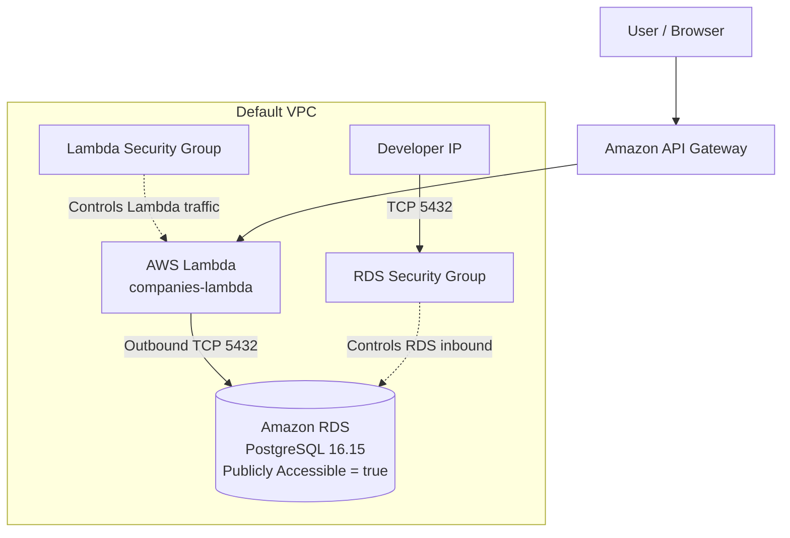
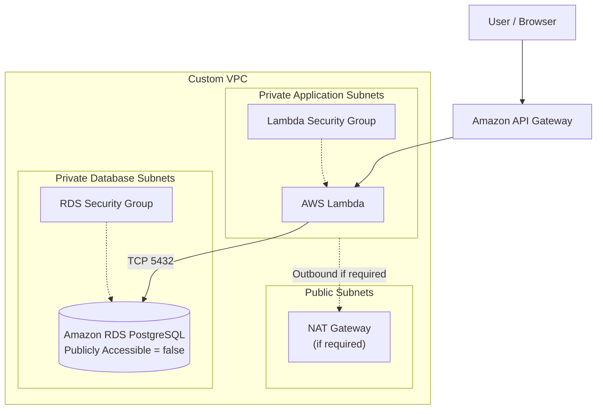

# RDS Network Architecture Assessment

## 1. Objective

เอกสารนี้จัดทำขึ้นเพื่อวิเคราะห์และประเมินโครงสร้างเครือข่ายของ Amazon RDS PostgreSQL ในระบบ Cooperative Education โดยตรวจสอบการกำหนดค่าจาก Terraform และ AWS เพื่อประเมินความปลอดภัยของการเชื่อมต่อระหว่าง AWS Lambda และ RDS รวมถึงเสนอแนวทางปรับปรุงโครงสร้างเครือข่ายให้เหมาะสมยิ่งขึ้น

การประเมินแบ่งออกเป็น 3 ส่วน ได้แก่

- Current State: โครงสร้างเครือข่ายปัจจุบัน
- Recommended Target State: โครงสร้างเครือข่ายที่แนะนำ
- Gap Analysis: ความแตกต่างระหว่างสถานะปัจจุบันกับสถานะเป้าหมาย

## 2. Current State

### 2.1 Architecture Overview

ระบบปัจจุบันใช้ AWS API Gateway เป็นจุดรับ Request จากผู้ใช้งาน และส่งต่อไปยัง AWS Lambda Function ชื่อ `****-companies-lambda` ซึ่งทำหน้าที่ประมวลผลและเชื่อมต่อกับ Amazon RDS PostgreSQL

จาก Terraform พบว่าระบบใช้ Default VPC และกำหนดให้ Lambda ใช้ Default Subnets โดยใช้ Security Group สำหรับควบคุมการเชื่อมต่อไปยัง RDS ผ่าน TCP Port 5432

### 2.2 Terraform Configuration Evidence

| Configuration | File | Evidence |
|---|---|---|
| Default VPC | `data.tf` | `default = true` |
| Default Subnets | `data.tf` | `data.aws_subnets.default` |
| Lambda Subnets | `lambda.tf` | `subnet_ids = data.aws_subnets.default.ids` |
| Lambda Security Group | `lambda.tf` | `security_group_ids = [aws_security_group.lambda.id]` |
| Database Engine | `rds.tf` | `engine = "postgres"` |
| RDS Public Accessibility | `rds.tf` | `publicly_accessible = true` |
| Lambda Egress | `security_groups.tf` | TCP 5432 to RDS Security Group |
| RDS Ingress from Lambda | `security_groups.tf` | TCP 5432 from Lambda Security Group |
| Developer Ingress | `security_groups.tf` | `cidr_blocks = [var.my_ip_cidr]` |

### 2.3 Terraform State Evidence

จากคำสั่ง `terraform state list` พบว่ามีทรัพยากรที่เกี่ยวข้องกับ Network และ Database ดังนี้

- `data.aws_vpc.default`
- `data.aws_subnets.default`
- `aws_lambda_function.companies`
- `aws_db_instance.coop_db`
- `aws_security_group.lambda`
- `aws_security_group.rds`
- `aws_security_group_rule.lambda_egress_to_rds`
- `aws_security_group_rule.rds_ingress_from_lambda`
- `aws_security_group_rule.rds_ingress_from_dev_ip`

ผลดังกล่าวแสดงว่า Terraform State มีการจัดการทรัพยากร Lambda, RDS และ Security Group ที่เกี่ยวข้องกับการเชื่อมต่อฐานข้อมูล

### 2.4 AWS Observed Configuration

จากการตรวจสอบ AWS CLI ก่อนหน้านี้ พบข้อมูลดังนี้

- RDS Instance: `****-coop-db-dev`
- Database Engine: PostgreSQL 16.15
- VPC: Default VPC
- `PubliclyAccessible`: `true`
- RDS Security Group มี Inbound Rule TCP Port 5432 จาก Lambda Security Group
- RDS Security Group มี Inbound Rule TCP Port 5432 จาก `0.0.0.0/0`
- Lambda และ RDS อยู่ภายใน VPC เดียวกัน


## 3. System / Network Diagram

### 3.1 Current State

แผนภาพ Current State แสดงการเชื่อมต่อจากผู้ใช้งานผ่าน API Gateway ไปยัง Lambda และการเชื่อมต่อจาก Lambda ไปยัง RDS ผ่าน Security Group โดยใช้ TCP Port 5432



หมายเหตุ: RDS ถูกกำหนด `publicly_accessible = true` ใน Terraform และพบค่า `PubliclyAccessible = true` จาก AWS CLI ที่ตรวจสอบก่อนหน้านี้ ไม่ได้จัดประเภท RDS ว่าเป็น Private

### 3.2 Recommended Target State


## 4. Gap Analysis

| Area | Current State | Recommended Target State | Gap |
|---|---|---|---|
| VPC | ใช้ Default VPC | ใช้ VPC ที่ออกแบบสำหรับระบบ | ควรประเมินการแยก Network |
| Lambda Subnets | ใช้ Default Subnets | Private Application Subnets | ยังไม่มีการแยก Subnet ตามบทบาท |
| RDS Accessibility | Publicly Accessible = true | Publicly Accessible = false | ต้องปิด Public Accessibility |
| Database Subnets | ยังไม่พบการกำหนด DB Subnet Group ใน `rds.tf` ที่ตรวจสอบ | Private DB Subnet Group | ต้องตรวจสอบและกำหนด Subnet Group ให้ชัดเจน |
| RDS Ingress | พบ `0.0.0.0/0` จาก AWS และ Lambda SG | อนุญาตเฉพาะ Lambda SG | ต้องนำ Rule ที่เปิดทุก IP ออก |
| Lambda-to-RDS | มี TCP 5432 Egress/Ingress ระหว่าง Security Group | คงการเชื่อมต่อ TCP 5432 ที่จำกัด Source | มีการกำหนดไว้แล้ว แต่ต้องทดสอบหลังปรับปรุง |

## 5. Verification and Limitations

### 5.1 Verification Performed

การตรวจสอบที่ดำเนินการแล้วประกอบด้วย

1. ตรวจสอบ Terraform Configuration ในไฟล์ `data.tf`, `lambda.tf`, `rds.tf`, `security_groups.tf` และ `variables.tf`
2. ตรวจสอบ Terraform State ด้วยคำสั่ง `terraform state list`
3. ตรวจสอบ AWS RDS Configuration ด้วย AWS CLI
4. ตรวจสอบ RDS Security Group Inbound Rules
5. ตรวจสอบ Lambda VPC Configuration และ Security Group
6. ตรวจสอบ Default VPC, Subnets และ Route Table

### 5.2 Terraform State Verification Result

จากการตรวจสอบ Terraform State พบว่า RDS Security Group มี Inbound Rule สำหรับ TCP Port 5432 จำนวน 4 รายการ ได้แก่ Developer IP, Lambda Security Group, RDS Proxy Security Group และ 0.0.0.0/0

เมื่อเปรียบเทียบกับ Terraform Configuration พบว่าไฟล์ security_groups.tf กำหนด Developer Ingress ผ่านตัวแปร var.my_ip_cidr และกำหนด Ingress จาก Lambda Security Group แต่ไม่พบการกำหนด Ingress จาก 0.0.0.0/0 ในไฟล์ Configuration ที่ตรวจสอบ

ดังนั้นจึงพบความแตกต่างระหว่าง Configuration ที่ตรวจสอบกับ Inbound Rules ที่ปรากฏใน Terraform State และจำเป็นต้องตรวจสอบแหล่งที่มาของ Rule ดังกล่าวเพิ่มเติมก่อนดำเนินการแก้ไข

### 5.3 Permission and Error Limitations

จากหลักฐานที่รวบรวมในขณะนี้ ยังไม่มี Error จาก AWS IAM หรือ Permission Denied ที่ยืนยันว่าไม่สามารถตรวจสอบทรัพยากรได้

ดังนั้นจึงไม่ควรอ้างว่าการตรวจสอบถูกจำกัดด้วยสิทธิ์ AWS Academy จนกว่าจะมี Error จากคำสั่งจริง หากพบข้อจำกัดเพิ่มเติมให้แนบข้อความ Error และคำสั่งที่ใช้ตรวจสอบ

## 6. Testing and Deployment

### 6.1 Terraform Configuration Validation

ตรวจสอบ Terraform Configuration เพื่อประเมินการเปลี่ยนแปลงก่อนนำไป Deploy โดยใช้คำสั่ง

```powershell
terraform validate
terraform plan
```

การตรวจสอบมีวัตถุประสงค์เพื่อยืนยันว่า Terraform Configuration ถูกต้อง และตรวจสอบรายการ Resource ที่จะถูกเพิ่ม แก้ไข หรือลบก่อนดำเนินการ Apply

### 6.2 Network Configuration Verification

ตรวจสอบ Network Configuration ของ AWS Environment โดยใช้ AWS CLI เพื่อยืนยันค่าการตั้งค่าของ RDS และ Security Groups ได้แก่

1. ตรวจสอบค่า `PubliclyAccessible` ของ RDS
2. ตรวจสอบ RDS Security Group Inbound Rules
3. ตรวจสอบว่า Lambda Security Group มี Outbound Rule สำหรับ TCP Port 5432
4. ตรวจสอบว่า RDS Security Group อนุญาต TCP Port 5432 จาก Lambda Security Group

## 7. Evidence Appendix

หลักฐานประกอบการประเมินจัดเก็บไว้ใน `docs/evidence`

| Evidence File | Description |
|---|---|
| `190-01-terraform-vpc-subnets.txt` | Terraform VPC และ Subnets |
| `190-02-terraform-lambda-config.txt` | Lambda VPC Configuration |
| `190-03-terraform-rds-config.txt` | RDS Configuration |
| `190-04-terraform-security-groups.txt` | Security Group Configuration |
| `190-05-terraform-security-group-state.txt` | Terraform State ของ Security Groups |
| `190-06-aws-rds-security-group-inbound.txt` | AWS RDS Security Group Inbound Rules |
| `190-07-aws-rds-instance.txt` | AWS RDS Instance Configuration |
| `190-08-aws-lambda-vpc-config.txt` | AWS Lambda VPC Configuration |
| `190-09-aws-vpc-subnets.txt` | AWS VPC Subnets |
| `190-10-aws-route-tables.txt` | AWS Route Tables |
| `190-11-aws-db-subnet-group-proxy.txt` | AWS DB Subnet Group และ RDS Proxy |
