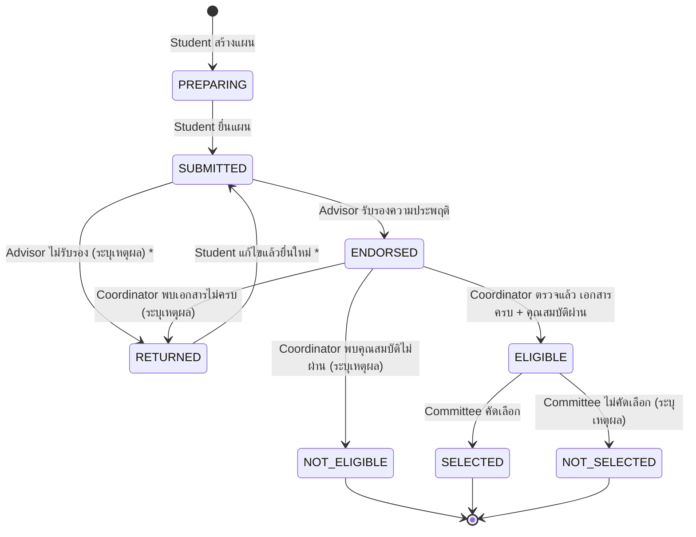

# บทบาทและ Workflow เป้าหมายของ V3 (ปรับตาม Project 5 Self-test)

> **สถานะเอกสาร:** ข้อเสนอ (Proposal) รอทีม Review ใน #125
> เอกสารนี้กำหนด "เป้าหมาย" เท่านั้น **ยังไม่มีการแก้โค้ด** การแก้จริงจะแตกเป็น Implementation Issue หลังทีมอนุมัติ
> เมื่อทำเสร็จแล้ว ให้นำเนื้อหาไปแทนที่ `docs/overview/V3-01-workflow-permissions.md` และ `docs/permission-matrix.md`

---

## 1. ทำไมต้องปรับ

ผล Self-test ของ Project 5 (เอกสาร In-class Setup & Self-test) พบว่า Workflow ของเราไม่ตรงกับโจทย์:

- **Self-test 1 = PARTIAL:** อาจารย์ที่ปรึกษา (Advisor) ในโจทย์ทำได้แค่ "รับรองความประพฤติ" (Endorse) แต่ระบบเราให้ Advisor อนุมัติแผนได้เลย
- **Self-test 2 = FAIL:** ระบบไม่มี role ผู้ประสานงานสหกิจ (Co-op Coordinator) และคณะกรรมการ (Co-op Committee) จึงไม่มีขั้นตอน "ตรวจเอกสารและคุณสมบัติ" และ "คัดเลือก"
- โจทย์ย้ำว่า **Eligible ไม่เท่ากับ Selected** และ **การรับรองของ Advisor ไม่ใช่การอนุมัติ** แต่ระบบเรารวมทุกอย่างไว้ในการกดอนุมัติครั้งเดียว

เป้าหมาย: แยกแต่ละขั้นตอนให้ชัด ให้แต่ละ role ทำได้เฉพาะงานของตัวเอง และบันทึกผลทุกขั้นให้อ่านย้อนหลังได้

---

## 2. สรุปสิ่งที่เปลี่ยน (เดิม → ใหม่)

| เรื่อง | เดิม (V3 ปัจจุบัน) | ใหม่ (เป้าหมาย) |
|---|---|---|
| Role ผู้ตรวจทั้งหมด | `STAFF` | `COORDINATOR` (เปลี่ยนชื่อ) |
| Role คัดเลือก | ไม่มี | `COMMITTEE` (เพิ่มใหม่) |
| งานของ `ADVISOR` | อนุมัติ / ส่งกลับ / ไม่อนุมัติ | **รับรองความประพฤติ (Endorse) เท่านั้น** |
| สถานะระหว่างทาง | `SUBMITTED` อย่างเดียว | `SUBMITTED` → `ENDORSED` → `ELIGIBLE` |
| สถานะสุดท้าย | `APPROVED` / `REJECTED` | `SELECTED` / `NOT_SELECTED` / `NOT_ELIGIBLE` |
| ประวัติการพิจารณา | `plan_reviews` ไม่แยกขั้นตอน | `plan_reviews` มีคอลัมน์ `step` บอกว่าเป็นขั้นไหน |

---

## 3. บทบาทผู้ใช้ (Roles)

ค่าในคอลัมน์ `app_users.role` และชื่อที่แสดงบนหน้าจอ:

| `role` | ชื่อที่แสดง | เห็นข้อมูลอะไร | ทำอะไรได้ |
|---|---|---|---|
| `STUDENT` | นักศึกษา (Student) | แผนของตัวเองเท่านั้น | สร้าง แก้ไข (เฉพาะ `PREPARING` / `RETURNED`) และยื่นแผน **แก้ผลการพิจารณาเองไม่ได้** |
| `ADVISOR` | อาจารย์ที่ปรึกษา (Academic Advisor) | เฉพาะนักศึกษาในที่ปรึกษา | **รับรองความประพฤติ (Endorse) เท่านั้น** อนุมัติหรือคัดเลือกไม่ได้ |
| `COORDINATOR` | ผู้ประสานงานสหกิจ (Co-op Coordinator) | นักศึกษาและแผนทั้งหมด | ตรวจเอกสารครบ/ไม่ครบ และตรวจคุณสมบัติ (Eligible / Not eligible) ส่งกลับให้นักศึกษาแก้ได้ **คัดเลือกไม่ได้** |
| `COMMITTEE` | คณะกรรมการสหกิจ (Co-op Committee) | เฉพาะแผนที่ผ่านการตรวจแล้ว (`ELIGIBLE` ขึ้นไป) | **คัดเลือกขั้นสุดท้าย** (Selected / Not selected) ภายในจำนวนรับของรอบ |
| `ADMIN` | ผู้ดูแลระบบ (Admin) | ข้อมูลบัญชีผู้ใช้ | จัดการบัญชี role และการจับคู่ Advisor กับนักศึกษา **ไม่มีสิทธิ์ดูหรือพิจารณาแผน** |

กติกาที่ใช้กับทุก role:

1. **1 บัญชี = 1 role** (เหมือนเดิม) ถ้าต้องทำงานของ role อื่น ให้เปลี่ยน role ของบัญชี ไม่ใช่เพิ่ม role
2. **Backend ต้องตรวจสิทธิ์ทุกครั้ง** การซ่อนปุ่มใน Frontend ไม่นับเป็นการตรวจสิทธิ์
3. ระบุตัวผู้ใช้จากค่า `sub` ใน Cognito JWT ที่ตรวจแล้วเท่านั้น ห้ามเชื่อ `student_id` ที่ส่งมาจาก Client
4. role ที่ไม่รู้จักถูกปฏิเสธ (`403`) ทุก endpoint

> **ระวังชื่อซ้ำ:** "ผู้ประสานงานสหกิจ (Co-op Coordinator)" คือเจ้าหน้าที่ฝั่งมหาวิทยาลัย
> **ไม่ใช่** "ผู้ประสานงานสถานประกอบการ" (ฝั่งบริษัท) ที่ `permission-matrix.md` เคยกล่าวถึง
> role ฝั่งบริษัทยังอยู่นอกขอบเขต V3 และห้ามให้สิทธิ์ `COORDINATOR` กับบัญชีของบริษัท

---

## 4. สถานะของแผนและการเปลี่ยนสถานะ (Plan Status)

`*` = รอยืนยันกับอาจารย์ (ดูหัวข้อ 9)

| สถานะปัจจุบัน | การดำเนินการ | ผู้ดำเนินการ | สถานะถัดไป | ต้องระบุเหตุผล |
|---|---|---|---|---|
| `PREPARING` | ยื่นแผน | Student เจ้าของแผน | `SUBMITTED` | – |
| `SUBMITTED` | รับรองความประพฤติ | `ADVISOR` ของนักศึกษาคนนั้น | `ENDORSED` | ไม่บังคับ (ใส่หมายเหตุได้ เช่น "ความประพฤติเรียบร้อย") |
| `SUBMITTED` | ไม่รับรอง | `ADVISOR` ของนักศึกษาคนนั้น | `RETURNED` * | บังคับ |
| `ENDORSED` | ตรวจผ่าน (เอกสารครบ + คุณสมบัติผ่าน) | `COORDINATOR` | `ELIGIBLE` | – |
| `ENDORSED` | เอกสารไม่ครบ | `COORDINATOR` | `RETURNED` | บังคับ เช่น "Incomplete / Missing Transcript" |
| `ENDORSED` | คุณสมบัติไม่ผ่าน | `COORDINATOR` | `NOT_ELIGIBLE` | บังคับ |
| `RETURNED` | แก้ไขแผน | Student เจ้าของแผน | `RETURNED` | – |
| `RETURNED` | ยื่นใหม่ | Student เจ้าของแผน | `SUBMITTED` * | – |
| `ELIGIBLE` | คัดเลือก | `COMMITTEE` | `SELECTED` | – |
| `ELIGIBLE` | ไม่คัดเลือก | `COMMITTEE` | `NOT_SELECTED` | บังคับ |

กติกาของสถานะ:

- **Student แก้ไขแผนได้เฉพาะ `PREPARING` และ `RETURNED`** สถานะอื่นเป็น Read-only
- **สถานะสิ้นสุด:** `SELECTED`, `NOT_SELECTED`, `NOT_ELIGIBLE` แผนนั้นแก้ไขหรือยื่นต่อไม่ได้อีก
- **แผนที่ยังดำเนินการอยู่** (นับในกติกา 1 แผนต่อรอบ): `PREPARING`, `SUBMITTED`, `ENDORSED`, `RETURNED`, `ELIGIBLE`
- **สร้างแผนใหม่ในรอบเดิมได้หรือไม่:**
  - `SELECTED` หรือ `NOT_SELECTED` → **ไม่ได้** (ผ่านการคัดเลือกของรอบนี้ไปแล้ว)
  - `NOT_ELIGIBLE` → **ได้** (เช่น ข้อมูลผลการเรียนถูกแก้ไขแล้ว) ต้องผ่านทุกขั้นใหม่ตั้งแต่ต้น
- **"`ELIGIBLE` ขึ้นไป"** ในเอกสารนี้หมายถึงสถานะ `ELIGIBLE`, `SELECTED` และ `NOT_SELECTED`
- **จำนวนรับต่อรอบ (Quota):** Committee เลือก `SELECTED` ได้ไม่เกินจำนวนรับของรอบ ถ้าเต็มแล้วให้ตอบ `409 Conflict` นับจำนวนและบันทึกผลใน transaction เดียว โดยล็อกแถวของรอบก่อน (`SELECT ... FOR UPDATE`) กันกดพร้อมกันแล้วเกินจำนวน
- **Concurrency:** แต่ละขั้นทำได้เฉพาะจากสถานะของขั้นนั้น (เช่น Endorse ได้เฉพาะ `SUBMITTED`) ถ้ามีคนบันทึกผลไปก่อนแล้ว รายการที่ตามมาได้ `409 Conflict` และไม่เขียนทับผลเดิม (ใช้หลักเดียวกับปัจจุบัน)
- **Transaction:** การบันทึกผลและการเปลี่ยนสถานะต้องสำเร็จหรือยกเลิกพร้อมกัน

---

## 5. ตารางสิทธิ์ราย Action (Permission Matrix)

✅ = ทำได้ · 🔸 = ทำได้แบบจำกัด (ดูหมายเหตุ) · ❌ = ทำไม่ได้ (`403`)

| Action | `STUDENT` | `ADVISOR` | `COORDINATOR` | `COMMITTEE` | `ADMIN` |
|---|---|---|---|---|---|
| ดูรายการแผน | 🔸 ของตัวเอง | 🔸 นักศึกษาในที่ปรึกษา | ✅ ทั้งหมด | 🔸 เฉพาะ `ELIGIBLE` ขึ้นไป | ❌ |
| ดูรายละเอียดแผน | 🔸 ของตัวเอง | 🔸 นักศึกษาในที่ปรึกษา | ✅ | 🔸 เฉพาะ `ELIGIBLE` ขึ้นไป | ❌ |
| สร้าง / แก้ไข / ยื่นแผน | 🔸 ของตัวเอง | ❌ | ❌ | ❌ | ❌ |
| รับรองความประพฤติ (Endorse) | ❌ | 🔸 นักศึกษาในที่ปรึกษา | ❌ | ❌ | ❌ |
| ตรวจเอกสารและคุณสมบัติ | ❌ | ❌ | ✅ | ❌ | ❌ |
| คัดเลือก (Select) | ❌ | ❌ | ❌ | ✅ | ❌ |
| ดูหน้ารายชื่อนักศึกษา | ❌ (ดูข้อมูลตัวเองในหน้าบัญชี) | 🔸 นักศึกษาในที่ปรึกษา | ✅ ทั้งหมด | 🔸 เฉพาะเจ้าของแผน `ELIGIBLE` ขึ้นไป | 🔸 เฉพาะชื่อและรหัส (สำหรับจัดการบัญชี) |
| ดูประวัติการพิจารณา | 🔸 ของแผนตัวเอง | 🔸 นักศึกษาในที่ปรึกษา | ✅ | 🔸 เฉพาะ `ELIGIBLE` ขึ้นไป | ❌ |
| จัดการบัญชีและ role | ❌ | ❌ | ❌ | ❌ | ✅ |

> หน้ารายชื่อนักศึกษา: ตามที่อาจารย์ระบุว่า "Student list เห็นได้แค่ Staff และ Advisor (เด็กในที่ปรึกษา)"
> ในโมเดลใหม่ Staff = `COORDINATOR` ส่วน `COMMITTEE` เห็นเฉพาะผู้สมัครที่ต้องคัดเลือก

---

## 6. การบันทึกประวัติ (`plan_reviews`)

ทุกขั้นตอนต้องบันทึกและอ่านย้อนหลังได้ โดยเพิ่มคอลัมน์ `step` ในตาราง `plan_reviews`:

| `step` | ใครบันทึก | ค่า `decision` ที่ใช้ได้ |
|---|---|---|
| `ENDORSEMENT` | `ADVISOR` | `ENDORSED`, `NOT_ENDORSED` |
| `SCREENING` | `COORDINATOR` | `ELIGIBLE`, `INCOMPLETE`, `NOT_ELIGIBLE` |
| `SELECTION` | `COMMITTEE` | `SELECTED`, `NOT_SELECTED` |

แต่ละแถวเก็บ: ผู้บันทึก (`reviewer_sub`), ผล (`decision`), ความเห็น (`comment`), เวลา (`reviewed_at`) เหมือนเดิม
ค่า `INCOMPLETE` ทำให้ Self-test 2 อ่านผล "Incomplete / Missing Transcript" ได้ตรงตัว แม้สถานะแผนจะเป็น `RETURNED`

---

## 7. ไล่ตาม Self-test (ใช้ตรวจว่าโมเดลนี้ผ่านโจทย์)

**Self-test 1 — S01 ยื่น และ ADV-1 รับรอง**

1. S01 สร้างแผน (`PREPARING`) แนบ Transcript แล้วยื่น → `SUBMITTED`
2. ออกจากหน้าแล้วเปิดใหม่ ข้อมูลและไฟล์แนบยังอยู่
3. ADV-1 กด Endorse พร้อมหมายเหตุ "ความประพฤติเรียบร้อย" → `ENDORSED` และมีแถว `plan_reviews` (`step = ENDORSEMENT`)
4. แผนยัง**ไม่ถือว่าผ่านการคัดเลือก** เพราะยังไม่ถึง `SELECTED` ✔ ตรงกับเงื่อนไข PASS

**Self-test 2 — COORD-1 ตรวจ S02 และ S01**

1. S02 (GPA 3.82, ได้รับรองแล้ว) ไม่มี Transcript → COORD-1 บันทึก `INCOMPLETE` เหตุผล "Missing Transcript" → แผน `RETURNED` ไม่ถูกนับเป็น `ELIGIBLE` ✔
2. S01 (GPA 3.65, กลุ่มวิชา 3.40, เอกสารครบ, ได้รับรอง) → COORD-1 บันทึกผ่าน → `ELIGIBLE` ✔
3. ผลและเหตุผลอ่านย้อนหลังได้จาก `plan_reviews` ✔

**Live Challenge — ความต่างของ 3 คำ**

- **Endorsement** = Advisor รับรองความประพฤติ (`ENDORSED`)
- **Eligibility** = Coordinator ตรวจเอกสารและเกณฑ์ (`ELIGIBLE`)
- **Selection** = Committee คัดเลือกภายในจำนวนรับ (`SELECTED`)

---

## 8. ผลกระทบเมื่อลงมือทำจริง (สำหรับแตก Implementation Issue)

ส่วนนี้ยังไม่ทำ ใช้ประกอบการประเมินเวลาและแบ่งงานเท่านั้น

| ส่วน | สิ่งที่ต้องแก้ |
|---|---|
| Database | Migration ใหม่ (เช่น `v3_02_roles_workflow.sql` พร้อม rollback) แก้ `CHECK` ของ `app_users.role`, `coop_plans.status`, `plan_reviews.decision` และเพิ่ม `plan_reviews.step` แปลงข้อมูลเดิม: `STAFF` → `COORDINATOR` · แผนเดิมที่เป็น `APPROVED` / `REJECTED` ไม่แปลงเป็นผลคัดเลือก เพราะเป็นผลของผู้ตรวจเดิม ไม่ใช่ Committee ให้กลับเป็น `SUBMITTED` เพื่อเริ่มขั้นรับรองใหม่ ประวัติเดิมยังอยู่ใน `plan_reviews` (`decision` ยังรับค่าเดิมไว้) |
| `infra/schema.sql` | อัปเดตให้ตรงกับผลหลัง Migration (ตอนนี้ยังเป็นของ V2) |
| Lambda | `authorize.mjs` (กติกาตามหัวข้อ 5), แยก `reviewCoopPlan.mjs` เป็น 3 action (Endorse / Screen / Select), ตรวจ Quota ตอน Select |
| API Gateway | route ใหม่ของแต่ละขั้น และอัปเดต `route-policy.mjs` |
| Seed / บัญชีทดสอบ | `seed-app-users.sh` เพิ่ม prefix `coordinator*`, `committee*` และเตรียมบัญชี ADV-1, COORD-1, COM-1 ตามโจทย์ |
| Frontend | แสดงฟอร์มตาม role (Advisor เห็นแค่ปุ่ม Endorse ฯลฯ), ซ่อนหน้ารายชื่อนักศึกษาจาก Student, ป้ายสถานะใหม่ |
| Tests | Lambda tests ที่อ้างชื่อ role (ประมาณ 170 จุดใน 9 ไฟล์) และ Frontend tests |
| เอกสาร | `V3-01-workflow-permissions.md`, `permission-matrix.md`, `V3-01-api-spec.md`, `V3-01-data-model.md`, `v3-02-auth.md` |

งานที่เกี่ยวข้องแต่แยกเป็น Issue ของตัวเอง:

- **การแนบไฟล์ (Transcript):** จำเป็นต่อ Self-test 1 และ 2 แต่ออกแบบแยก
- **เกณฑ์และจำนวนรับแยกตามรอบ:** เช่น GPA > 2.80, GPA กลุ่มวิชา ≥ 2.50, รับ 2 คน ใช้ในขั้น Screening และ Selection

---

## 9. เรื่องที่ทีมต้องตัดสินใจ

ข้อที่เอกสารของอาจารย์ไม่ได้บอก **เป็นข้อเสนอ รอทีมยืนยันใน #125** (เลยเวลาแล้วไม่ตอบ = ยอมรับ)

1. **Advisor ไม่รับรอง (D3):** ส่งกลับให้แก้ (`RETURNED`) พร้อมเหตุผล ไม่จบแผน
2. **ยื่นใหม่หลังถูกส่งกลับ (D4):** ต้องให้ Advisor รับรองใหม่
3. **Committee (D1):** เป็น role ใหม่ `COMMITTEE`
4. **การคัดเลือกและจำนวนรับ (D5):** อยู่ใน V3 แบบง่าย Committee เลือกเองจากแผน `ELIGIBLE` ได้ไม่เกินจำนวนรับของรอบ
5. **Admin กับรายชื่อนักศึกษา (D9):** เห็นแค่ชื่อและรหัส เพื่อใช้จัดการบัญชี

ถ้าทีมโหวตต่างจากนี้ ให้แก้เอกสารนี้ตามผลโหวต

---

## 10. นอกขอบเขต

- role ฝั่งสถานประกอบการ (ผู้ประสานงานสถานประกอบการ)
- การถือหลาย role ในบัญชีเดียว
- เฟส 2–4 ของสหกิจ (ยื่นบริษัท ฝึกงาน รายงาน) ตาม `working-agreement.md` หัวข้อ 5

---

## 11. ที่มาของคำศัพท์ (ต้องตกลงร่วมกันก่อนใช้)

ทุกคำด้านล่างยังเป็นข้อเสนอ ทีมต้องตกลงใน #125 ก่อนนำไปใช้ในโค้ด

**คำที่มาจากเอกสาร Self-test ของอาจารย์โดยตรง** (ควรใช้ตามนี้)

| คำ | ข้อความในเอกสารของอาจารย์ |
|---|---|
| `PREPARING` | คงชื่อเดิม ตรงกับ "Draft" ในเอกสาร Self-test และ "Preparing" ในโจทย์ FR5 |
| `ENDORSED` | "บันทึกการรับรองความประพฤติเป็น Endorsed พร้อมหมายเหตุ" |
| `ELIGIBLE`, `SELECTED` | "Eligible ไม่เท่ากับ Selected" |
| `INCOMPLETE` | "Incomplete / Missing Transcript (หรือสถานะเทียบเท่า)" |
| `COORDINATOR`, `COMMITTEE` | ชื่อ role "Co-op Coordinator" และ "Co-op Committee" |
| Endorsement / Eligibility / Selection | "ชี้ความต่างของ endorsement, eligibility และ selection" |

**คำที่ทีมตั้งเพิ่ม** (เปลี่ยนได้ถ้าทีมเห็นต่าง)

| คำ | เหตุผล |
|---|---|
| `NOT_ENDORSED`, `NOT_ELIGIBLE`, `NOT_SELECTED` | คำฝั่งปฏิเสธ ตั้งให้คู่กับคำของอาจารย์ |
| `SCREENING` (ชื่อ `step`) | แปลจากคำว่า "คัดกรอง" ในเอกสาร ("ยังไม่ผ่านการคัดกรอง") |
| `ENDORSEMENT`, `SELECTION` (ชื่อ `step`) | ใช้รูปคำนามของคำในเอกสาร |
| เปลี่ยน `STAFF` เป็น `COORDINATOR` | ใช้ชื่อตามเอกสาร แทนการคง `STAFF` ไว้แล้วเปลี่ยนแค่ป้ายบนหน้าจอ |
