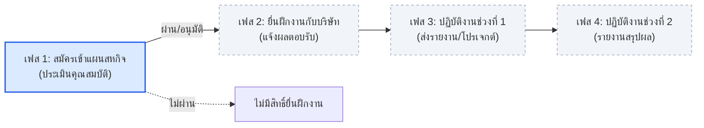

# ข้อตกลงการทำงานของทีม (Team Working Agreement)
**ระบบบริหารและวางแผนสหกิจศึกษา (Cooperative Education Planning & Management System)**

เอกสารฉบับนี้จัดทำขึ้นเพื่อรวบรวมและสรุปข้อตกลง กติกา กระบวนการทำงาน และขอบเขตการพัฒนาของทีม เพื่อให้สมาชิกทุกคนในทีมทำงานไปในทิศทางเดียวกันอย่างมีประสิทธิภาพ

---

## 1. รูปแบบและแนวทางการทำงาน (Work Model)

1. **Issue-Driven Development:**
   - ใช้รูปแบบการพัฒนาแบบ **Issue-driven** ตามข้อแนะนำของอาจารย์
   - สมาชิกทุกคนต้องดูแลรับผิดชอบงานตั้งแต่การสร้างหรือรับมอบหมาย Issue ไปจนถึงผลลัพธ์สุดท้ายที่ใช้งานได้จริง (End-to-End Delivery)
2. **End-to-End Ownership:**
   - ผู้รับผิดชอบแต่ละ Issue ต้องรับผิดชอบการพัฒนาแบบครบวงจร:
     $$\text{Data / Model} \longrightarrow \text{Query / API} \longrightarrow \text{UI / Frontend} \longrightarrow \text{Test} \longrightarrow \text{Evidence}$$
3. **Collaboration & Flexibility:**
   - หากมีส่วนใดที่ไม่ถนัดหรือต้องการความช่วยเหลือ สามารถพูดคุยเพื่อขอความร่วมมือ (Collaborate) หรือแลกเปลี่ยน Task กับสมาชิกคนอื่นในทีมได้

---

## 2. กติกาและบทบาทการทำงาน (Rules of Engagement)

> **“คนที่สร้าง Issue = Reviewer ของ Issue นั้น”**

### 2.1 บทบาท Owner (ผู้รับผิดชอบการพัฒนา)
1. **เลือก Issue:** เลือก Issue ที่จะรับผิดชอบและทำการ Assign ให้ตนเอง
2. **ปรับสถานะ:** เมื่อเริ่มลงมือทำ ให้ย้าย Issue ไปยังคอลัมน์ `Doing` / `In Progress`
3. **สอบถามข้อสงสัย:** หากมีจุดที่คลุมเครือหรือไม่เข้าใจ ให้สอบถามผ่าน Comment ถึง Reviewer ของ Issue นั้นโดยตรง
4. **การตั้งชื่อ Branch:** ต้องสร้าง Branch แยกสำหรับแต่ละ Issue ตามรูปแบบ:
   ```text
   <type>/<issue-number>-<short-description>
   ```
   *ตัวอย่าง:* `feat/14-home-page`, `feat/106-plan-review-list`, `fix/94-responsive-table`
5. **การเขียน Commit Message:** ต้องระบุรูปแบบให้ชัดเจน:
   ```text
   <type>: <สิ่งที่ทำอย่างกระชับ> (#issue)
   ```
   *ประเภท (Types) ที่ใช้งาน:*
   - `feat:` เพิ่มฟีเจอร์หรือความสามารถใหม่
   - `fix:` แก้ไข Bug หรือข้อผิดพลาด
   - `docs:` จัดทำหรือปรับปรุงเอกสาร
   - `test:` เพิ่มเติมหรือแก้ไข Test cases
   - `refactor:` ปรับโครงสร้างโค้ดโดยไม่เปลี่ยนพฤติกรรมการทำงาน
   - `chore:` งานจัดการทั่วไป เช่น Configuration, Dependencies
   
   *ตัวอย่าง:* `feat: implement employers page interface (#16)`
6. **ส่งมอบงานและเปิด Pull Request:**
   - เมื่อทำตามเงื่อนไขใน Acceptance Criteria (AC) ครบถ้วน ให้เปิด **Pull Request (PR)**
   - เช็คลิสต์ยืนยัน Task ใน Issue
   - เขียนและแนบ **Evidence** (ภาพหน้าจอ, วิดีโอ, หรือผล Test) ลงใน Issue เพื่อให้ Reviewer ตรวจสอบ
   - แจ้ง Reviewer ทราบผ่าน Comment ใน Issue นั้น
7. **การแก้ไขตามคำแนะนำ:** หาก Reviewer ส่ง **Request Changes** ให้ Owner แก้ไขตามข้อเสนอแนะ เมื่อแก้ไขเสร็จแล้วให้ยืนยันใน PR และแจ้ง Reviewer อีกครั้ง

---

### 2.2 บทบาท Reviewer (ผู้ตรวจและประเมินงาน)
1. **การสร้าง Issue:** กำหนดเป้าหมายหรือโจทย์ของ Issue ให้ชัดเจนและกระชับ
2. **รายละเอียดใน Issue ต้องครบถ้วน:** ประกอบด้วย:
   - **Problem / Goal:** ปัญหาหรือเป้าหมายที่ต้องการแก้ไข
   - **Task Checklist:** งานย่อยที่ต้องดำเนินการ
   - **Acceptance Criteria (AC):** เกณฑ์การยอมรับเพื่อยืนยันว่างานสำเร็จ
   - **Evidence Requirement:** หลักฐานที่ต้องใช้ในการตรวจ
   - **Estimate:** ระยะเวลาโดยประมาณ (เช่น 2–3 วัน)
   - **Reviewer:** ระบุชื่อ GitHub Account ของตนเอง
3. **การแบ่ง Sub-issues:** หาก Issue มีขนาดใหญ่หรือซับซ้อน ควรแบ่งเป็น Sub-tasks หรือ Sub-issues ย่อยให้เป็นระบบ
4. **ติดตามความคืบหน้า:** ติดตามและสนับสนุน Owner ที่กำลังทำ Issue นั้นอย่างต่อเนื่อง
5. **ระยะเวลาตรวจงาน:** เมื่อ Owner แจ้งส่งมอบงานพร้อม AC และ Evidence ครบถ้วน Reviewer ต้องเข้าตรวจงานจริง**ภายใน 24 ชั่วโมง**
6. **การตรวจเช็ค:** ตรวจสอบตาม Acceptance Criteria + Evidence ที่แนบมา
7. **สรุปผลการตรวจ:** Comment สรุปผลการตรวจใน Issue อย่างชัดเจน
8. **ข้อห้ามสำคัญ:** หากพบข้อผิดพลาดหรือจุดที่ต้องการแก้ไข **ห้าม Reviewer ลงมือแก้ไขโค้ดเอง** ให้ Comment หรือกด Request Changes เพื่อส่งคืนให้ Owner แก้ไข
9. **Merge & Close:** เมื่อผลงานผ่านเกณฑ์ AC และ Evidence ครบถ้วน ให้ทำการ Merge PR เข้าสู่ `main` และปิด Issue

---

## 3. ตัวอย่างโครงสร้าง Issue Template

```markdown
**Title:** <ชื่อ Issue ที่กระชับและตรงประเด็น>

**Problem / Goal:**  
<อธิบายที่มาของปัญหา หรือเป้าหมายที่ต้องการทำให้สำเร็จ>

**Task:**  
- [ ] <งานย่อยที่ต้องทำ 1>
- [ ] <งานย่อยที่ต้องทำ 2>

**Acceptance Criteria:**  
- [ ] <เกณฑ์การยอมรับ 1>
- [ ] <เกณฑ์การยอมรับ 2>

**Evidence:**  
- [ ] <หลักฐานยืนยัน เช่น ภาพหน้าจอผลการทดสอบ, Test Log, หรือ GIF>

**Estimate:** <เช่น 2-3 วัน>  
**Reviewer:** @<ชื่อ GitHub ของ Reviewer>
```

---

## 4. ข้อตกลงเรื่องข้อมูล Mock Data ใน Database

- **ความครอบคลุมของ Test Cases:**
  - ควรจัดเตรียมและเพิ่มข้อมูล Mock ในฐานข้อมูล (Seed Data) ให้ครอบคลุม**ทุก Test Case และ Scenario ที่เป็นไปได้** (เช่น สถานะต่าง ๆ: ฉบับร่าง, รอตรวจ, อนุมัติแล้ว, ส่งกลับแก้ไข, ไม่อนุมัติ, ข้อมูลที่กรอกไม่ครบ, เกรดเฉลี่ยเงื่อนไขต่าง ๆ)
- **ประโยชน์:**
  - ช่วยให้สมาชิกในทีมทดสอบระบบ (Internal Testing) ได้ง่ายและรวดเร็ว
  - อำนวยความสะดวกเมื่อต้องส่งมอบให้กลุ่มอื่นหรืออาจารย์ร่วมทดลองใช้งาน (Cross-team Review & User Testing) โดยสามารถเห็นทุกสถานะและเคสต่าง ๆ ได้ทันทีโดยไม่ต้องเสียเวลาสร้างข้อมูลใหม่จากศูนย์

---

## 5. ขอบเขตและวงจรชีวิตสหกิจศึกษา (Cooperative Education Lifecycle & Scope)

กระบวนการสหกิจศึกษาตามปกติประกอบด้วย **4 เฟส (Phases)** ดังนี้:



### รายละเอียดแต่ละเฟส:
1. **เฟส 1 — สมัครเข้าแผนสหกิจศึกษา (Application & Plan Review):**
   - นักศึกษาตรวจสอบคุณสมบัติ จัดทำร่าง และยื่นแผนสหกิจศึกษาผ่านระบบ
   - อาจารย์ที่ปรึกษา/เจ้าหน้าที่ตรวจสอบคุณสมบัติและพิจารณาแผน
   - **เงื่อนไขสำคัญ:**
     - **ผ่าน (อนุมัติแล้ว):** นักศึกษาจะได้รับสิทธิ์เข้าสู่กระบวนการยื่นฝึกงานกับสถานประกอบการในเฟสถัดไป
     - **ไม่ผ่าน (ไม่อนุมัติ):** ไม่มีสิทธิ์ยื่นฝึกงานกับสถานประกอบการ
2. **เฟส 2 — ยื่นฝึกงานกับบริษัท (Company Application & Matching):**
   - นักศึกษาที่ผ่านการอนุมัติในเฟส 1 นำแผนไปยื่นสมัครฝึกงานกับสถานประกอบการ
   - เมื่อได้รับการตอบรับหรือยืนยันตำแหน่งงาน ให้นำข้อมูลมาแจ้งต่อเจ้าหน้าที่สหกิจศึกษา
3. **เฟส 3 — ฝึกงานช่วงที่ 1 (Work Term 1 & Interim Progress):**
   - นักศึกษาเริ่มเข้าปฏิบัติงานจริงในสถานประกอบการช่วงแรก
   - ต้องจัดทำและส่งรายงานความคืบหน้าเกี่ยวกับงานและโครงงาน (Project) ที่ได้รับมอบหมาย
4. **เฟส 4 — ฝึกงานช่วงที่ 2 (Work Term 2 & Final Evaluation):**
   - นักศึกษาปฏิบัติงานช่วงหลังจนเสร็จสิ้นรอบสหกิจ
   - ส่งรายงานสรุปโครงงาน รายงานประเมินผล และการประเมินจากสถานประกอบการ

---

### 🎯 ขอบเขตของโครงการนี้ (Project Scope)
- **สำหรับโครงการนี้ (CS361 Cooperative Education System) จะจำกัดขอบเขต (Scope) การพัฒนาหลักอยู่ที่ "เฟส 1" (การสมัคร ยื่น และพิจารณาแผนสหกิจศึกษา)** เป็นสำคัญ
- กระบวนการในเฟส 2, 3 และ 4 ถือเป็นส่วนที่อยู่นอกขอบเขตการพัฒนาของระบบในเวอร์ชันปัจจุบัน
