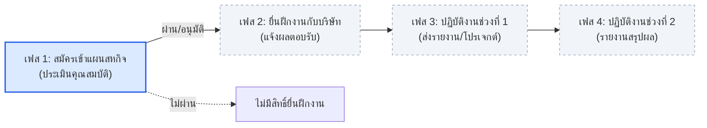
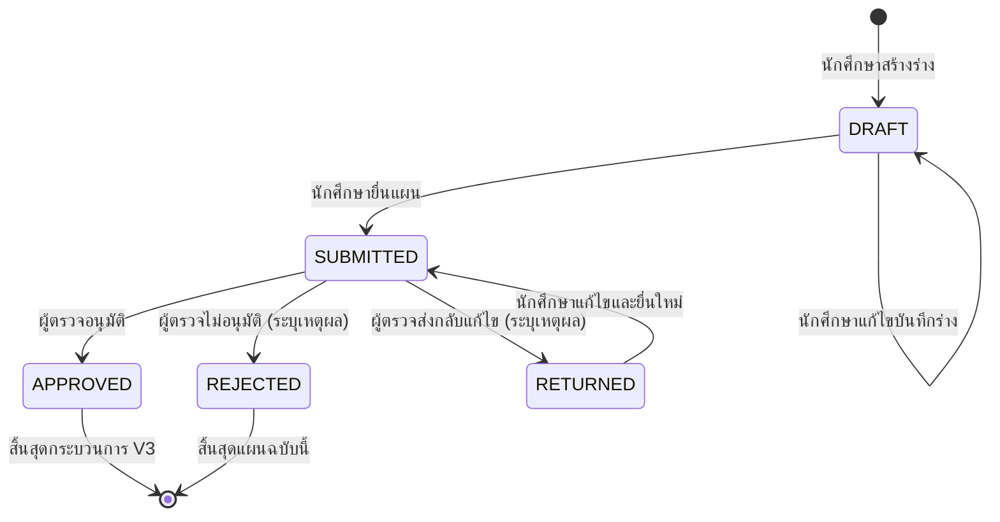

# ข้อตกลงการทำงานของทีม (Team Working Agreement)
**ระบบบริหารและวางแผนสหกิจศึกษา (Cooperative Education Planning & Management System)**

เอกสารฉบับนี้จัดทำขึ้นเพื่อรวบรวมและสรุปข้อตกลง กติกา กระบวนการทำงาน และขอบเขตการพัฒนาของทีม เพื่อให้สมาชิกทุกคนในทีมทำงานไปในทิศทางเดียวกันอย่างมีประสิทธิภาพ

---

## 1. รูปแบบและแนวทางการทำงาน (Work Model)

1. **Issue-Driven Development:**
   - ใช้รูปแบบการพัฒนาแบบ **Issue-driven** ตามข้อแนะนำของอาจารย์
   - สมาชิกทุกคนต้องดูแลรับผิดชอบงานตั้งแต่การสร้างหรือรับมอบหมาย Issue ไปจนถึงผลลัพธ์สุดท้ายที่ใช้งานได้จริง (End-to-End Delivery)
2. **End-to-End Ownership:**
   - ผู้รับผิดชอบแต่ละ Issue ต้องรับผิดชอบการพัฒนาแบบครบวงจร:
     $$\text{Data / Model} \longrightarrow \text{Query / API} \longrightarrow \text{UI / Frontend} \longrightarrow \text{Test} \longrightarrow \text{Evidence}$$
3. **Collaboration & Flexibility:**
   - หากมีส่วนใดที่ไม่ถนัดหรือต้องการความช่วยเหลือ สามารถพูดคุยเพื่อขอความร่วมมือ (Collaborate) หรือแลกเปลี่ยน Task กับสมาชิกคนอื่นในทีมได้

---

## 2. กติกาและบทบาทการทำงาน (Rules of Engagement)

> **“คนที่สร้าง Issue = Reviewer ของ Issue นั้น”**
> 
> - **Cross-Review Rule:** ผู้รับผิดชอบการพัฒนา (Owner / Assignee) จะต้องเป็นคนละคนกับ Reviewer เสมอ เพื่อให้มีการตรวจสอบข้ามบุคคล (**ห้าม Assignee เป็น Reviewer ตรวจรับงานของตนเองเด็ดขาด**)

### 2.1 บทบาท Owner (ผู้รับผิดชอบการพัฒนา)
1. **เลือก Issue:** เลือก Issue ที่จะรับผิดชอบและทำการ Assign ให้ตนเอง
2. **ปรับสถานะ:** เมื่อเริ่มลงมือทำ ให้ย้าย Issue ไปยังคอลัมน์ `Doing` / `In Progress`
3. **สอบถามข้อสงสัย:** หากมีจุดที่คลุมเครือหรือไม่เข้าใจ ให้สอบถามผ่าน Comment ถึง Reviewer ของ Issue นั้นโดยตรง
4. **การตั้งชื่อ Branch:** ต้องสร้าง Branch แยกสำหรับแต่ละ Issue ตามรูปแบบ:
   ```text
   <type>/<issue-number>-<short-description>
   ```
   *ตัวอย่าง:* `feat/14-home-page`, `feat/106-plan-review-list`, `fix/94-responsive-table`
5. **การเขียน Commit Message:** ต้องระบุรูปแบบให้ชัดเจน:
   ```text
   <type>: <สิ่งที่ทำอย่างกระชับ> (#issue)
   ```
   *ประเภท (Types) ที่ใช้งาน:*
   - `feat:` เพิ่มฟีเจอร์หรือความสามารถใหม่
   - `fix:` แก้ไข Bug หรือข้อผิดพลาด
   - `docs:` จัดทำหรือปรับปรุงเอกสาร
   - `test:` เพิ่มเติมหรือแก้ไข Test cases
   - `refactor:` ปรับโครงสร้างโค้ดโดยไม่เปลี่ยนพฤติกรรมการทำงาน
   - `chore:` งานจัดการทั่วไป เช่น Configuration, Dependencies
   
   *ตัวอย่าง:* `feat: implement employers page interface (#16)`
6. **ส่งมอบงานและเปิด Pull Request:**
   - เมื่อทำตามเงื่อนไขใน Acceptance Criteria (AC) ครบถ้วน ให้เปิด **Pull Request (PR)**
   - เช็คลิสต์ยืนยัน Task ใน Issue
   - เขียนและแนบ **Evidence** (ภาพหน้าจอ, วิดีโอ, หรือผล Test) ลงใน Issue เพื่อให้ Reviewer ตรวจสอบ
   - แจ้ง Reviewer ทราบผ่าน Comment ใน Issue นั้น
7. **การแก้ไขตามคำแนะนำ:** หาก Reviewer ส่ง **Request Changes** ให้ Owner แก้ไขตามข้อเสนอแนะ เมื่อแก้ไขเสร็จแล้วให้ยืนยันใน PR และแจ้ง Reviewer อีกครั้ง

---

### 2.2 บทบาท Reviewer (ผู้ตรวจและประเมินงาน)
1. **การสร้าง Issue:** กำหนดเป้าหมายหรือโจทย์ของ Issue ให้ชัดเจนและกระชับ
2. **รายละเอียดใน Issue ต้องครบถ้วน:** ประกอบด้วย:
   - **Problem / Goal:** ปัญหาหรือเป้าหมายที่ต้องการทำให้สำเร็จ
   - **Task Checklist:** งานย่อยที่ต้องดำเนินการ
   - **Acceptance Criteria (AC):** เกณฑ์การยอมรับเพื่อยืนยันว่างานสำเร็จ
   - **Evidence Requirement:** หลักฐานที่ต้องใช้ในการตรวจ
   - **Estimate:** ระยะเวลาโดยประมาณ (หน่วย person-hours หรือ 2–3 วัน)
   - **Reviewer:** ระบุชื่อ GitHub Account ของตนเอง
3. **การแบ่ง Sub-issues:** หาก Issue มีขนาดใหญ่หรือซับซ้อน ควรแบ่งเป็น Sub-tasks หรือ Sub-issues ย่อยให้เป็นระบบ
4. **ติดตามความคืบหน้า:** ติดตามและสนับสนุน Owner ที่กำลังทำ Issue นั้นอย่างต่อเนื่อง
5. **ระยะเวลาตรวจงาน:** เมื่อ Owner แจ้งส่งมอบงานพร้อม AC และ Evidence ครบถ้วน Reviewer ต้องเข้าตรวจงานจริง**ภายใน 24 ชั่วโมง**
6. **การตรวจเช็ค:** ตรวจสอบตาม Acceptance Criteria + Evidence ที่แนบมา
7. **สรุปผลการตรวจ:** Comment สรุปผลการตรวจใน Issue อย่างชัดเจน
8. **ข้อห้ามสำคัญ:** หากพบข้อผิดพลาดหรือจุดที่ต้องการแก้ไข **ห้าม Reviewer ลงมือแก้ไขโค้ดเอง** ให้ Comment หรือกด Request Changes เพื่อส่งคืนให้ Owner แก้ไข
9. **Merge & Close:** เมื่อผลงานผ่านเกณฑ์ AC และ Evidence ครบถ้วน ให้ทำการ Merge PR เข้าสู่ `main` และปิด Issue
10. **Branch Cleanup:** เมื่อ Merge PR เรียบร้อยแล้ว **ให้ลบ Branch ของงานนั้นออกจาก GitHub ทันที** เพื่อรักษาความสะอาดของ Repository

---

## 3. ตัวอย่างโครงสร้าง Issue Template

```markdown
**Title:** <ชื่อ Issue ที่กระชับและตรงประเด็น>

**Problem / Goal:**  
<อธิบายที่มาของปัญหา หรือเป้าหมายที่ต้องการทำให้สำเร็จ>

**Task:**  
- [ ] <งานย่อยที่ต้องทำ 1>
- [ ] <งานย่อยที่ต้องทำ 2>

**Acceptance Criteria:**  
- [ ] <เกณฑ์การยอมรับ 1>
- [ ] <เกณฑ์การยอมรับ 2>

**Evidence:**  
- [ ] <หลักฐานยืนยัน เช่น ภาพหน้าจอผลการทดสอบ, Test Log, หรือ GIF>

**Depends on:** <Issue หรือ PR ที่ต้องเสร็จก่อนหน้า (ถ้ามี)>  
**Estimate:** <เช่น 6-8 ชั่วโมง หรือ 2-3 วัน>  
**Assignee:** @<ชื่อ GitHub ของผู้พัฒนา>  
**Reviewer:** @<ชื่อ GitHub ของ Reviewer (ห้ามซ้ำกับ Assignee)>
```

---

## 4. ข้อตกลงเรื่องข้อมูลและการจัดการฐานข้อมูล (Data & Mock Strategy)

- **ความครอบคลุมของ Test Cases (Mock Data Coverage):**
  - ควรจัดเตรียมและเพิ่มข้อมูล Mock ในฐานข้อมูล (Seed Data) ให้ครอบคลุม**ทุก Test Case และ Scenario ที่เป็นไปได้** (เช่น สถานะต่าง ๆ: ฉบับร่าง, รอตรวจ, อนุมัติแล้ว, ส่งกลับแก้ไข, ไม่อนุมัติ, ข้อมูลที่กรอกไม่ครบ, เงื่อนไขเกรดเฉลี่ยต่าง ๆ)
  - **ประโยชน์:**
    - ช่วยให้สมาชิกในทีมทดสอบระบบ (Internal Testing) ได้ง่าย รวดเร็ว และไม่ต้องรอสร้างข้อมูลเอง
    - อำนวยความสะดวกเมื่อต้องส่งมอบให้กลุ่มอื่นหรืออาจารย์ร่วมทดลองใช้งาน (Cross-team Review & User Testing) โดยสามารถเห็นทุกสถานะและเคสต่าง ๆ ได้ทันที
- **Idempotent Data Migration:**
  - สคริปต์ Migration และ Seed Data ต้องออกแบบให้สามารถ**รันซ้ำได้ (Idempotent)** โดยไม่เกิด Duplicate Key Constraint Error
  - ต้องจัดเตรียมคำสั่งหรือแนวทางการย้อนกลับ (Rollback) ควบคู่กับ Migration เสมอ

---

## 5. ขอบเขตและวงจรชีวิตสหกิจศึกษา (Cooperative Education Lifecycle & Scope)

กระบวนการสหกิจศึกษาตามปกติประกอบด้วย **4 เฟส (Phases)** ดังนี้:



### รายละเอียดแต่ละเฟส:
1. **เฟส 1 — สมัครเข้าแผนสหกิจศึกษา (Application & Plan Review):**
   - นักศึกษาตรวจสอบคุณสมบัติ จัดทำร่าง และยื่นแผนสหกิจศึกษาผ่านระบบ
   - อาจารย์ที่ปรึกษา/เจ้าหน้าที่ตรวจสอบคุณสมบัติและพิจารณาแผน
   - **เงื่อนไขสำคัญ:**
     - **ผ่าน (อนุมัติแล้ว):** นักศึกษาจะได้รับสิทธิ์เข้าสู่กระบวนการยื่นฝึกงานกับสถานประกอบการในเฟสถัดไป
     - **ไม่ผ่าน (ไม่อนุมัติ):** ไม่มีสิทธิ์ยื่นฝึกงานกับสถานประกอบการ
2. **เฟส 2 — ยื่นฝึกงานกับบริษัท (Company Application & Matching):**
   - นักศึกษาที่ผ่านการอนุมัติในเฟส 1 นำแผนไปยื่นสมัครฝึกงานกับสถานประกอบการ
   - เมื่อได้รับการตอบรับหรือยืนยันตำแหน่งงาน ให้นำข้อมูลมาแจ้งต่อเจ้าหน้าที่สหกิจศึกษา
3. **เฟส 3 — ฝึกงานช่วงที่ 1 (Work Term 1 & Interim Progress):**
   - นักศึกษาเริ่มเข้าปฏิบัติงานจริงในสถานประกอบการช่วงแรก
   - ต้องจัดทำและส่งรายงานความคืบหน้าเกี่ยวกับงานและโครงงาน (Project) ที่ได้รับมอบหมาย
4. **เฟส 4 — ฝึกงานช่วงที่ 2 (Work Term 2 & Final Evaluation):**
   - นักศึกษาปฏิบัติงานช่วงหลังจนเสร็จสิ้นรอบสหกิจ
   - ส่งรายงานสรุปโครงงาน รายงานประเมินผล และการประเมินจากสถานประกอบการ

---

### 🎯 ขอบเขตของโครงการนี้ (Project Scope)
- **สำหรับโครงการนี้ (CS361 Cooperative Education System) จะจำกัดขอบเขตการพัฒนาหลักอยู่ที่ "เฟส 1" (การสมัคร ยื่น และพิจารณาแผนสหกิจศึกษา)** เป็นสำคัญ
- กระบวนการในเฟส 2, 3 และ 4 ถือเป็นส่วนที่อยู่นอกขอบเขตการพัฒนาของระบบในเวอร์ชันปัจจุบัน

---

## 6. ขอบเขตและข้อกำหนดเฉพาะของระบบ V3 (V3 System Boundaries)

### 6.1 กลุ่มผู้ใช้เป้าหมาย (Users & Roles)
- **Primary User:** นักศึกษาชั้นปีที่ 3 ที่เตรียมเข้าสู่แผนสหกิจศึกษา (ตรวจสอบข้อมูล, จัดทำร่างแผน, ยื่นแผน, และติดตามผลการพิจารณา)
- **อาจารย์ที่ปรึกษา (Advisor):** ตรวจสอบและพิจารณาแผนของนักศึกษาในความดูแล
- **เจ้าหน้าที่สหกิจ (Officer):** ตรวจสอบแผนทั้งหมดในระบบ และดำเนินการพิจารณาตามกติกา
- **ผู้ดูแลระบบ (Admin):** จัดการบัญชีผู้ใช้ บทบาท และการจับคู่บัญชีกับข้อมูลนักศึกษา (สิทธิ์ Admin ไม่ถือว่ามีสิทธิ์ตรวจแผนโดยอัตโนมัติ)

### 6.2 ภายในขอบเขต V3 (In-Scope)
1. การยืนยันตัวตนผ่าน AWS Cognito User Pool และการควบคุมสิทธิ์ตามบทบาท (RBAC)
2. การสร้าง บันทึกร่าง แก้ไข ยื่น และยื่นใหม่เมื่อแผนถูกส่งกลับ
3. การแสดงรายการแผนและรายละเอียดตามระดับสิทธิ์ของผู้ใช้
4. การพิจารณาแผน: อนุมัติ (`APPROVED`), ไม่อนุมัติ (`REJECTED`), หรือส่งกลับแก้ไข (`RETURNED`) พร้อมบันทึกความเห็น
5. การแสดงผลการพิจารณา: สถานะปัจจุบัน, ชื่อผู้ตรวจ, เวลาที่ตรวจ, และความเห็น
6. การสืบค้นและเรียกดูข้อมูลบริษัท ตำแหน่งงาน รอบเวลา และเกณฑ์สหกิจจากระบบเดิม
7. การนำเข้าข้อมูลประวัตินักศึกษาและผลการเรียนแบบ Manual สำหรับใช้ทดสอบในต้นแบบ

### 6.3 อยู่นอกขอบเขต V3 (Out-of-Scope)
1. การเชื่อมต่อระบบ SSO จริงของมหาวิทยาลัย (วางแผนรองรับผ่าน Cognito ในอนาคต)
2. การซิงค์เกรดหรือรายวิชาอัตโนมัติจากระบบทะเบียน (ไม่มี Live API เชื่อมสำนักทะเบียน)
3. ระบบแจ้งเตือนทางอีเมล (Email Push) หรือช่องทางแชตภายนอก
4. Dashboard วิเคราะห์ข้อมูลขั้นสูง (Advanced Analytics)
5. การติดตามสถานะในเฟส 2–4 หลังอนุมัติ (เช่น `APPLIED`, `COMPLETED`)
6. การเก็บประวัติการแก้ไขแผนแบบละเอียดทุกเวอร์ชัน (Full Historical Diff)
7. ระบบ Portal ให้สถานประกอบการภายนอกล็อกอินเข้ามาดำเนินการ

---

## 7. กติกาทางธุรกิจและวงจรสถานะของแผนสหกิจ (Business & State Machine Rules)



1. **สิทธิ์การมีแผน (Cardinality):**
   - นักศึกษา 1 คน สามารถมีแผนสหกิจที่กำลังดำเนินการได้**ไม่เกิน 1 แผนต่อรอบสหกิจ**
2. **สิทธิ์การแก้ไขแผน (Edit Rights):**
   - นักศึกษาแก้ไขข้อมูลแผนได้เฉพาะเมื่อสถานะเป็น `DRAFT` หรือ `RETURNED` เท่านั้น
   - ระหว่างที่สถานะเป็น `SUBMITTED` (รอตรวจ) **ระบบต้องล็อกไม่ให้นักศึกษาแก้ไขข้อมูล (Read-Only)** เพื่อป้องกันข้อมูลเปลี่ยนระหว่างการพิจารณา
3. **การส่งกลับและการไม่อนุมัติ (Return vs Reject):**
   - **การส่งกลับ (`RETURNED`):** เปิดโอกาสให้นักศึกษาแก้ไขข้อมูลและกดยื่นใหม่ (`SUBMITTED`) ได้
   - **การไม่อนุมัติ (`REJECTED`):** ถือเป็นการสิ้นสุดกระบวนการของแผนฉบับนั้น
4. **การระบุเหตุผล (Mandatory Review Comments):**
   - ผู้ตรวจ**ต้องระบุเหตุผลหรือความเห็น (Review Comment)** ทุกครั้งเมื่อตัดสินใจส่งกลับ (`RETURNED`) หรือไม่อนุมัติ (`REJECTED`)
5. **การป้องกัน Concurrency Conflict:**
   - ระบบต้องตรวจสอบสถานะล่าสุดก่อนบันทึกผล เพื่อป้องกันกรณีผู้ตรวจหลายคนเปิดพิจารณาแผนเดียวกันพร้อมกัน
6. **ความปลอดภัยในการระบุตัวตน (Security & Identity Rule):**
   - API ต้องใช้ค่า `sub` จาก Cognito JWT Token ที่ผ่านการตรวจสอบลายเซ็นแล้วเพื่อระบุตัวตนผู้ใช้
   - **ห้ามใช้ `student_id` ที่ส่งมาจาก Client (Request Body/Param) เป็นหลักฐานระบุตัวตนเด็ดขาด** เพื่อป้องกัน Insecure Direct Object References (IDOR)
7. **การแยกคำศัพท์เฉพาะ (Terminology):**
   - `Position` = ตำแหน่งงานที่สถานประกอบการเปิดรับ
   - `Project` = โครงงานสหกิจที่นักศึกษาทำขณะปฏิบัติงาน
   - **ห้ามใช้คำรวมกันว่า `Position / Project`** ให้แยกความหมายและฟิลด์ให้ชัดเจนเสมอ

---

## 8. มาตรฐานการพัฒนา UI/UX และการแสดงผลข้อมูล (UX/UI & Design Standards)

รวบรวมจากผลการวิเคราะห์ Feedback รอบ V2 เพื่อป้องกันข้อผิดพลาดเชิงประสบการณ์ผู้ใช้ (UX/UI Anti-patterns):

1. **Fixed Schema Layout (ห้ามซ่อนหัวข้อเมื่อไม่มีข้อมูล):**
   - หน้าแสดงรายละเอียดข้อมูล ต้องแสดงโครงสร้างหัวข้อมาตรฐานคงที่เสมอ
   - **ห้ามใช้เงื่อนไขซ่อนหัวข้อ (`{field && ...}`)** เพราะจะทำให้ผู้ใช้เข้าใจผิดว่าระบบแสดงผลตกหล่น
   - หากไม่มีข้อมูล ให้แสดงข้อความกำกับอย่างโปร่งใส เช่น *“ไม่ได้ระบุในประกาศ”* หรือ *“ไม่มีข้อมูลสถานที่”*
2. **Anti-Dead Click & Proper Affordance:**
   - ห้ามทำส่วนแสดงผลที่คลิกไม่ได้ให้ดูเหมือนคลิกได้ (ห้ามใส่ Cursor Pointer หรือ Hover Effect หลอกตาหากไม่มี Action)
   - หากไม่มี URL เว็บไซต์บริษัท ให้แสดงเป็นข้อความ Disabled ปกติ
   - ให้แยกปุ่ม Action ให้ชัดเจน: เช่น ปุ่ม **"ดูตำแหน่งในระบบ"** (Primary Action) และปุ่ม **"เว็บไซต์ภายนอก ↗"** (Secondary Action)
3. **ความสอดคล้องระหว่างหน้าบ้านและหลังบ้าน (Search & Query Consistency):**
   - ช่องค้นหาหน้าบ้านระบุว่าค้นหาข้อมูลใด หลังบ้าน (SQL Query) ต้องค้นหาฟิลด์เหล่านั้นให้ตรงกัน (เช่น ระบุค้นหาสถานที่ได้ SQL ต้องมีเงื่อนไขค้นหาสถานที่ด้วย)
4. **ความโปร่งใสในการจัดการ Error (No Silent Fallback in Production):**
   - **ห้ามใช้ Silent Fallback** ดึงข้อมูล Mock เก่ามาแสดงแทนโดยไม่แจ้งเตือนเมื่อเกิด Network Error หรือ 5xx Server Error ใน Production
   - ต้องแสดงสถานะข้อผิดพลาดตามจริงอย่างชัดเจน (Error Alert) พร้อมปุ่มให้ผู้ใช้กดลองใหม่ (Retry)
5. **การเข้าถึงและการนำทาง (Accessibility & Navigation):**
   - **Accessible Navigation:** แถบเมนูหลัก (Navbar) **ต้องแสดง Icon ควบคู่กับ Text Label เสมอ** ห้ามใช้ Icon โดดๆ โดยไม่มีป้ายกำกับ (Mystery Meat Navigation)
   - **Modal Accessibility:** หน้าต่าง Modal / Dialog ต้องมี Accessible Name (`aria-labelledby`), รองรับการปิดด้วยปุ่ม `Escape`, มี Focus Trap และคืนค่า Focus ไปยังจุดเริ่มต้นเมื่อปิด
   - **Responsive & Scaling:** รองรับหน้าจอทุกขนาด (Mobile 360/390px, Tablet, Desktop) และรองรับ Browser Zoom 200% โดยที่ข้อมูลไม่ตกขอบหรือไม่สามารถเลื่อนอ่านได้

---

## 9. ข้อตกลงด้านสถาปัตยกรรมและเทคโนโลยี (Architecture & Tech Stack)

- **Managed Data Source (Single Source of Truth):**
  - ใช้ **PostgreSQL บน AWS RDS** เป็นฐานข้อมูลหลัก
  - ใช้ **RDS Proxy** เพื่อจัดการ Connection Pooling ลดปัญหา Connection Exhaustion จาก Lambda ในช่วงการใช้งานพร้อมกัน
- **Shared API & Data Specifications:**
  - สมาชิกในทีมที่ทำงานบน Database หรือ API ร่วมกัน ต้องยึดถือ Data Model และ Interface กลางร่วมกันเสมอ
  - **ห้ามเปลี่ยนแปลงโครงสร้างตารางหรือ API Response โดยไม่แจ้งล่วงหน้า** และต้องหารือกับผู้รับผิดชอบฝั่งที่เกี่ยวข้องก่อนทุกครั้ง
- **ความปลอดภัยของ Credentials (Secret Safety):**
  - **ห้าม Commit รหัสผ่าน, Secret Keys หรือ Credentials จริงขึ้น GitHub หรือ Paste ในห้องแชตเด็ดขาด**
  - เก็บค่า Config และรหัสผ่านไว้ใน `.env` ภายในเครื่อง ซึ่งถูก `.gitignore` ไว้เรียบร้อยแล้ว

---

## 10. การทดสอบและการส่งมอบงาน (Testing & Quality Assurance)

1. **การทดสอบ Unit/Component Test:**
   - ทดสอบด้วยคำสั่ง:
     ```bash
     npm test
     ```
   - ชุดทดสอบ Unit Test (Vitest) ต้องทำงานได้อย่างสมบูรณ์แบบ Isolated โดย**ไม่ต้องพึ่งพา AWS Backend**
   - ทุกครั้งก่อนเปิด PR ชุดทดสอบทั้งหมดต้องผ่าน 100% (Green)
2. **การตรวจสอบ Build และ Type-checking:**
   - ก่อนส่งมอบงาน ต้องรันคำสั่งตรวจสอบ:
     ```bash
     npm run build
     ```
   - ต้องคอมไพล์ผ่านโดยไม่มีข้อผิดพลาดด้าน TypeScript (`tsc -b`) หรือ Vite Build Warning ตกค้าง
3. **การแนบหลักฐาน (Evidence):**
   - Owner ต้องแนบหลักฐานที่ตรวจสอบได้จริงลงใน Issue ทุกครั้งก่อนแจ้ง Reviewer เช่น:
     - ภาพหน้าจอ UI ที่ทำงานถูกต้องตาม Acceptance Criteria
     - GIF หรือ Screen Recording สาธิต Interaction Flow
     - บันทึกผลการรัน Test (Console Output / Coverage)

