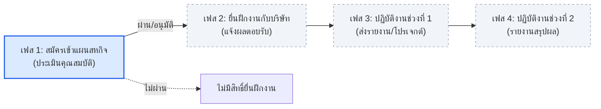
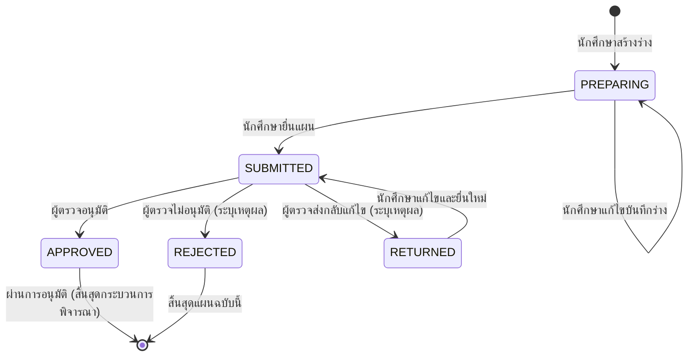

# ข้อตกลงการทำงานของทีม (Team Working Agreement)
**ระบบบริหารและวางแผนสหกิจศึกษา (Cooperative Education Planning & Management System)**

เอกสารฉบับนี้จัดทำขึ้นเพื่อรวบรวมและสรุปข้อตกลง กติกา กระบวนการทำงาน และมาตรฐานการพัฒนาที่ใช้ร่วมกันตลอดทั้งโครงการในทุกเวอร์ชัน เพื่อให้สมาชิกทุกคนในทีมทำงานไปในทิศทางเดียวกันอย่างมีประสิทธิภาพ

---

## 1. รูปแบบและแนวทางการทำงาน (Work Model)

1. **Issue-Driven Development:**
   - ใช้รูปแบบการพัฒนาแบบ **Issue-driven** ตามข้อแนะนำของอาจารย์
   - สมาชิกทุกคนต้องดูแลรับผิดชอบงานตั้งแต่การสร้างหรือรับมอบหมาย Issue ไปจนถึงผลลัพธ์สุดท้ายที่ใช้งานได้จริง (End-to-End Delivery)
2. **End-to-End Ownership:**
   - ผู้รับผิดชอบแต่ละ Issue ต้องรับผิดชอบการพัฒนาแบบครบวงจร:
     $$\text{Data / Model} \longrightarrow \text{Query / API} \longrightarrow \text{UI / Frontend} \longrightarrow \text{Test} \longrightarrow \text{Evidence}$$
3. **Collaboration & Flexibility:**
   - หากมีส่วนใดที่ไม่ถนัดหรือต้องการความช่วยเหลือ สามารถพูดคุยเพื่อขอความร่วมมือ (Collaborate) หรือแลกเปลี่ยน Task กับสมาชิกคนอื่นในทีมได้

---

## 2. กติกาและบทบาทการทำงาน (Rules of Engagement)

> **Reviewer มาจากรอบหมุน ไม่ใช่คนสร้าง Issue** (มติ §10 ข้อ 4)
> 
> - **Cross-Review Rule:** ผู้รับผิดชอบการพัฒนา (Owner / Assignee) จะต้องเป็นคนละคนกับ Reviewer เสมอ เพื่อให้มีการตรวจสอบข้ามบุคคล (**ห้าม Assignee เป็น Reviewer ตรวจรับงานของตนเองเด็ดขาด**)

### 2.1 บทบาท Owner (ผู้รับผิดชอบการพัฒนา)
1. **เลือก Issue:** เลือก Issue ที่จะรับผิดชอบและทำการ Assign ให้ตนเอง ให้ภาระงานรวมได้ประมาณ 1/5 ของ estimate ทั้ง milestone ใครไม่เลือก คนวางแผนเติมงานให้ครบโควตา (§10 ข้อ 2)
2. **ปรับสถานะ:** เมื่อเริ่มลงมือทำ ให้ย้าย Issue ไปยังคอลัมน์ `Doing` / `In Progress`
3. **สอบถามข้อสงสัย:** หากมีจุดที่คลุมเครือหรือไม่เข้าใจ ให้สอบถามผ่าน Comment ถึง Reviewer ของ Issue นั้นโดยตรง
4. **การตั้งชื่อ Branch:** ต้องสร้าง Branch แยกสำหรับแต่ละ Issue ตามรูปแบบ:
   ```text
   <type>/<issue-number>-<short-description>
   ```
   *ตัวอย่าง:* `feat/14-home-page`, `feat/106-plan-review-list`, `fix/94-responsive-table`
5. **การเขียน Commit Message:** ต้องระบุรูปแบบให้ชัดเจน:
   ```text
   <type>: <สิ่งที่ทำอย่างกระชับ> (#issue)
   ```
   *ประเภท (Types) ที่ใช้งาน:*
   - `feat:` เพิ่มฟีเจอร์หรือความสามารถใหม่
   - `fix:` แก้ไข Bug หรือข้อผิดพลาด
   - `docs:` จัดทำหรือปรับปรุงเอกสาร
   - `test:` เพิ่มเติมหรือแก้ไข Test cases
   - `refactor:` ปรับโครงสร้างโค้ดโดยไม่เปลี่ยนพฤติกรรมการทำงาน
   - `chore:` งานจัดการทั่วไป เช่น Configuration, Dependencies
   
   *ตัวอย่าง:* `feat: implement employers page interface (#16)`
6. **ส่งมอบงานและเปิด Pull Request:**
   - เมื่อทำตามเงื่อนไขใน Acceptance Criteria (AC) ครบถ้วน ให้เปิด **Pull Request (PR)** ตาม PR template ใส่ `Closes #<เลข issue>` และ label ของด้านที่แตะ (§10.7)
   - เช็คลิสต์ยืนยัน Task ใน Issue
   - เขียนและแนบ **Evidence** (ภาพหน้าจอ, วิดีโอ, หรือผล Test) ลงใน Issue เพื่อให้ Reviewer ตรวจสอบ
   - แจ้ง Reviewer ทราบผ่าน Comment ใน Issue นั้น
7. **การแก้ไขตามคำแนะนำ:** หาก Reviewer ส่ง **Request Changes** ให้ Owner แก้ไขตามข้อเสนอแนะ เมื่อแก้ไขเสร็จแล้วให้ยืนยันใน PR และแจ้ง Reviewer อีกครั้ง

---

### 2.2 บทบาทผู้สร้าง Issue และ Reviewer (ผู้ตรวจและประเมินงาน)

ข้อ 1–3 เป็นหน้าที่ของผู้สร้าง Issue ข้อ 4–10 เป็นหน้าที่ของ Reviewer ซึ่งมาจากรอบหมุนตาม §10 ข้อ 4

1. **การสร้าง Issue:** กำหนดเป้าหมายหรือโจทย์ของ Issue ให้ชัดเจนและกระชับ
2. **รายละเอียดใน Issue ต้องครบถ้วน:** ประกอบด้วย:
   - **Problem / Goal:** ปัญหาหรือเป้าหมายที่ต้องการทำให้สำเร็จ
   - **Task Checklist:** งานย่อยที่ต้องดำเนินการ
   - **Acceptance Criteria (AC):** เกณฑ์การยอมรับเพื่อยืนยันว่างานสำเร็จ
   - **Evidence Requirement:** หลักฐานที่ต้องใช้ในการตรวจ
   - **Estimate:** ไม่เกิน 6 ชั่วโมง ถ้าเกิน 8 ชั่วโมงต้องแตก sub-issue (§10 ข้อ 3)
   - **Reviewer:** ระบุชื่อ GitHub Account ตามรอบหมุน (ห้ามซ้ำกับ Assignee)
3. **การแบ่ง Sub-issues:** หาก Issue มีขนาดใหญ่หรือซับซ้อน ควรแบ่งเป็น Sub-tasks หรือ Sub-issues ย่อยให้เป็นระบบ
4. **ติดตามความคืบหน้า:** ติดตามและสนับสนุน Owner ที่กำลังทำ Issue นั้นอย่างต่อเนื่อง
5. **ระยะเวลาตรวจงาน:** เมื่อ Owner แจ้งส่งมอบงานพร้อม AC และ Evidence ครบถ้วน Reviewer ต้องเข้าตรวจงานจริง**ภายใน 24 ชั่วโมง**
6. **การตรวจเช็ค:** ตรวจสอบตาม Acceptance Criteria + Evidence ที่แนบมา
7. **สรุปผลการตรวจ:** Comment สรุปผลการตรวจใน Issue อย่างชัดเจน
8. **ข้อห้ามสำคัญ:** หากพบข้อผิดพลาดหรือจุดที่ต้องการแก้ไข **ห้าม Reviewer ลงมือแก้ไขโค้ดเอง** ให้ Comment หรือกด Request Changes เพื่อส่งคืนให้ Owner แก้ไข
9. **Merge & Close:** เมื่อผลงานผ่านเกณฑ์ AC และ Evidence ครบถ้วน ให้กด Approve พร้อมเขียนอธิบาย 2–3 ประโยคว่างานนี้ทำงานยังไง GitHub จะ merge อัตโนมัติเมื่อ check ผ่านครบ (เปิด auto-merge ไว้) และปิด Issue เองจาก `Closes #`
10. **Branch Cleanup:** GitHub ลบ branch ให้อัตโนมัติหลัง merge

---

## 3. ตัวอย่างโครงสร้าง Issue Template

ใช้ template ใน `.github/ISSUE_TEMPLATE/` ได้แก่ issue หลัก, sub-issue, Definition & Boundary และ bug โครงด้านล่างคือส่วนที่ทุก sub-issue ต้องมี

```markdown
**Title:** <ชื่อ Issue ที่กระชับและตรงประเด็น>

**Problem / Goal:**  
<อธิบายที่มาของปัญหา หรือเป้าหมายที่ต้องการทำให้สำเร็จ>

**Demo:** หลังจบ issue นี้ ผู้ใช้ทำ ___ ได้ (เขียนบรรทัดนี้ไม่ได้ = แตก issue ผิด)

**Task:**  
- [ ] <งานย่อยที่ต้องทำ 1>
- [ ] <งานย่อยที่ต้องทำ 2>

**Acceptance Criteria:**  
- [ ] <เกณฑ์การยอมรับ 1>
- [ ] <เกณฑ์การยอมรับ 2>

**Evidence:**  
- [ ] <หลักฐานยืนยัน เช่น ภาพหน้าจอผลการทดสอบ, Test Log, หรือ GIF>

**Labels:** <ด้านที่แตะ ใส่ได้หลาย label เช่น frontend, backend, database>  
**Blocked by:** <Issue ที่ต้องเสร็จก่อนหน้า (ถ้ามี)>  
**Estimate:** <ไม่เกิน 6 ชั่วโมง>  
**Assignee:** @<ชื่อ GitHub ของผู้พัฒนา>  
**Reviewer:** @<ชื่อ GitHub ของ Reviewer (ห้ามซ้ำกับ Assignee)>
```

---

## 4. ข้อตกลงเรื่องข้อมูลและการจัดการฐานข้อมูล (Data & Mock Strategy)

- **ความครอบคลุมของ Test Cases (Mock Data Coverage):**
  - ควรจัดเตรียมและเพิ่มข้อมูล Mock ในฐานข้อมูล (Seed Data) ให้ครอบคลุม**ทุก Test Case และ Scenario ที่เป็นไปได้** (เช่น สถานะต่าง ๆ: ฉบับร่าง, รอตรวจ, อนุมัติแล้ว, ส่งกลับแก้ไข, ไม่อนุมัติ, ข้อมูลที่กรอกไม่ครบ, เงื่อนไขเกรดเฉลี่ยต่าง ๆ)
  - **ประโยชน์:**
    - ช่วยให้สมาชิกในทีมทดสอบระบบ (Internal Testing) ได้ง่าย รวดเร็ว และไม่ต้องรอสร้างข้อมูลเอง
    - อำนวยความสะดวกเมื่อต้องส่งมอบให้กลุ่มอื่นหรืออาจารย์ร่วมทดลองใช้งาน (Cross-team Review & User Testing) โดยสามารถเห็นทุกสถานะและเคสต่าง ๆ ได้ทันที
- **Idempotent Data Migration:**
  - สคริปต์ Migration และ Seed Data ต้องออกแบบให้สามารถ**รันซ้ำได้ (Idempotent)** โดยไม่เกิด Duplicate Key Constraint Error
  - ต้องจัดเตรียมคำสั่งหรือแนวทางการย้อนกลับ (Rollback) ควบคู่กับ Migration เสมอ

---

## 5. ขอบเขตและวงจรชีวิตสหกิจศึกษา (Cooperative Education Lifecycle & Scope)

กระบวนการสหกิจศึกษาตามปกติประกอบด้วย **4 เฟส (Phases)** ดังนี้:



### รายละเอียดแต่ละเฟส:
1. **เฟส 1 — สมัครเข้าแผนสหกิจศึกษา (Application & Plan Review):**
   - นักศึกษาตรวจสอบคุณสมบัติ จัดทำร่าง และยื่นแผนสหกิจศึกษาผ่านระบบ
   - อาจารย์ที่ปรึกษา/เจ้าหน้าที่ตรวจสอบคุณสมบัติและพิจารณาแผน
   - **เงื่อนไขสำคัญ:**
     - **ผ่าน (อนุมัติแล้ว):** นักศึกษาจะได้รับสิทธิ์เข้าสู่กระบวนการยื่นฝึกงานกับสถานประกอบการในเฟสถัดไป
     - **ไม่ผ่าน (ไม่อนุมัติ):** ไม่มีสิทธิ์ยื่นฝึกงานกับสถานประกอบการ
2. **เฟส 2 — ยื่นฝึกงานกับบริษัท (Company Application & Matching):**
   - นักศึกษาที่ผ่านการอนุมัติในเฟส 1 นำแผนไปยื่นสมัครฝึกงานกับสถานประกอบการ
   - เมื่อได้รับการตอบรับหรือยืนยันตำแหน่งงาน ให้นำข้อมูลมาแจ้งต่อเจ้าหน้าที่สหกิจศึกษา
3. **เฟส 3 — ฝึกงานช่วงที่ 1 (Work Term 1 & Interim Progress):**
   - นักศึกษาเริ่มเข้าปฏิบัติงานจริงในสถานประกอบการช่วงแรก
   - ต้องจัดทำและส่งรายงานความคืบหน้าเกี่ยวกับงานและโครงงาน (Project) ที่ได้รับมอบหมาย
4. **เฟส 4 — ฝึกงานช่วงที่ 2 (Work Term 2 & Final Evaluation):**
   - นักศึกษาปฏิบัติงานช่วงหลังจนเสร็จสิ้นรอบสหกิจ
   - ส่งรายงานสรุปโครงงาน รายงานประเมินผล และการประเมินจากสถานประกอบการ

---

### 🎯 ขอบเขตของโครงการนี้ (Project Scope)
- **สำหรับโครงการนี้ (CS361 Cooperative Education System) จะจำกัดขอบเขตการพัฒนาหลักอยู่ที่ "เฟส 1" (การสมัคร ยื่น และพิจารณาแผนสหกิจศึกษา)** เป็นสำคัญ
- กระบวนการในเฟส 2, 3 และ 4 ถือเป็นส่วนที่อยู่นอกขอบเขตการพัฒนาของโครงการนี้

---

## 6. กติกาทางธุรกิจและวงจรสถานะของแผนสหกิจ (Business & State Machine Rules)



1. **สิทธิ์การมีแผน (Cardinality):**
   - นักศึกษา 1 คน สามารถมีแผนสหกิจที่กำลังดำเนินการได้**ไม่เกิน 1 แผนต่อรอบสหกิจ**
2. **สิทธิ์การแก้ไขแผน (Edit Rights):**
   - นักศึกษาแก้ไขข้อมูลแผนได้เฉพาะเมื่อสถานะเป็น `PREPARING` หรือ `RETURNED` เท่านั้น
   - ระหว่างที่สถานะเป็น `SUBMITTED` (รอตรวจ) **ระบบต้องล็อกไม่ให้นักศึกษาแก้ไขข้อมูล (Read-Only)** เพื่อป้องกันข้อมูลเปลี่ยนระหว่างการพิจารณา
3. **การส่งกลับและการไม่อนุมัติ (Return vs Reject):**
   - **การส่งกลับ (`RETURNED`):** เปิดโอกาสให้นักศึกษาแก้ไขข้อมูลและกดยื่นใหม่ (`SUBMITTED`) ได้
   - **การไม่อนุมัติ (`REJECTED`):** ถือเป็นการสิ้นสุดกระบวนการของแผนฉบับนั้น
4. **การระบุเหตุผล (Mandatory Review Comments):**
   - ผู้ตรวจ**ต้องระบุเหตุผลหรือความเห็น (Review Comment)** ทุกครั้งเมื่อตัดสินใจส่งกลับ (`RETURNED`) หรือไม่อนุมัติ (`REJECTED`)
5. **การป้องกัน Concurrency Conflict:**
   - ระบบต้องตรวจสอบสถานะล่าสุดก่อนบันทึกผล เพื่อป้องกันกรณีผู้ตรวจหลายคนเปิดพิจารณาแผนเดียวกันพร้อมกัน
6. **ความปลอดภัยในการระบุตัวตน (Security & Identity Rule):**
   - API ต้องใช้ค่า `sub` จาก Cognito JWT Token ที่ผ่านการตรวจสอบลายเซ็นแล้วเพื่อระบุตัวตนผู้ใช้
   - **ห้ามใช้ `student_id` ที่ส่งมาจาก Client (Request Body/Param) เป็นหลักฐานระบุตัวตนเด็ดขาด** เพื่อป้องกัน Insecure Direct Object References (IDOR)
7. **การแยกคำศัพท์เฉพาะ (Terminology):**
   - `Position` = ตำแหน่งงานที่สถานประกอบการเปิดรับ
   - `Project` = โครงงานสหกิจที่นักศึกษาทำขณะปฏิบัติงาน
   - **ห้ามใช้คำรวมกันว่า `Position / Project`** ให้แยกความหมายและฟิลด์ให้ชัดเจนเสมอ

---

## 7. มาตรฐานการพัฒนา UI/UX และการแสดงผลข้อมูล (UX/UI & Design Standards)

มาตรฐานการออกแบบและพัฒนาส่วนต่อประสานผู้ใช้ เพื่อป้องกันข้อผิดพลาดเชิงประสบการณ์ผู้ใช้ (UX/UI Anti-patterns):

1. **Fixed Schema Layout (ห้ามซ่อนหัวข้อเมื่อไม่มีข้อมูล):**
   - หน้าแสดงรายละเอียดข้อมูล ต้องแสดงโครงสร้างหัวข้อมาตรฐานคงที่เสมอ
   - **ห้ามใช้เงื่อนไขซ่อนหัวข้อ (`{field && ...}`)** เพราะจะทำให้ผู้ใช้เข้าใจผิดว่าระบบแสดงผลตกหล่น
   - หากไม่มีข้อมูล ให้แสดงข้อความกำกับอย่างโปร่งใส เช่น *“ไม่ได้ระบุในประกาศ”* หรือ *“ไม่มีข้อมูลสถานที่”*
2. **Anti-Dead Click & Proper Affordance:**
   - ห้ามทำส่วนแสดงผลที่คลิกไม่ได้ให้ดูเหมือนคลิกได้ (ห้ามใส่ Cursor Pointer หรือ Hover Effect หลอกตาหากไม่มี Action)
   - หากไม่มี URL เว็บไซต์บริษัท ให้แสดงเป็นข้อความ Disabled ปกติ
   - ให้แยกปุ่ม Action ให้ชัดเจน: เช่น ปุ่ม **"ดูตำแหน่งในระบบ"** (Primary Action) และปุ่ม **"เว็บไซต์ภายนอก ↗"** (Secondary Action)
3. **ความสอดคล้องระหว่างหน้าบ้านและหลังบ้าน (Search & Query Consistency):**
   - ช่องค้นหาหน้าบ้านระบุว่าค้นหาข้อมูลใด หลังบ้าน (SQL Query) ต้องค้นหาฟิลด์เหล่านั้นให้ตรงกัน (เช่น ระบุค้นหาสถานที่ได้ SQL ต้องมีเงื่อนไขค้นหาสถานที่ด้วย)
4. **ความโปร่งใสในการจัดการ Error (No Silent Fallback in Production):**
   - **ห้ามใช้ Silent Fallback** ดึงข้อมูล Mock เก่ามาแสดงแทนโดยไม่แจ้งเตือนเมื่อเกิด Network Error หรือ 5xx Server Error ใน Production
   - ต้องแสดงสถานะข้อผิดพลาดตามจริงอย่างชัดเจน (Error Alert) พร้อมปุ่มให้ผู้ใช้กดลองใหม่ (Retry)
5. **การเข้าถึงและการนำทาง (Accessibility & Navigation):**
   - **Accessible Navigation:** แถบเมนูหลัก (Navbar) **ต้องแสดง Icon ควบคู่กับ Text Label เสมอ** ห้ามใช้ Icon โดดๆ โดยไม่มีป้ายกำกับ (Mystery Meat Navigation)
   - **Modal Accessibility:** หน้าต่าง Modal / Dialog ต้องมี Accessible Name (`aria-labelledby`), รองรับการปิดด้วยปุ่ม `Escape`, มี Focus Trap และคืนค่า Focus ไปยังจุดเริ่มต้นเมื่อปิด
   - **Responsive & Scaling:** รองรับหน้าจอทุกขนาด (Mobile 360/390px, Tablet, Desktop) และรองรับ Browser Zoom 200% โดยที่ข้อมูลไม่ตกขอบหรือไม่สามารถเลื่อนอ่านได้

---

## 8. ข้อตกลงด้านสถาปัตยกรรมและเทคโนโลยี (Architecture & Tech Stack)

- **Managed Data Source (Single Source of Truth):**
  - ใช้ **PostgreSQL บน AWS RDS** เป็นฐานข้อมูลหลัก
  - **การเชื่อมต่อฐานข้อมูล:** ตามข้อตกลงล่าสุดของทีม มีมติ**ถอด RDS Proxy ออก** และใช้การเชื่อมต่อตรงระหว่าง AWS Lambda กับ RDS PostgreSQL โดยตรง เพื่อลดความซับซ้อน ปัญหา Timeout และข้อจำกัดด้านสิทธิ์ IAM ใน AWS Academy Lab
- **Shared API & Data Specifications:**
  - สมาชิกในทีมที่ทำงานบน Database หรือ API ร่วมกัน ต้องยึดถือ Data Model และ Interface กลางร่วมกันเสมอ
  - **ห้ามเปลี่ยนแปลงโครงสร้างตารางหรือ API Response โดยไม่แจ้งล่วงหน้า** และต้องหารือกับผู้รับผิดชอบฝั่งที่เกี่ยวข้องก่อนทุกครั้ง
- **ข้อจำกัดและข้อกำหนดการใช้งาน AWS Academy Lab (LabRole & voclabs):**
  - **ห้ามสร้าง IAM Role ใหม่:** บัญชี AWS Academy Learner Lab บล็อกสิทธิ์ `iam:CreateRole` ทุกงาน (เช่น Lambda Execution Role) **ต้องนำบทบาทสำเร็จรูป `LabRole` ที่มีอยู่แล้วมาใช้ซ้ำเสมอ (Reuse existing `LabRole`)**
  - **การจัดการ Session Token ที่หมดอายุ:** Credential ของ `voclabs` มีอายุจำกัด (ไม่กี่ชั่วโมง) หากพบข้อผิดพลาด `InvalidClientTokenId` หรือ `ExpiredToken` ต้องต่ออายุชั่วคราวด้วยการคัดลอก AWS CLI credentials ใหม่จากหน้า Learner Lab มาใส่ใน `~/.aws/credentials`
  - **การเลือกใช้บริการและสถาปัตยกรรม:** ต้องคำนึงถึงขอบเขตสิทธิ์ของ Lab เสมอ หลีกเลี่ยง Service ที่เกินสิทธิ์ และลดความซับซ้อนของ Infrastructure เพื่อไม่ให้ติดปัญหา Permission ใน Lab
- **ความปลอดภัยของ Credentials (Secret Safety):**
  - **ห้าม Commit รหัสผ่าน, Secret Keys หรือ Credentials จริงขึ้น GitHub หรือ Paste ในห้องแชตเด็ดขาด**
  - เก็บค่า Config และรหัสผ่านไว้ใน `.env` ภายในเครื่อง ซึ่งถูก `.gitignore` ไว้เรียบร้อยแล้ว

---

## 9. การทดสอบและการส่งมอบงาน (Testing & Quality Assurance)

1. **การทดสอบ Unit/Component Test:**
   - ทดสอบด้วยคำสั่ง:
     ```bash
     npm test
     ```
   - ชุดทดสอบ Unit Test (Vitest) ต้องทำงานได้อย่างสมบูรณ์แบบ Isolated โดย**ไม่ต้องพึ่งพา AWS Backend**
   - ทุกครั้งก่อนเปิด PR ชุดทดสอบทั้งหมดต้องผ่าน 100% (Green)
2. **การตรวจสอบ Build และ Type-checking:**
   - ก่อนส่งมอบงาน ต้องรันคำสั่งตรวจสอบ:
     ```bash
     npm run build
     ```
   - ต้องคอมไพล์ผ่านโดยไม่มีข้อผิดพลาดด้าน TypeScript (`tsc -b`) หรือ Vite Build Warning ตกค้าง
3. **การแนบหลักฐาน (Evidence):**
   - Owner ต้องแนบหลักฐานที่ตรวจสอบได้จริงลงใน Issue ทุกครั้งก่อนแจ้ง Reviewer เช่น:
     - ภาพหน้าจอ UI ที่ทำงานถูกต้องตาม Acceptance Criteria
     - GIF หรือ Screen Recording สาธิต Interaction Flow
     - บันทึกผลการรัน Test (Console Output / Coverage)

---

## 10. กติกาทีมรอบ V3 Feedback (มติ 22 ต.ค. 2569)

ทีมโหวตผ่าน Google Forms เมื่อ 22 ต.ค. 2569 และผ่านครบทั้ง 13 ข้อ ผลโหวตบันทึกไว้ใน [`docs/meetings/V3-feedback-team-rules-vote-2026-10-22.md`](meetings/V3-feedback-team-rules-vote-2026-10-22.md) ถ้ากติกาข้อไหนขัดกับหัวข้อก่อนหน้า ให้ยึดหัวข้อนี้

คนวางแผนเป็นคนตัดสินเรื่องต่อไปนี้ โดยไม่ต้องโหวต: ใครทำงานที่ block คนอื่น และใครดูแลด้านไหน

### 10.1 กติกา 13 ข้อ

1. **แบ่งงาน:** ทุกคนรับ 1 ปัญหาและทำครบทุกชั้น พร้อมดูแล 1 ด้าน (ภาพรวม / UX/UI / Backend / Database / QA) ถือ 2 milestone แล้วหมุน
2. **ภาระงานเท่ากัน:** แต่ละคนถืองานรวมประมาณ 1/5 ของ estimate ทั้งหมด (±20%) ใครไม่เลือกงาน คนวางแผนเติมงานที่เหลือให้ครบโควตา
3. **ขนาดงาน:** issue หนึ่งไม่เกิน 6 ชม. ถ้าเกิน 8 ชม. ให้แตก sub-issue ตามสิ่งที่ผู้ใช้ทำได้ ไม่แตกตามชั้น และ PR ไม่เกินประมาณ 400 บรรทัด
4. **โควตารีวิว:** รีวิวคนละ ⌈จำนวน sub-issue ÷ 5⌉ ต่อ milestone (ไม่นับ issue หลัก) PR ละ 1 reviewer ที่ไม่ใช่เจ้าของงาน
5. **มาตรฐาน reviewer:** รันจริงตาม AC และเขียนอธิบาย 2–3 ประโยคก่อน approve ถ้าไม่ผ่านให้กด Request changes ห้ามแก้โค้ดเอง
6. **ด่าน merge:** GitHub บล็อก merge จนกว่าจะได้ approve จากคนอื่น CI ผ่าน และ PR ตรงตามมาตรฐาน
7. **checkpoint:** งานที่ block คนอื่นต้องมี draft PR ภายในวันที่ 2 ถ้าไม่มี คนวางแผนจับคู่หรือย้ายคนรับผิดชอบ แล้วบันทึกไว้ใน issue
8. **การทดสอบ:** เจ้าของงานเขียน test ในงานตัวเอง ตั้งชื่อ tester ของ issue หลักตั้งแต่วันแบ่งงาน และก่อนปิด milestone มีทดสอบรวมที่ QA จัด tester มีสิทธิ์ไม่ให้ปิด issue หลักถ้ายังไม่ผ่าน
9. **Definition & Boundary:** ทุกคนทำ issue Definition & Boundary ของปัญหาตัวเอง ผู้ดูแลภาพรวมรวมเป็นข้อตกลงหลัก แล้วทุกคนติ๊กยอมรับรายคน
10. **ทุกคนอธิบายระบบได้:** demo ทุกสัปดาห์ (โพสต์คลิปหน้าจอแทนการประชุมได้) quiz สดจับเวลาก่อนวันพรีเซนต์ และใช้บันไดงูสุ่มคนพรีเซนต์ในวันจริง (ห้ามได้ส่วนของตัวเอง)
11. **เริ่มจาก user story:** ผูก user story กับ FR1–FR10 ในโจทย์ก่อนแตก issue ผู้ดูแลภาพรวมรวมเป็นตาราง user story ↔ FR ↔ issue
12. **docs ชุดเดียว:** docs ฉบับปัจจุบันมีชุดเดียว ฉบับเก่าย้ายไป `docs/archive/` มีคู่มือ setup ตั้งแต่ศูนย์ และมีคนที่ไม่ได้เขียนคู่มือลองทำตามบนเครื่องใหม่ทุก milestone
13. **ปฏิทินท้าย milestone:** D-2 หยุดเพิ่มฟีเจอร์ ทั้งวันใช้ทดสอบรวมและแก้บั๊ก D-1 หยุดแก้โค้ด ทำ demo กับ evidence และงานที่ไม่ทันย้ายไปรอบหน้า (D คือวันส่ง เช่น ส่งวันศุกร์ D-2 คือวันพุธ)

### 10.2 ผู้ดูแล 5 ด้าน

ผู้ดูแลด้านไม่ได้เขียนทุกอย่างเอง และไม่ต้องเช็กทีละ PR ทำงานแค่ 2 ช่วง ผ่าน issue `[ด้าน X]` ของตัวเอง 1 อันต่อ milestone

| ด้าน | ก่อนเริ่ม milestone | ก่อนปิด milestone |
|---|---|---|
| ภาพรวม | scope ของเวอร์ชัน, แผนผังระบบ 1 หน้า, รายการกลาง (ชื่อสถานะ, รหัส error, ชื่อ field), ตาราง user story ↔ FR | ลองใช้งานครบ flow ทุก role แล้วปิด issue หลัก |
| UX/UI | component กลางใน `src/components/ui/` และ guideline 1 หน้า | ไล่ทุกหน้าว่าหน้าตาไปทางเดียวกันและใช้บนมือถือได้ |
| Backend | รูปแบบ handler และรูปแบบ error กลาง | เรียก API ด้วยบัญชีแต่ละ role แล้วเทียบกับ spec |
| Database | กติกา migration และ seed สาธิตที่มีทุกสถานะ | สร้างฐานข้อมูลใหม่ตั้งแต่ศูนย์ด้วย script |
| QA | test case ตาม flow ของแต่ละ role และจับคู่ tester | นำทดสอบรวม แล้วเก็บบั๊กเปิดเป็น issue |

ปัญหาที่เจอตอนตรวจ ให้เปิดเป็น issue ส่งกลับเจ้าของงาน ห้ามแก้เอง

### 10.3 ใครทำอะไรใน 1 issue

| บทบาท | ทำอะไร | ห้ามทำ |
|---|---|---|
| เจ้าของงาน | ทำ sub-issue ครบทุกชั้นพร้อม test เปิด PR และแก้ตามความเห็น | merge งานตัวเอง |
| Reviewer (1 คน ตามรอบหมุน) | รันตาม AC อ่านทุกไฟล์ เขียนอธิบายแล้ว approve | แก้โค้ดเอง |
| Tester (ทุกคน คนละ 1 issue หลักของคนอื่น) | ลองใช้ issue หลักนั้นแบบผู้ใช้จริงจนครบ flow | ทดสอบงานของตัวเอง |
| QA (1 คน) | เขียน test case จับคู่ tester นำทดสอบรวม และเป็น tester 1 issue เหมือนคนอื่น | เขียน test แทนเจ้าของงาน |
| ผู้ดูแลภาพรวม | ปิด issue หลักเมื่อครบเงื่อนไข | ปิดทั้งที่ยังมีบั๊กค้าง |

### 10.4 โครงสร้าง issue ใน 1 milestone

```text
Milestone
├─ P1 issue หลัก (เจ้าของ · Tester)
│   ├─ P1-① sub-issue
│   ├─ P1-② sub-issue
│   └─ [bug] …              ← บั๊กที่เจอตอนทดสอบ parent คือปัญหานั้น
├─ [QA] ทดสอบรวม             ← test case + checklist "P1 ผ่านแล้ว — @tester"
└─ [ด้าน X]                  ← ก่อนเริ่ม / ก่อนปิด ของผู้ดูแลด้าน
```

- sub-issue ปิดเองเมื่อ PR ที่มี `Closes #` merge
- issue หลักปิดได้เมื่อ sub-issue และบั๊กปิดครบ และ tester ติ๊กผ่านแล้ว
- issue บั๊กให้เขียนว่าเจอจาก issue ไหน เช่น "พบจาก #300" เพื่อให้ QA เห็นบั๊กของวันทดสอบในที่เดียว
- issue หนึ่งมี parent ได้ 1 อัน: บั๊กที่ไม่ได้เป็นของปัญหาใดปัญหาหนึ่ง (เช่น component กลางพัง) ให้ใช้ issue `[ด้าน X]` เป็น parent

### 10.5 การทดสอบ 2 แบบ

| | ① test ของงาน | ② ทดสอบรวม |
|---|---|---|
| ตรวจอะไร | ฟีเจอร์ของตัวเองถูกตาม AC | ทุกชิ้นต่อกันแล้วใช้ได้ครบ flow |
| ใครทำ | เจ้าของเขียน test และ reviewer รันตาม AC | tester ลองงานของคนอื่น โดย QA นำ |
| เมื่อไหร่ | ก่อน merge แต่ละ sub-issue | วัน D-2 ก่อนปิด issue หลัก |

### 10.6 Definition & Boundary และการยืนยันโดยไม่ต้องประชุม

1. เจ้าของแต่ละปัญหาเปิด issue Definition & Boundary ของตัวเองจาก template (out of scope ใช้ประโยค "ผู้ใช้ยังทำ X ไม่ได้ในเวอร์ชันนี้ เพราะ Y")
2. ผู้ดูแลภาพรวมรวมเป็นเอกสาร `docs/overview/V*-01-definition-boundary.md` ซึ่งเป็นหลักฐานข้อตกลง
3. issue หลักของข้อตกลงมีรายชื่อติ๊กยืนยันรายคน `- [ ] @ชื่อ เห็นด้วยและยอมรับ` พร้อมกำหนดเวลา
4. ไม่เห็นด้วยหรืออยากเพิ่ม ให้ comment โดยระบุเลขข้อ **เลยเวลาแล้วไม่ติ๊กและไม่ comment = ถือว่ายอมรับ**
5. คนวางแผนสรุป "ผลการตัดสิน" ใน issue แล้วปิด

### 10.7 ด่านอัตโนมัติบน GitHub

- **ruleset `protect-main`** (ตั้งเมื่อ 22 ต.ค. 2569 โดยเจ้าของ repo): merge เข้า main ได้ผ่าน PR เท่านั้น ต้องได้ approve 1 คนที่ไม่ใช่คน push ล่าสุด approve เก่าถูกยกเลิกเมื่อ push เพิ่ม check `Lint & Type-check`, `Unit Tests` และ `Build Check` ต้องผ่าน ห้าม force push และห้ามลบ main
- **auto-merge** เปิดไว้ เจ้าของ PR กดเปิด auto-merge แล้ว GitHub merge ให้เองเมื่อผ่านทุกด่าน และลบ branch ให้อัตโนมัติ
- **บอท `PR Standards`** ตรวจว่า PR มี `Closes #`, มี label, ยาวไม่เกิน 400 บรรทัด และ approve มีข้อความอธิบาย
- **template** ของ PR และ issue อยู่ใน `.github/`

---

## ประวัติการแก้ไข

| วันที่ | การแก้ไข | อ้างอิง |
|---|---|---|
| 15 ต.ค. 2569 | เขียนข้อตกลงฉบับแรก | - |
| 23 ต.ค. 2569 | เพิ่ม §10 ตามมติโหวต 13 ข้อ, แก้ §2 ให้ reviewer มาจากรอบหมุน, เพิ่มบรรทัด Demo / Labels / Blocked by ใน §3, แก้ชื่อสถานะ DRAFT เป็น PREPARING ใน §6 ให้ตรงกับระบบ | #126 |

